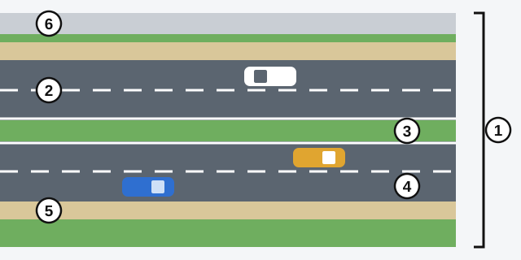
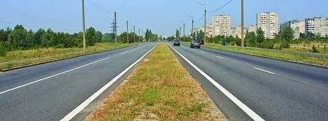
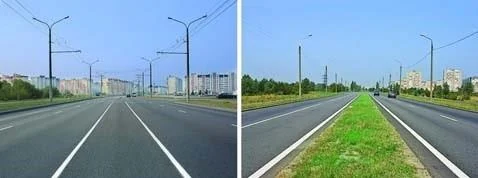
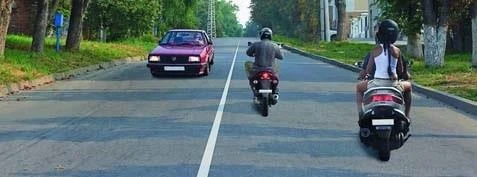
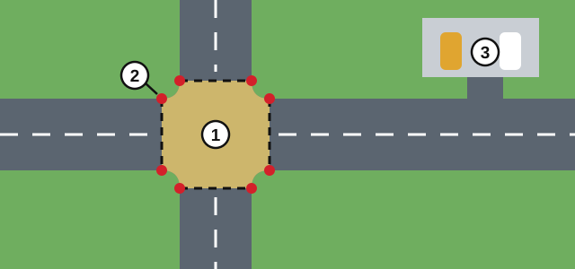
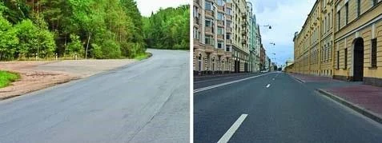
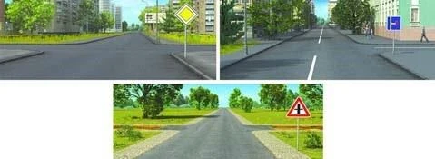
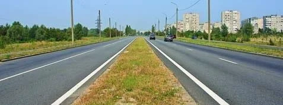
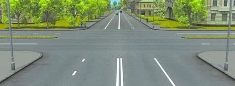
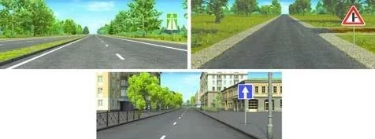

# Parts of the Road

The law gives everyday words like "road" and "lane" exact meanings, and the exam tests those meanings. Learn the
parts of the road once here, and every later lesson gets easier.

## What is a road made of?

*1: the road. 2: a carriageway. 3: the dividing strip. 4: a lane. 5: a shoulder. 6: a pavement.*

Under Article 2 of the RA law, a **road** is the strip of land, or the surface of an artificial structure, that
carries at least one carriageway. Tram tracks, pavements, shoulders and dividing strips are part of the road too,
where they exist.

| Part | In plain words |
|---|---|
| **Carriageway** | The part of the road for non-rail vehicles. One road may have several. |
| **Lane** | A lengthwise strip of the carriageway, wide enough for one row of vehicles. Marked or unmarked. |
| **Dividing strip** | Separates neighbouring carriageways, by construction and (or) by marking. Not intended for vehicles or pedestrians to move or stop on. |
| **Pavement** | The part for pedestrians. It runs right beside the carriageway, or is separated from it in any way. |

> **Common trap:** "Road" is the big word and "carriageway" the small one. The pavement and the shoulder are both
> part of the road.

## How do I count carriageways and lanes?

A dividing strip is what splits a road into separate carriageways.

*The green dividing strip gives this road two carriageways. The lanes inside each one are only lanes.*

A dividing strip doesn't have to be green. A marked strip counts just the same.

*Both roads have a dividing strip: marked on the left, built on the right.*

Under point 51 of the Traffic Rules, markings give the number of lanes. One line down the middle means two lanes,
one each way.

*One centre line: two lanes.*

> **Remember:** Width makes a lane, not paint. A road with no markings still has lanes.

## What counts as an intersection?

An **intersection** is the area where roads cross, join or separate at the same level. Its edge is imaginary: lines
that join the opposite points where the kerbs start to curve.

*1: the intersection. 2: a point where the kerb starts to curve, with the imaginary lines running between these
points. 3: a car park, whose exit is not an intersection.*

An exit onto the road from an adjacent area, such as a yard, a car park or a filling station, is **not** an
intersection. You still give way to those already on the road, but the intersection rules don't apply.

*Left: an intersection. Right: only exits from adjacent areas.*

An intersection is one shared area, however many arms lead into it.

## What makes a stop a "stopping point"?

A **stopping point** of a public-use vehicle is a place on its route for boarding and alighting that is **also**
equipped with the corresponding road signs. The signs tell other drivers where the stopping-point restrictions apply.

## Which road is the main road?

Under point 3 of the Traffic Rules, a road is the **main road** in either of two cases:

- **It has the sign.** It is marked with sign 2.1 "Main road", signs 2.3.1 to 2.3.7, or sign 5.1 "Motorway",
  in relation to the road crossing or joining it.
- **It has the better surface.** It has a hard surface (asphalt concrete, cement concrete, stone materials and so
  on) and the other road has an earth surface.

*A main road is shown on the left (sign 2.1) and at the bottom (sign 2.3.1, asphalt meeting earth roads). The blue
sign on the right gives no priority.*

> **Common trap:** More lanes don't make a road main, and neither does asphalt against tiles, because both are hard
> surfaces. Sign 2.7 "Priority over oncoming traffic" only settles who goes first through a narrow section, and sign
> 5.5 "Road with one-way traffic" only describes how traffic runs.

## Try it yourself

**How many lanes does this road have?**

**Four.** The strip makes two carriageways, and each is marked into two lanes.

**How many intersections, and how many crossings of carriageways?**

**One intersection, two crossings.** There is one shared area. But the road running left to right is split by a
dividing strip, so the other road cuts across two carriageways.

**Where is a main road shown?**

**In both upper pictures.** One has sign 5.1 "Motorway". The other has an earth road joining asphalt under a
"Junction with a minor road" sign. Sign 5.5 below gives no priority.

## Key points

- The road includes the carriageway, pavement, shoulder, dividing strip and tram tracks.
- A carriageway is for non-rail vehicles. A road can have several.
- A lane may be marked or unmarked. A dividing strip may be built or marked.
- An intersection is one shared area. An exit from a yard, car park or filling station isn't one.
- A stopping point needs its road signs.
- Main road: the right sign, or a hard surface against an earth one. Lane count doesn't matter.

{{practice}}
