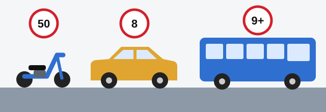

# People and Vehicles

The rules you must follow depend on what the law calls you, and on what it calls your vehicle. All the definitions
in this lesson come from Article 2 of the RA law, and the exam often changes a single word in them.

## Who counts as a driver?

The person at the wheel, and two others:

- **A driving instructor.** The person teaching someone to drive is treated as a driver, with a driver's duties and
  responsibility.
- **A person driving pack or riding animals, or livestock, along a road.** The words "along a road" decide it:
  someone herding animals across a field is not a driver.

## Who counts as a passenger?

A **passenger** is a person in or on a vehicle, and also a person getting on or off it, except the driver and the
driving instructor. So you are a passenger from the moment you start boarding until you have got off.

## Who counts as a pedestrian?

A **pedestrian** is a person on the road outside a vehicle. There is one exception: a person authorized to carry out
works on the road and doing them in the manner set by law.

These people are treated as pedestrians too:

- Disabled persons in a wheelchair without an engine.
- Disabled persons in a wheelchair with an engine, at pedestrian speed.
- Persons wheeling a bicycle, moped or motorcycle on foot.
- Persons pulling or pushing a handcart, sledge, pram or wheelchair.

> **Remember:** Riding makes you a driver. Pushing makes you a pedestrian.

## Who may regulate traffic?

The law's term is **traffic regulator**, and the questions say "traffic controller". It means a person who has the
authority to regulate traffic and does so in the manner set by legislation. Both parts are needed. A driver or
passenger who jumps out to wave cars along has no such authority.

## What is an emergency situation?

An **emergency situation** arises from the action or inaction of a traffic participant, or of the traffic regulator,
and creates a real danger of an accident. So the danger can come from the person directing traffic too.

> **Common trap:** The wrong option stops at "a traffic participant". The full definition adds the traffic regulator.

## What counts as a vehicle?

A **vehicle** is a device for carrying people, goods, or equipment mounted on it, along a road. The test is what it
is for, not what type it is. So a trailer, a bicycle and a horse-drawn cart all count, not only cars and motorcycles.

*Three numbers to learn. Moped: 50, for both engine volume and speed. Passenger car: up to 8 passenger seats. Bus:
9 or more.*

| Term | Definition in plain words |
|---|---|
| **Motor car** | A mechanical vehicle for carrying people or goods along a road, or for towing a vehicle that carries goods. It includes agricultural tractors for which this is an additional function. |
| **Light passenger car** | A motor car with not more than 8 passenger seats, built for carrying passengers and luggage safely and comfortably. |
| **Bus** | The same, but with more than 8 passenger seats. |
| **Truck** | A motor car built for carrying goods. The definition has no weight in it. |
| **Moped** | Two or three wheels, an engine of not more than 50 cubic cm, and a maximum speed of not more than 50 km/h. |
| **Bicycle** | At least two wheels, normally moved by the muscle power of the person on it, by pedals or a handle. A wheelchair is excluded. It may also have a small motor of not more than 0.25 kW. |
| **Trailer (semi-trailer)** | A vehicle with no engine, set in motion by a mechanical vehicle and travelling as one whole with it. Special trailers are included. |
| **Public-use vehicle** | A vehicle with stopping points that runs along routes and carries passengers and (or) luggage: a tram, trolleybus or bus. |

> **Common trap:** "More than 8" is not "8 or more". A vehicle with exactly 8 passenger seats is a light passenger
> car, not a bus.

> **Common trap:** A taxi is not a public-use vehicle, because it has no fixed stops or routes. Nor is a vehicle on a
> tourist route.

A towed mechanical vehicle doesn't become a trailer: it still has its own engine.

## What is the permissible maximum mass?

It is the mass of the fully equipped and fuelled vehicle **loaded with the driver, passengers and cargo**, which the
manufacturing organisation has set as the maximum permissible. It is the full weight, not the empty one, and every
part of the definition counts.

## Try it yourself

**Your motorcycle runs out of fuel and you push it along the road.** What are you now? **A pedestrian**, because a
person wheeling a motorcycle on foot is treated as one.

**A van has a driver's seat and 8 passenger seats.** Is it a bus? **No.** A bus needs more than 8 passenger seats, so
this one is still a light passenger car.

**An instructor sits beside a learner.** Is the instructor a passenger? **No.** The instructor is excluded from
"passenger" and treated as a driver.

## Key points

- A driving instructor, and a person driving animals along a road, are treated as drivers.
- Boarding and getting off are part of being a passenger.
- Wheeling a bicycle, moped or motorcycle on foot makes you a pedestrian. A road worker doing lawful work isn't one.
- Passenger car: up to 8 passenger seats. Bus: more than 8. Moped: 50 cubic cm and 50 km/h.
- A truck's definition has no weight. A trailer has no engine.
- Public-use vehicles are trams, trolleybuses and buses, never taxis.
- Permissible maximum mass is the fully loaded figure set by the manufacturer.

{{practice}}
