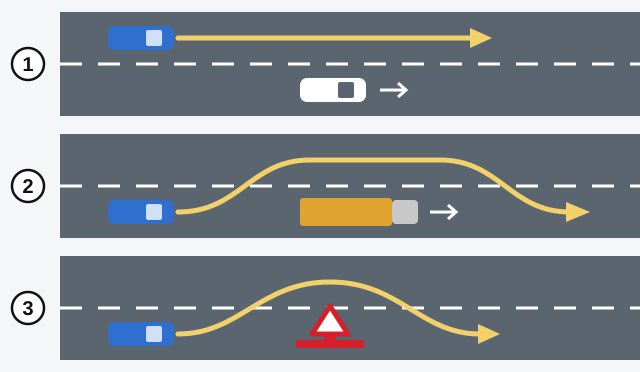
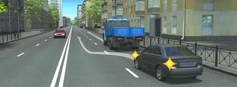

# Actions on the Road

A rule about "overtaking" or "parking" only makes sense if you know exactly what that word covers. These terms are
defined in Article 2 of the RA law and point 3 of the Traffic Rules, and the exam tests the exact wording.

## Stopping or parking?

Both mean deliberately bringing the vehicle to a standstill. Time and purpose tell them apart.

- **Stopping:** up to 5 minutes, or the time needed for a passenger to board or alight, or to load or unload.
- **Parking:** more than 5 minutes, except to prevent a collision with another road user or an obstacle, for a
  passenger to board or alight, to load or unload, and in other cases provided by legislation.

> **Common trap:** "Stopping because a passenger asked" is not the definition. The law looks at time and purpose, not
> at who asked.

## What is a forced stop?

A **forced stop** is one you did not choose. The vehicle comes to a standstill because of:

- A malfunction of the vehicle.
- The physical or mental state of the driver or a passenger.
- The load being carried.
- A danger or another obstacle appearing on the road.
- A prohibiting signal of a traffic light or traffic officer, or the need to give way.

So an unexpected red light and a traffic jam are covered too. When a question lists them with a breakdown, the
answer is "all the listed cases".

## What is an obstacle?

Under point 3 of the Traffic Rules, an **obstacle** is a stationary object in a lane that stops drivers continuing
along that lane: a damaged or faulty vehicle, a foreign object, damage to the road surface and the like.

> **Common trap:** A car stopped in a traffic jam is not an obstacle. It is part of the traffic stream and will move
> when the stream does.

## What does "give way" really mean?

To **give way** means you must not continue, resume moving or make any manoeuvre if this may force other drivers to
change direction or speed **suddenly**.

The word "suddenly" decides the exam question. Giving way is a duty not to obstruct, not an order to stop every time.

## Which moves have their own name?

| Term | Meaning |
|---|---|
| **Starting to move** | The moment the vehicle moves off from a stopping or parking place, whether or not it changes into the next lane. |
| **Changing lanes** | Leaving your lane, or your row within a marked lane, and keeping your initial direction. |
| **Turn** | A manoeuvre to enter another road or an area adjacent to the road. |
| **U-turn** | A manoeuvre to change your direction to the oncoming direction. |

Driving into a yard or a car park is still a turn. A U-turn is the manoeuvre itself, not the driving that follows it.

**Manoeuvring** is the name for this whole group: starting to move (moving out into the next lane), changing lanes,
changing direction (a turn or U-turn), stopping (by changing lanes) and reversing.

> **Remember:** The brackets are part of the definition. Pulling away or stopping is a manoeuvre only when you move
> across into another lane.

## Passing, overtaking or bypassing?

All three get you ahead of something. Ask two questions: is it moving, and did you leave your lane?

| | Name | What you get ahead of | Do you leave your lane? |
|---|---|---|---|
| 1 | **Passing** | One or several moving vehicles | No |
| 2 | **Overtaking** | One or several moving vehicles | Yes |
| 3 | **Bypassing** an obstacle | A stationary obstacle in your lane | Yes |

> **Common trap:** Overtaking doesn't require going into the oncoming lane. Leaving the lane you occupy is enough.

## What do "insufficient visibility" and "dark time of day" mean?

**Insufficient visibility** means road visibility or a visibility distance of up to 300 metres in fog, rain, snowfall
or other weather unfavourable for road safety. Weather is part of the definition, so darkness alone doesn't make it
insufficient visibility.

The **dark time of day** is the period between the end of evening twilight and the beginning of morning twilight. The
law fixes no clock hours for it, and it doesn't begin at sunset: during twilight there is still some light.

## Try it yourself

**What manoeuvre is the driver of the grey car performing?**

**Overtaking.** The truck is moving and the car has left its lane. It would be passing if the car stayed in its lane,
and bypassing if the truck were a stationary obstacle.

**You stop to unload boxes, and it takes 12 minutes.** Are you parked? **No.** More than 5 minutes is fine for
unloading, so this is still stopping.

## Key points

- Stopping: up to 5 minutes, or as long as boarding, alighting, loading or unloading takes. Parking: longer, for
  other reasons.
- A forced stop covers breakdowns, danger, the load, red lights and traffic jams.
- A car queuing in a jam is not an obstacle.
- Giving way means not forcing others to change speed or direction suddenly.
- A turn can lead into another road or an adjacent area.
- Passing stays in the lane. Overtaking leaves it. Bypassing goes round something stationary.
- Insufficient visibility: up to 300 metres in bad weather. Dark time of day: from twilight to twilight.

{{practice}}
