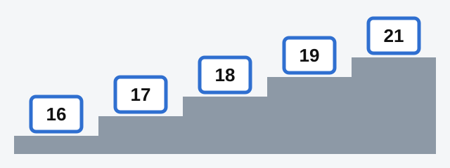
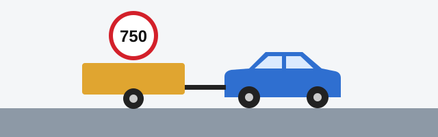

# Licences and Categories

A licence is only valid for the vehicles in its category, and each category has its own minimum age. The exam asks
for these numbers exactly, so this lesson puts them in one table and adds the few rules around it.

## How old must I be?

*The ages to know. 16: practical exam for subcategory "AM". 17: practical exam for everything else. 18: licence for
"A", "B" and "C". 19: licence for trailer combinations. 21: licence for "D" and "D1".*

Article 27 of the RA law sets these ages:

| Category | National licence | Conditions | International licence |
|---|---|---|---|
| "A", "B" | 18 | | 18 |
| "C" | 18 | | 21 |
| "BE", "CE", "DE", "C1E", "D1E" | 19 | You already hold "B", "C" or "D", or the matching subcategory | 21 |
| "D", "D1" | 21 | You already hold "B", "C" or "C1" | 21 |

International licences for subcategories "AM", "A1" and "B1" also start at 18. For "C1" they start at 21.

> **Common trap:** Category "C" is the one that catches people. The national licence comes at 18, but the
> international one only at 21.

> **Common trap:** For "D" and "D1" both conditions are needed: age 21 **and** a "B", "C" or "C1" licence. Age alone
> isn't enough.

Persons conscripted into the RA armed forces and other troops have one exception. They may get "D" and "D1" at 19,
if they already hold "B", "C" or "C1".

## Where does training begin?

Initial practical training takes place on a driving range or driving ground. Where there is none, it takes place in
a closed area isolated from road traffic. Only after this stage may you train on roads. So a first lesson never takes
place on a public road, not even a quiet one.

## When can I take the practical exam?

To sit the practical exam in the Road Police subdivisions, you must be a **candidate driver**, and you become one at
17. The exception is a candidate driver of a subcategory "AM" vehicle, for whom 16 is enough.

## When may I actually drive?

The right to drive begins **from the moment you receive your licence**, or from the moment its digital version is
issued. Passing the exam only entitles you to have it issued.

> **Remember:** Passing is not the finish line. Until the licence is issued, you have no right to drive.

## How long does a licence last?

- **National licence:** 10 years, after which it has to be exchanged.
- **International licence:** up to 3 years, and never longer than your national licence is valid.

## Can I tow a trailer?

If you hold "B", "C", "D", "C1" or "D1", you may also drive that vehicle with a trailer, as long as the trailer's
permissible maximum mass is not more than **750 kg**.

*750 kg is the trailer's permissible maximum mass: its loaded figure, not its empty weight.*

A heavier trailer needs the matching licence: "BE", "CE", "DE", "C1E" or "D1E".

## Try it yourself

**You are 17 and have just passed the practical exam for category "B".** May you drive? **No.** The licence for "B" is
issued at 18, and the right to drive begins when you receive it.

**You are 20, hold a "C" licence, and want to drive buses.** May you get "D"? **Not yet**, unless you are a conscript.
You hold the right licence, but "D" needs age 21.

**You hold "B" and want to tow a trailer with a permissible maximum mass of 1,000 kg.** Is your licence enough? **No.**
That is over 750 kg, so you need "BE".

## Key points

- "A", "B" and "C" at 18. Trailer combinations at 19. "D" and "D1" at 21, and only with "B", "C" or "C1".
- International licences: 18 for "A" and "B", 21 for "C", "D" and the trailer combinations.
- Conscripts may get "D" and "D1" at 19, if they hold "B", "C" or "C1".
- Practical exam from 17, or 16 for "AM". Initial training is never on a public road.
- The right to drive begins when you receive the licence, not when you pass.
- National licence 10 years. International up to 3 years.
- Trailer on your existing licence: up to 750 kg permissible maximum mass.

{{practice}}
