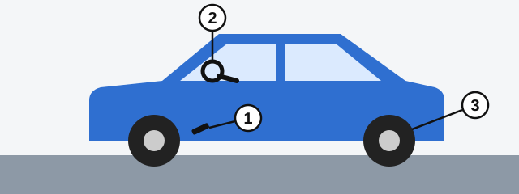

# Your Duties and Documents

Holding a licence brings duties that begin before you turn the key. The RA law sets these out, and the exam asks who
is responsible for what.

## What must I carry?

Under Article 24 of the RA law, the driver of a mechanical vehicle must have, and present for checking:

- The driving licence for that category of vehicle.
- The vehicle's registration documents.

> **Common trap:** You don't need a power of attorney to drive someone else's vehicle. The law in force doesn't
> require one, so "all the listed documents" is wrong.

## What must I check before moving off?

*1: the braking system. 2: the steering control. 3: the remaining tyre tread height, which must meet the established
norms.*

The law requires all three, not just the brakes and steering.

Extra: A one-minute walk around the car

*Not from the question bank.*

Before you get in, walk once around the car. Look for soft or damaged tyres and for fresh leaks underneath, and
check that the lights and windows are clean. As you move off, press the brake gently to feel that it responds.

## Who keeps the vehicle in good condition?

**The owner or user** of the vehicle, under Article 14. Not the seller, and not the organisation that did the last
technical inspection.

## How soon must I register a vehicle I bought?

**Within 15 days.** Under Article 13, you present the vehicle to the Road Police bodies for state registration within
15 days of the day you acquire it, counted from the day the transaction is signed.

## When must I lend my vehicle?

You must provide it, for the purpose of assistance:

- To police officers, to take people who need urgent medical aid to a medical institution.
- To medical workers travelling in the same direction to give medical aid, with your consent.

## What else does Article 24 ask?

These come up again later in the book:

- If you are involved in an accident, stop at once, switch on the hazard warning lights, and don't move anything
  connected with the accident.
- A learner at the wheel must wear a seat belt.
- On a motorcycle, moped or bicycle on the carriageway, wear a fastened helmet.

## Try it yourself

**You borrow a friend's car and an officer asks for your papers.** What do you show? **Your licence and the car's
registration documents.** You need no power of attorney.

## Key points

- Carry your licence and the registration documents.
- Before moving off, check the brakes, the steering and the tyre tread.
- The owner or user answers for the vehicle's technical condition.
- Register a vehicle within 15 days.
- Provide your vehicle to police for urgent medical cases, and to medical workers with your consent.

{{practice}}
