# Traffic Lights

A traffic light tells you when you may move, and it settles who goes first when two drivers may move at once. Red and green are the easy part, so most of this lesson covers arrows, trams and reversible lanes.

## What does each signal mean?

| Signal | Meaning | What you do |
|---|---|---|
| Green | Movement is permitted | Go, giving way where this lesson says so |
| Flashing green | Movement is permitted, but its time is ending and a prohibiting signal will come on soon | Judge now whether you can stop without braking sharply |
| Yellow | Stop, with one exception (point 19) | Stop at the places listed below |
| Red | Movement is prohibited | Stop |
| Red and yellow together | Movement is prohibited, and green will come on shortly | Get ready, but wait for green |
| Flashing yellow | Movement is permitted, and the intersection counts as unregulated | Follow the priority signs and priority rules |

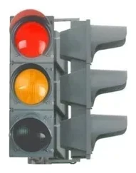

*Red and yellow together, point 7: movement is still prohibited.*

> **Common trap:** Red with yellow is a warning to be ready, not a permission. It is a normal phase of a working light. It doesn't mean the light is broken or that an emergency vehicle is coming.

## May I carry on when yellow comes on?

Only if you can't stop without harsh braking (point 19). If you can stop calmly, stop.

## Where exactly do I stop?

Point 18 gives the order:

1. At the "Stop line" marking or sign 6.16 "Stop line".
2. If there is neither, before the intersection, at the edge of the crossing carriageway.
3. In other places, before the traffic light.

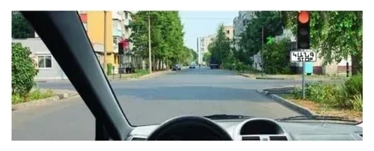

*Sign 6.16 stands at the light, so you stop before the traffic light.*

A big intersection can have a second stop line in the middle. Under point 93, you then obey each light separately. The first green carries you only as far as the second line.

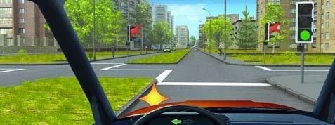

*Turning left here, you enter, stop before the second "Stop line" and wait for its green.*

The same goes for a U-turn past a light with sign 6.16. You finish it only on green, even if you are part-way through.

## Do road signs still count when a light works?

Priority signs don't. Under point 173, when a light contradicts a priority sign, you follow the light. The rule names priority signs only, so it doesn't switch off prohibitory or mandatory signs.

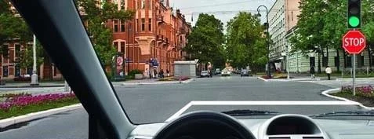

*Green, with sign 2.5 "Movement without stopping prohibited" under it: you don't have to stop.*

> **Remember:** The priority signs wait underneath the light. They take over when it is switched off or flashing yellow.

## Who gives way on a plain green?

- **Turning left or making a U-turn:** give way to oncoming vehicles going straight or turning right (point 90).
- **Turning right:** you owe oncoming traffic nothing, because your paths don't cross. You must still give way to any pedestrians and cyclists on the road you enter (point 87).
- **A vehicle with a blue flashing beacon and special sound signal:** give way to it, as point 28 requires, even on your green.

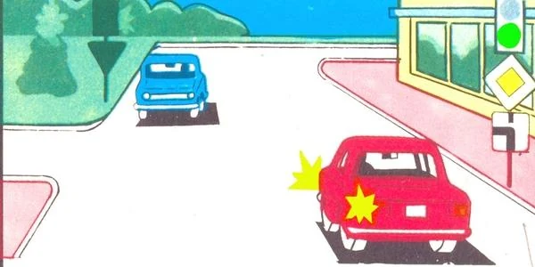

*Both cars have green. The red car turns left, so the blue car goes first.*

Extra: Green doesn't mean the way is clear

*Not from the question bank.*

Before you move off on green, glance left and right. A late driver or pedestrian may still be crossing. A second of checking costs you nothing.

## What does a green arrow beside a red light mean?

The arrow sits in an **additional section** next to the main light. It lets you move in its direction while everyone else waits.

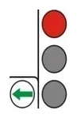

**The arrow lets you go. It doesn't let you go first.** Under point 91, a driver moving on an arrow lit beside red must give way to vehicles coming from other directions. This holds wherever the arrow points, even straight ahead, and for a bus pulling out of a stop.

The arrow also acts only in its own direction (point 8):

- **Right arrow:** take the nearest opening only. Reaching a second opening would mean driving straight on, and red forbids that.
- **Left arrow:** it covers a U-turn only where signs 5.15.1 or 5.15.2 allow the left turn from the left edge lane. From the right lane, you may only turn left.

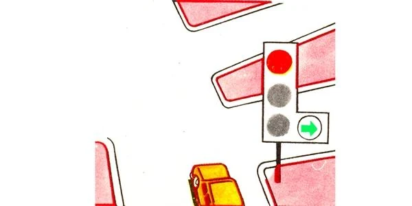

*Only to the right, through the first opening.*

Green main signals can have additional sections too:

- **A section that is off** prohibits movement in its direction (point 8).
- **A black outline arrow on the main green** shows which directions that green covers, and tells you a section exists for the rest (point 10). It doesn't ban the other directions: their own section decides.

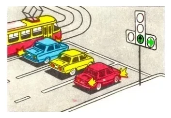

*Straight and right are open, so the yellow and red cars may move. The left section is off, so the tram and the blue car wait.*

## When does a tram go first?

| Situation | Who goes first |
|---|---|
| Signals let a tram and other vehicles move at the same time | The tram, whichever way it is going (point 92) |
| The tram moves on an arrow beside its own red or yellow | Everyone else. The tram gives way (points 91, 92) |
| The tram's signal doesn't allow its direction | You. The tram has to wait |
| The tram and a bus both move on arrows, and their paths cross | The tram, then the bus |
| The tram and a car both move on arrows, on paths that don't cross | They go together |

## How do I read the tram light?

Four moon-white lenses form a T. Trams use this light, and so do other public-use vehicles in separated lanes (point 14). Movement is permitted only when the **bottom** lens and an upper lens are lit together:

- Upper left: to the left.
- Upper middle: straight.
- Upper right: to the right.

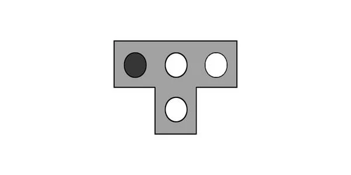

*Straight and right are allowed. Only left is prohibited.*

If the bottom lens is dark, the tram must stand still, however many upper lenses are lit.

## What are reversible lights?

These lights hang over single lanes, especially lanes whose direction can be turned around. Each one governs only the lane under it, never the whole carriageway (point 13).

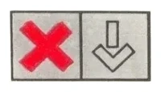

| Signal above the lane | Meaning |
|---|---|
| Red X | Movement in this lane is prohibited, so you can't enter it to overtake either |
| Green downward arrow | Movement in this lane is permitted, for ordinary travel and not just overtaking |
| Off, with marking 1.9 on both sides of the lane | Entry is prohibited |

> **Common trap:** A dark reversible light is a ban, not a free lane. You may not enter to overtake, even if the road is clear and the vehicle ahead is slow.

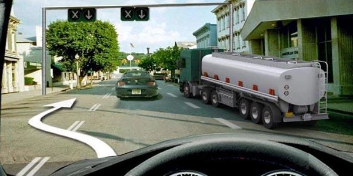

*The lights are off, so this path is prohibited. A left turn doesn't come from this lane either: make it from the proper edge lane.*

## Try it yourself

**You are the red car, beside the blue car.** Your main signal is red, with a green right arrow. A green car is on the crossing road.

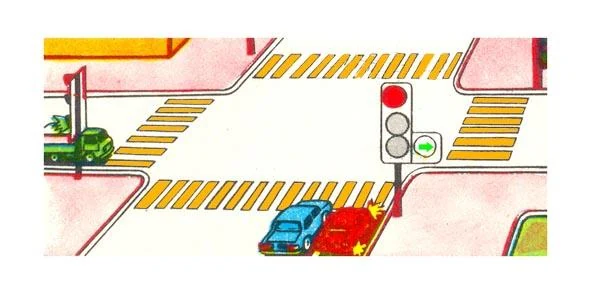

Who passes first? **The green car.** You and the blue car may turn right, but under point 91 you give way to it.

**You are turning left on green.** The tram beside you signals left too, but only its bottom and upper middle lenses are lit.

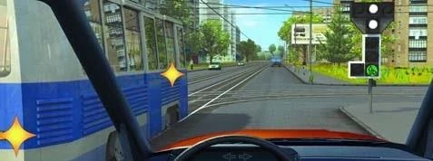

Who goes first? **You do.** The tram's signal lets it go straight only, so its turn isn't permitted and it has no priority over you (point 92).

**Three vehicles, one light.** The car has plain green. The tram and the bus face red with a right arrow.

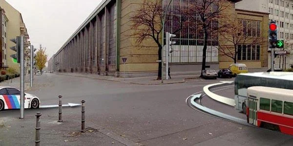

What is the order? **Car, tram, bus.** The arrow puts both behind the car (point 91), and point 92 puts the tram ahead of the bus.

## Key points

- Red with yellow still means stop. Flashing green still means go, but not for long.
- If yellow catches you and you can't stop without harsh braking, you may continue.
- A working light overrides priority signs only.
- On green, a left turn or U-turn gives way to oncoming traffic going straight or right.
- A green arrow beside red means go after giving way, and only in that direction.
- A tram goes first when both of you may move, unless it is on an arrow beside its own red or yellow.
- A reversible light governs one lane, and when it is off, entry is prohibited.

{{practice}}
