# Traffic Officers

An officer's signal outranks lights and signs, so a wrong reading can send you straight into crossing traffic. There are only three signals to learn, and each one comes down to a single question: which side of the officer's body are you facing?

## Does the officer really outrank lights and signs?

Yes. Under point 20, you must obey the officer's signals even when they contradict the traffic lights or the requirements of signs and markings. He can see what is happening at the intersection right now, and a sign can't.

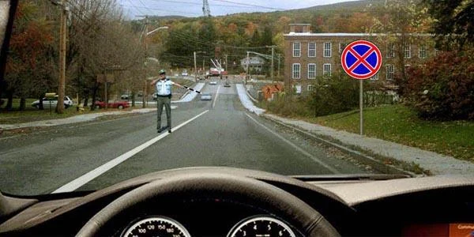

*The officer directs you to stop here. You must stop, even though sign 3.27 "No stopping" is in place.*

The practice questions sometimes call him the traffic controller. It is the same person.

## Which signals do I need to know?

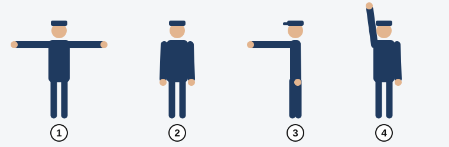

*1: arms out to the sides. 2: arms lowered. 3: right arm forward. 4: arm raised. Positions 1 and 2 mean exactly the same.*

For each signal, find out which part of the officer faces you: his chest, his back, his left side or his right side. The tables below use "non-rail vehicles" for everything except trams.

## Arms out or lowered

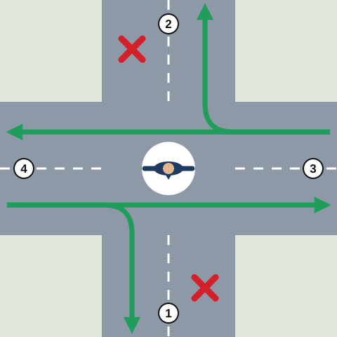

*Seen from above. 1: his chest. 2: his back. 3: his left side. 4: his right side. Green arrows show what is permitted, and red crosses show where nobody may move.*

| You come from his | Non-rail vehicles | Trams |
|---|---|---|
| Left or right side | Straight and right | Straight |
| Chest or back | No movement | No movement |

Think of the officer as a wall that runs along his arms. You can drive along the wall, but not through it. And it doesn't matter whether his arms are out or down: the wall stands in the same place.

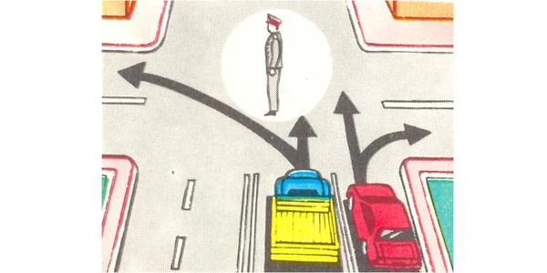

*You approach from his side. The red car may go straight or right. The truck may go straight, but not left.*

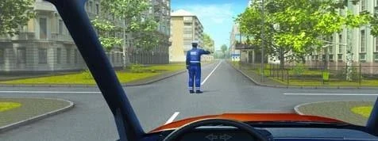

*His back faces you, so you may not move in any direction.*

> **Common trap:** You can't enter the intersection and wait there for a left turn, or turn left after giving way to oncoming traffic. Stop at the "Stop line" and wait for a signal that permits it (point 18).

## Right arm forward

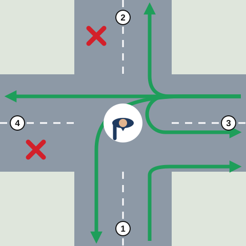

*Same numbers: 1 is his chest, 2 his back, 3 his left side, 4 his right side.*

| You come from his | Non-rail vehicles | Trams |
|---|---|---|
| Left side | All directions: straight, right, left, U-turn | Left only |
| Chest | Right only | Right only |
| Right side or back | No movement | No movement |

Walk around him in your mind. His left side is the open side, so everything is allowed there. Facing his chest, you can only slip away to the right. Behind him or at his right, you wait.

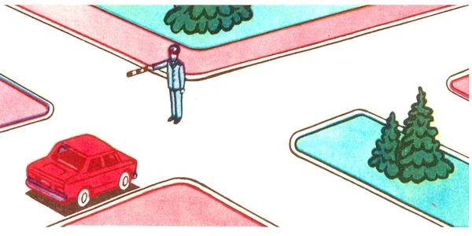

*The red car faces his chest, so it may only turn right, by the first opening.*

Trams follow this signal strictly. A tram at his left side may only go left, so a tram whose rails run straight ahead has to wait, while the cars beside it drive on.

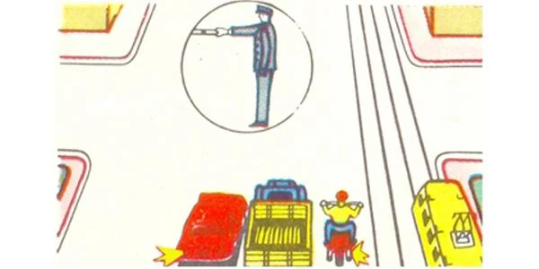

*The car, truck and motorcycle may all move. The tram may not.*

> **Common trap:** The tram's usual priority doesn't help a tram that the officer has stopped. If you turn right from his chest side and the tram comes from his back, you go first.

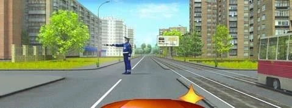

*Your right turn is permitted. The tram is stopped by the signal.*

## Who else do I watch for when turning?

Turning from a permitted side, you still must not obstruct pedestrians crossing the road you enter (point 87). With the right arm forward, pedestrians may cross behind the officer's back.

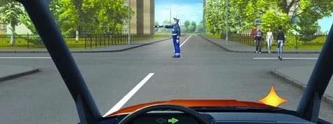

*You come from his left, so a right turn is allowed, but only without obstructing the pedestrian.*

A right turn from his chest side doesn't cross the path of a car coming from his left. You owe that car nothing, and you go first.

## What if he raises his arm?

It works like the yellow light. Stop at the places point 18 gives: the stop line first, then the edge of the crossing carriageway. If you can't stop without harsh braking, you may continue on your way (point 19).

## What does his whistle mean?

It draws your attention to him, and that is all (point 17). It isn't a demand to stop. The demands come from his arms.

Extra: What to do if you can't read the signal

*Not from the question bank.*

If you are unsure what an officer wants, slow down early and keep away from the intersection until you are sure. Try to catch his eye. A pause is safer than a guess, and he can repeat the signal or point at you.

## Try it yourself

**Five vehicles, one officer.** His arms are out. The green car faces his back, and the white car faces his chest. The blue car is on his side, signalling left. The red and yellow cars are on his sides, going straight or right.

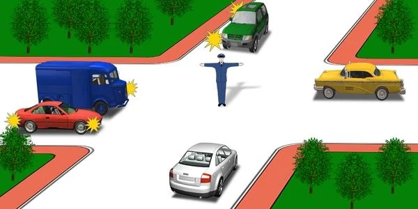

Who may not move? **The blue, green and white cars.** Back and chest are closed, and his sides allow only straight and right, so the blue car can't turn left.

**The officer's right arm is forward.** A motorcycle faces his chest, a car is at his left, a truck is at his right and a bus is behind him.

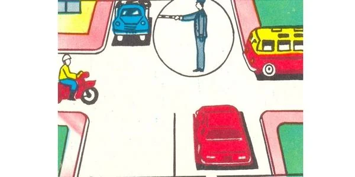

Who may go straight? **Only the car.** The motorcycle may only turn right, and the truck and bus must wait.

**A red light and an officer together.** His right arm is forward, and both vehicles come from his left. The yellow bus turns left and the blue car turns right.

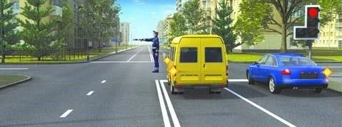

Who may continue? **Both drivers.** The officer outranks the light (point 20), and his left side is open in all directions.

## Key points

- The officer's signals beat lights, signs and markings (point 20).
- Arms out or lowered mean the same: sides go straight or right, trams straight, chest and back stop.
- Right arm forward: left side all directions, chest right only, right side and back stop.
- A tram goes only left from his left side when his right arm is forward.
- From his chest, "right" means the first opening only. When you turn, don't obstruct pedestrians.
- A raised arm works like yellow. You may continue only if you can't stop without harsh braking.
- The whistle only draws attention.

{{practice}}
