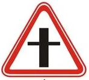
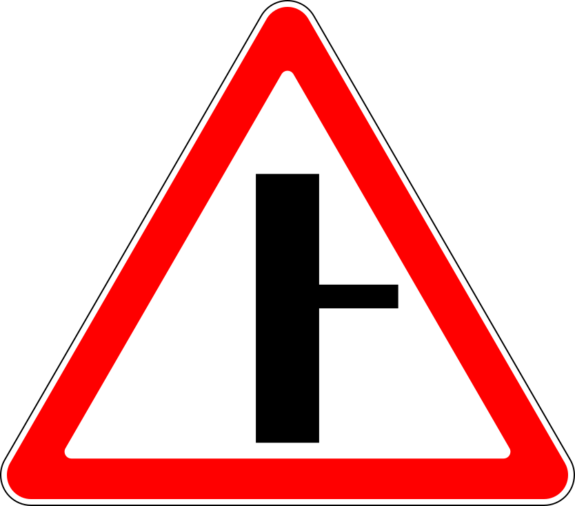
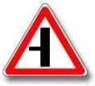
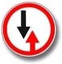
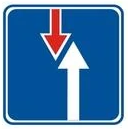
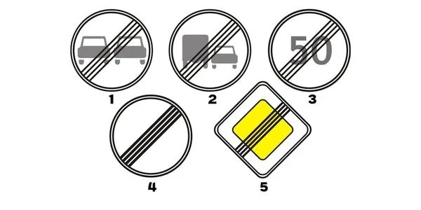
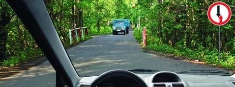
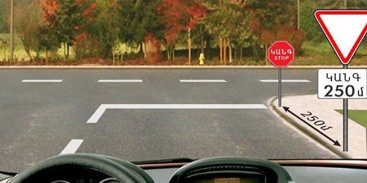
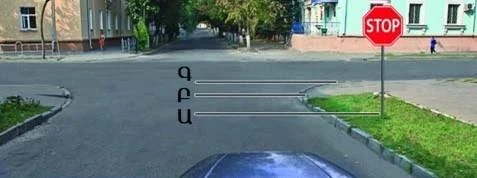
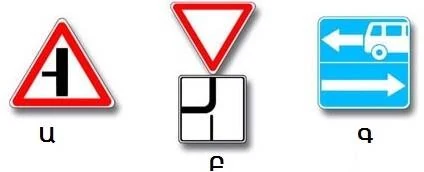

# Priority Signs

Priority signs answer one question: who goes first? They work where nothing else decides, so learn exactly
what each one asks of you, because the exam separates "give way" from "stop and give way".

## What do the priority signs look like?

This family has no single shape, so learn each sign on its own.

| Sign | No. | Name | Meaning |
|---|---|---|---|
|  | 2.1 | Main road | You have priority through uncontrolled intersections |
|  | 2.3.1 | Junction with a minor road | Your road is the main one. A minor road crosses it |
|  | 2.3.2 | Adjoining of a minor road | Your road is the main one. A minor road joins from the right |
|  | 2.3.3 | Adjoining of a minor road | Your road is the main one. A minor road joins from the left |
|  | 2.4 | Give way | Give way to vehicles on the crossing road |
|  | 2.5 | Movement without stopping prohibited | Stop, then give way to vehicles on the crossing road |
|  | 2.6 | Priority of oncoming traffic | Give way to oncoming vehicles at a narrow section |
|  | 2.7 | Priority over oncoming traffic | You go first at a narrow section |

Sign 2.2 "End of main road" is the yellow diamond with black stripes across it, number 5 here:

> **Common trap:** In signs 2.3.1 to 2.3.3, the triangle isn't a warning of something you must yield to. The
> thick line is your road, so the priority is yours. Compare sign 1.6, whose plain cross has arms of equal
> weight: there, neither road is the main one.

Priority signs fix the order only at unregulated intersections. If the traffic light is working, follow
the light.

## How do "Give way" and "Stop" differ?

Both make you yield. Only one makes you stop.

- **Sign 2.4 "Give way":** yield to vehicles on the crossing road. If nobody is coming, you carry on.
- **Sign 2.5 "Movement without stopping prohibited":** stop in every case, whether or not anything is coming.
  Then give way, and drive on by your own judgement.

Under sign 2.4, you give way to every vehicle, not only mechanical ones. Bicycles, mopeds and horse-drawn
carts count too.

If sign 2.4 stands with plate 8.13 "Direction of the main road", you must give way to whoever is on
the main road, from any direction, including vehicles coming from your left.

> **Remember:** Stop under sign 2.5 **at the stop line**. If there is no line, stop **at the edge of the
> crossing carriageway**, where you can actually see the traffic. The sign itself is not the stopping place at
> an intersection. Only before a railway crossing with no line does the driver stop at the sign.

So you may drive past the sign, up to the line.

## Who goes first at a narrow section?

Signs 2.6 and 2.7 work as a pair: 2.7 faces one driver and 2.6 faces the driver coming the other way.

*Sign 2.6: don't enter the narrow section if that would obstruct oncoming traffic, and give way to vehicles
on it or approaching it.*

Use this hook: **the red arrow is the driver who gives way.** On 2.6 the red arrow points up, in your
direction, so you yield. On 2.7 it points down, at the oncoming driver, so you go first.

> **Common trap:** Sign 2.6 looks like a prohibitory sign, but it forbids no passage: it only settles who
> goes first. Sign 2.7 looks like an information sign, but it gives you priority. That priority covers
> oncoming traffic on the narrow section only, not traffic on a crossing road.

## Try it yourself

**A give-way sign stands on the right, with a plate reading STOP and 250 m.**

Where must you stop? **Before the stop line.** The first sign and its plate only warn you that sign 2.5 is
250 m further on. Don't stop at either sign.

**The STOP sign is on the right, and no stop line is painted.**

Where do you stop? **At the edge of the crossing carriageway, position Գ (C).** With no line, that is the
place the sign requires.

**You must give way to drivers coming from the left. Which sign says so?**

**Only Բ (B).** Sign 2.4 with plate 8.13 puts you on the secondary road. Under Ա (A) you are the one on the
main road.

## Key points

- 2.1 and the 2.3 group put you on the main road. The thick line is yours.
- 2.4: give way to every vehicle on the crossing road. No stop needed if the way is clear.
- 2.5: always stop, at the stop line or else at the edge of the crossing carriageway. Then give way.
- With plate 8.13, give way to the main road from any direction.
- 2.6: you yield at a narrow section. 2.7: you go first. The red arrow yields.
- Priority signs decide only at unregulated intersections.

{{practice}}
