# Prohibitory Signs

A prohibitory sign imposes or lifts a restriction: a ban on entry, on speed, on mass or on a manoeuvre. To
answer the exam you need three things for each one: what it bans, who it covers, and where the ban ends.

## What do they look like?

Three looks cover the whole family:

- **A red ring:** something is banned. The picture or number inside tells you what.
- **A red ring on blue:** a ban on stopping or parking.
- **A white disc with black diagonal stripes:** a restriction ends.

Not every red-bordered sign belongs here. The inverted triangle 2.4 "Give way" and the red ring 2.6 are
priority signs.

The official names say "lorry". That means a truck.

## Signs that close the road

| Sign | No. | Name | Meaning |
|---|---|---|---|
| 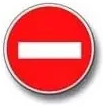 | 3.1 | No entry | No entry in this direction, with no exception for residents |
| 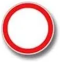 | 3.2 | No traffic | No vehicle may travel here. People who live or work in the zone may enter |
| 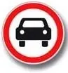 | 3.3 | Movement of mechanical vehicles prohibited | Bans all mechanical vehicles, not only cars |
| 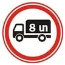 | 3.4 | Movement of lorries prohibited | No figure: bans trucks over 3.5 t. With a figure: trucks over that mass |
| 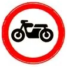 | 3.5 | Movement of motorcycles prohibited | Bans motorcycles |
| 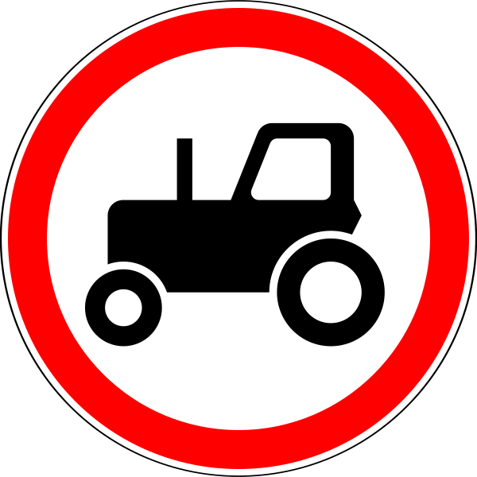 | 3.6 | Movement of tractors prohibited | Bans tractors and self-propelled machines |
| 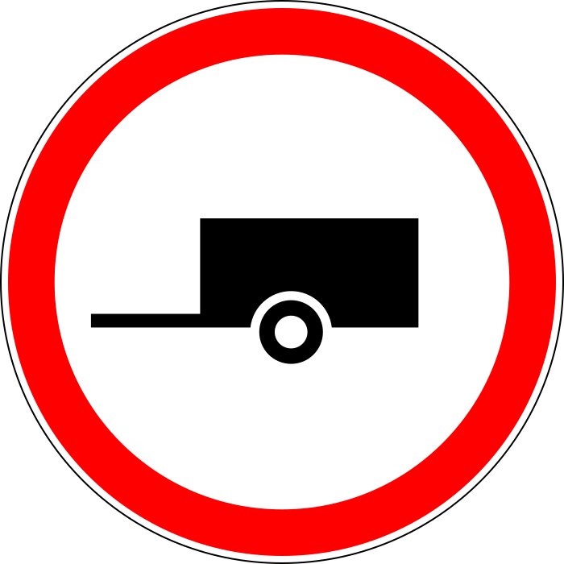 | 3.7 | Movement with a trailer prohibited | Bans trucks and tractors with any trailer, and towing a mechanical vehicle |
| 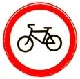 | 3.9 | Movement of bicycles prohibited | Bans bicycles |
| 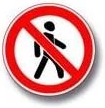 | 3.10 | Movement of pedestrians prohibited | Bans pedestrians on the side where it stands |

> **Common trap:** The car on sign 3.3 stands for every mechanical vehicle. The car, the motorcycle and the
> motorcycle with a sidecar all break it. And sign 3.7 doesn't reach a passenger car with a trailer, because
> a passenger car is neither a truck nor a tractor.

**Who is exempt?** The ban of signs 3.1 to 3.3, 3.18.1, 3.18.2 and 3.19 doesn't apply to public-use transport
vehicles. Sign 3.2 also spares vehicles that serve premises in the zone or belong to people who live or
work there. They enter and leave by the intersection nearest their destination. Signs 3.1 and 3.3 give
residents no such exception.

## Signs that set a limit

| Sign | No. | Name | Meaning |
|---|---|---|---|
| 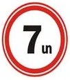 | 3.11 | Mass limit | No vehicle or road train heavier in total than the figure |
| 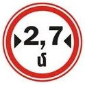 | 3.14 | Width limit | Limits the vehicle's overall width |
| 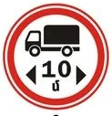 | 3.15 | Length limit | Limits the vehicle's overall length |
| 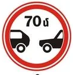 | 3.16 | Minimum distance limit | Don't drive closer than the figure to the vehicle ahead |
| 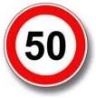 | 3.24 | Maximum speed limit | Don't drive faster than the figure |
| 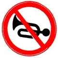 | 3.26 | Audible signal prohibited | Don't use the horn, except to prevent an accident |

Sign 3.11 counts the whole road train. A 5 t truck with a 4 t trailer weighs 9 t, so it can't pass a 5 t sign.

## Signs that stop you until you are allowed on

| Sign | No. | Name | Meaning |
|---|---|---|---|
| 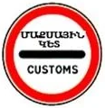 | 3.17.1 | Customs post | Don't pass the post without stopping |
| 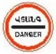 | 3.17.2 | Danger | No vehicle may go further because of an accident, fire, breakdown or other danger |

After sign 3.17.2, you may move again only with permission. Only police, ambulance, rescue services and
others removing the danger are excepted. This is the opposite of sign 2.5, where you decide when to go.

## Turning and overtaking

| Sign | No. | Name | Meaning |
|---|---|---|---|
| 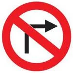 | 3.18.1 | No right turn | Bans the right turn at this intersection |
| 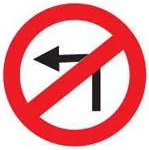 | 3.18.2 | No left turn | Bans the left turn at this intersection |
| 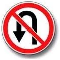 | 3.19 | No U-turn | Bans the U-turn only |
|  | 3.20 | Overtaking prohibited | Bans overtaking |
|  | 3.22 | Overtaking by lorries prohibited | Bans overtaking by trucks over 3.5 t |

Signs 3.18.1 and 3.18.2 stand immediately before the intersection of carriageways they act on. Each sign
acts where it stands: if 3.18.1 guards only the second opening on your right, the first stays open.

> **Common trap:** A turn ban isn't a U-turn ban. Under 3.18.1 and 3.18.2 you may still turn back the way
> you came. Only 3.19 bans that. And 3.19 leaves straight, left and right open.

Sign 3.20 applies to all types of vehicle, and its standard exceptions name slow-moving vehicles,
horse-drawn carts, two-wheeled motorcycles without a sidecar, mopeds and bicycles. Sign 3.22 leaves
motorcycles, passenger cars, buses and trucks up to 3.5 t free to overtake.

## Stopping and parking

| Sign | No. | Name | Meaning |
|---|---|---|---|
|  | 3.27 | No stopping | Bans stopping and parking |
|  | 3.28 | No parking | Bans parking only |
|  | 3.29 | No parking on odd days of the month | One stroke: odd days |
|  | 3.30 | No parking on even days of the month | Two strokes: even days |

Under 3.28 you may still stop briefly, for example to pick up a passenger. Count the strokes on 3.29 and
3.30: one is odd, two is even.

> **Remember:** Signs 3.10 and 3.27 to 3.30 act only on the side of the road where they stand.

## Where does a ban end?

The effect of signs 3.16, 3.20, 3.22, 3.24 and 3.26 to 3.30 runs from the sign to the **nearest intersection
beyond it**. In a built-up area with no intersection, it runs to the end of the built-up area.

Places for turning round, breaks in the dividing strip and exits from adjacent areas don't end it. An
intersection or an end sign does.

| Sign | No. | Name | Meaning |
|---|---|---|---|
| 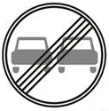 | 3.21 | End of the overtaking prohibition zone | Ends sign 3.20 |
| 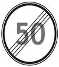 | 3.25 | End of maximum speed limit zone | Ends the limit with that figure |
| 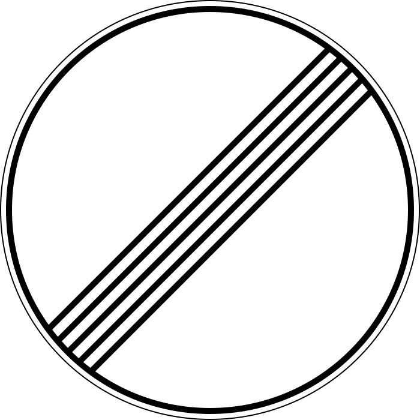 | 3.31 | End of the zone of all restrictions | Ends 3.16, 3.20, 3.22, 3.24 and 3.26 to 3.30 at once |

Sign 3.23 ends the ban on overtaking by trucks. It is number 2 in this picture, with 3.21, 3.25 and 3.31
as numbers 1, 3 and 4:

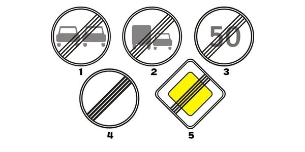

A plain 3.24 or 3.28 and a white ZONE plate carrying the same picture work differently. A zone sign covers
a whole area until its end-of-zone sign. See Special Regulation Signs.

## Try it yourself

**The driver has stopped beyond a place for turning round.**

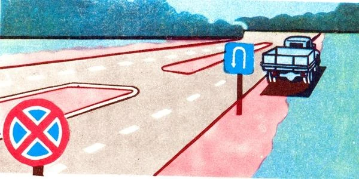

Does sign 3.27 still apply there? **Yes.** There is no intersection between the sign and the truck, and a
place for turning round doesn't end the zone.

**You are driving a truck with a maximum permissible mass of exactly 3.5 t.** A red ring with a truck and no
figure stands at the road ahead.

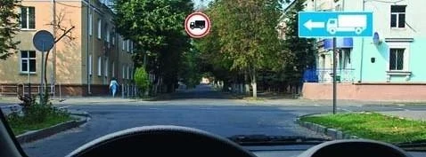

Which way may you go? **Any way.** With no figure, sign 3.4 covers trucks of more than 3.5 t, and yours is
not more than that.

## Key points

- Red ring: a ban. Red ring on blue: stopping or parking. Black stripes on white: an ending.
- 3.3 bans all mechanical vehicles. 3.7 doesn't touch a passenger car with a trailer.
- Public transport is exempt from 3.1 to 3.3, 3.18.1, 3.18.2 and 3.19. Only 3.2 lets residents and workers in.
- 3.27 bans stopping and parking, 3.28 only parking. One stroke is odd days, two is even.
- 3.17.2: move on only with permission.
- Most bans end at the nearest intersection. A turning place or a break in the strip doesn't end them.

{{practice}}
