# Mandatory Signs

A mandatory sign gives an order: go this way, pass on this side, keep to this speed. The exam tests how far
each order reaches, because the same arrow means something different before an intersection and at the
start of a road section.

## What do they look like?

Look for a **round blue sign with a white picture**.

> **Remember:** Shape tells you how seriously to take a blue sign. A blue **disc** compels. A blue
> **rectangle** or **square** informs or describes. Sign 4.1.1 orders you straight on, but the blue square 5.5
> only says the road is one-way.

## Which way may I go?

| Sign | No. | Name | Meaning |
|---|---|---|---|
| 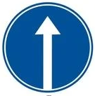 | 4.1.1 | Straight ahead only | Straight on only |
| 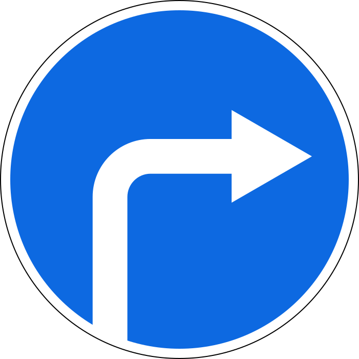 | 4.1.2 | Movement to the right | Right only. Every driver must turn right |
| 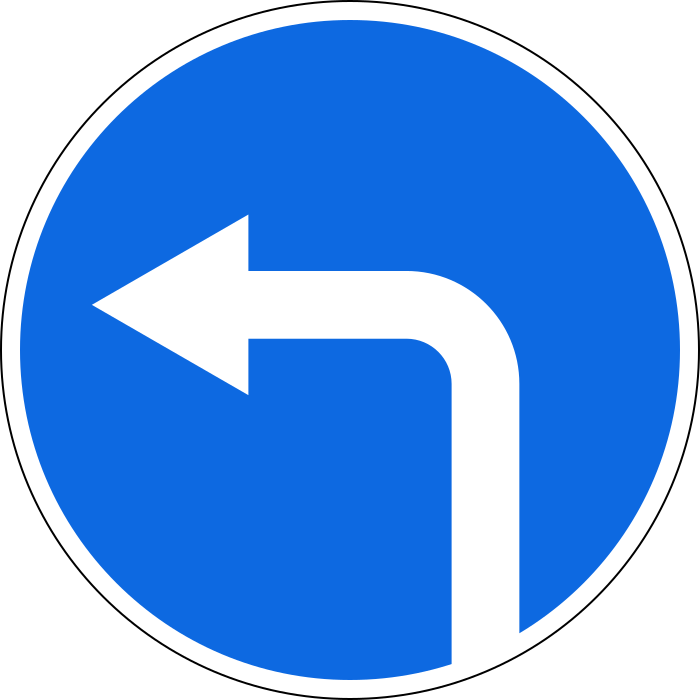 | 4.1.3 | Movement to the left | Left only, and a U-turn is allowed |
| 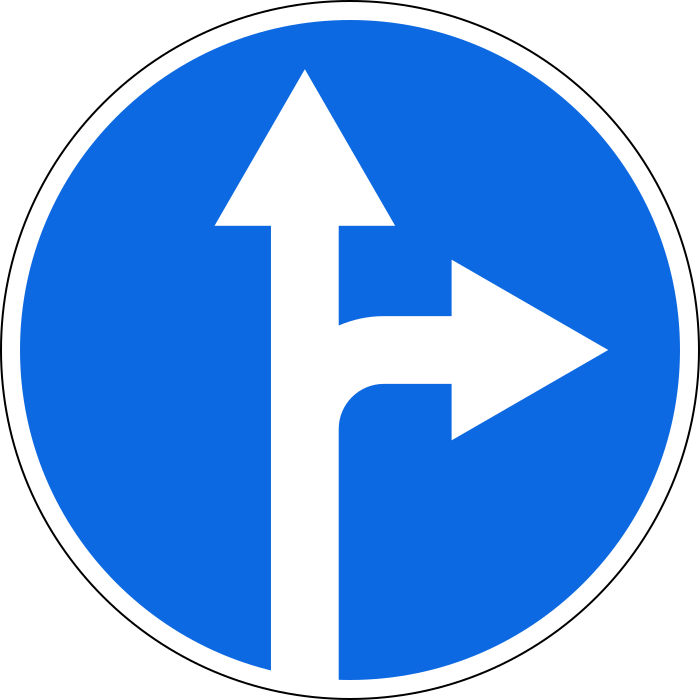 | 4.1.4 | Movement straight or to the right | Straight or right |
| 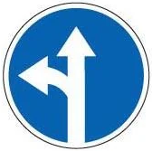 | 4.1.5 | Movement straight or to the left | Straight or left, and a U-turn is allowed |
| 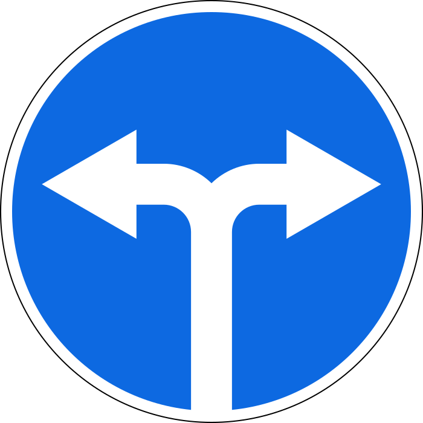 | 4.1.6 | Movement to the right or to the left | Right or left, and a U-turn is allowed. Not straight on |

You may go only where the arrows point, with one addition: **a sign that permits a left turn also permits a
U-turn.** You still need the right lane. Point 40 sends you to the left edge lane for a left turn or U-turn
and to the right edge lane for a right turn, so under sign 4.1.6 the left lane can't turn right.

## How far does the order reach?

It depends on where the sign stands.

**Before an intersection,** it acts on that intersection of carriageways only. If the crossing road has a
dividing strip, you meet two intersections of carriageways. The sign covers the first, and the second is
outside its reach.

**At the start of a road section,** sign 4.1.1 acts as far as the nearest intersection. The next intersection
beyond that is free again. On that stretch you may not turn left or make a U-turn, but it doesn't stop you
turning **right** into a courtyard or other area next to the road.

> **Common trap:** The courtyard exception works on the right only. Left needs a left turn, which sign 4.1.1
> forbids. And a blue square showing a U-turn place further on doesn't give you permission here.

## Passing an obstacle

| Sign | No. | Name | Meaning |
|---|---|---|---|
| 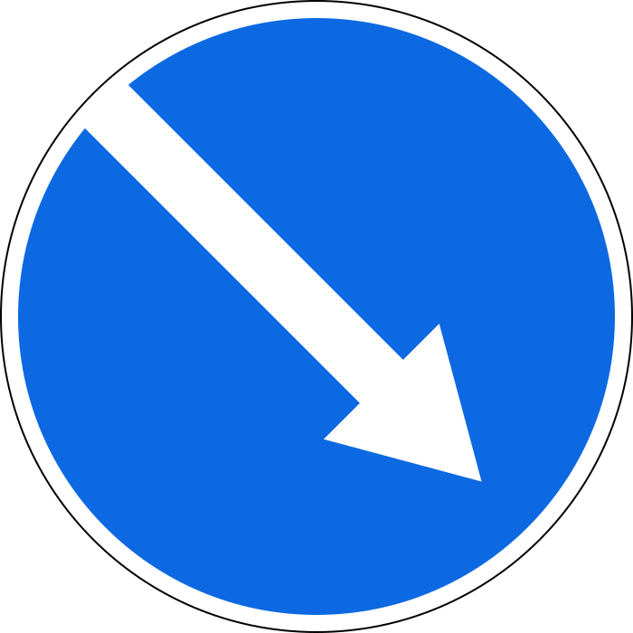 | 4.2.1 | Bypassing the obstacle on the right | Pass on the right only |
| 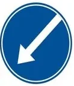 | 4.2.2 | Bypassing the obstacle on the left | Pass on the left only |
| 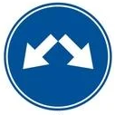 | 4.2.3 | Bypass the obstacle on the right or on the left | Pass on either side |

These arrows slant downwards, while the direction signs above curve or point straight. The sign may be
fixed to a striped board, plate 8.22 "Obstacle".

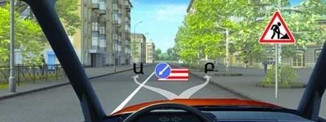

*Sign 4.2.2 on a red and white board. You may pass only on the left, path Ա (A).*

## Other orders

| Sign | No. | Name | Meaning |
|---|---|---|---|
|  | 4.3 | Roundabout | Travel only in the direction of the arrows, round the central island |
| 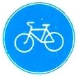 | 4.4.1 | Cycle path | Marks a cycle path |
| 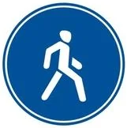 | 4.5.1 | Footpath | Marks a path for pedestrians only |
| 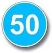 | 4.6 | Minimum speed limit | Travel only at this speed or higher |

Three signs carry a walking figure and do three different things:

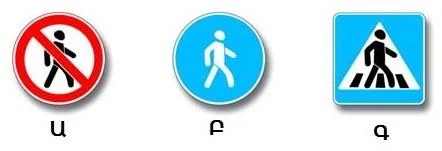

*Ա (A) is 3.10, which bans pedestrians. Բ (B) is 4.5.1, the only one that marks a footpath. Գ (C) is 5.19.1,
which marks a crossing.*

Three signs also show a speed. The blue disc 4.6 is a floor. The red ring 3.24 is a ceiling. The blue
square 6.2 is only advice.

## Try it yourself

**The sign before you is 4.1.1, and the crossing road has a dividing strip.**

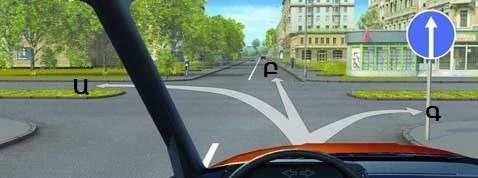

Which paths are open? **Ա (A) or Բ (B).** Straight on is what the sign orders. The left turn at the second
carriageway is outside its reach. The right turn at the first carriageway, Գ (C), is what it forbids.

**Three drivers, three manoeuvres.** Sign 4.1.1 is in pictures 1 and 2, and sign 5.5 is in picture 3.

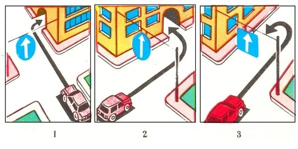

Who is right? **Picture 1.** The right turn into a courtyard is the exception. The left turn in picture 2
isn't, and a U-turn on a one-way road is prohibited by point 50.

**An obstacle lies ahead, with this sign on it.**

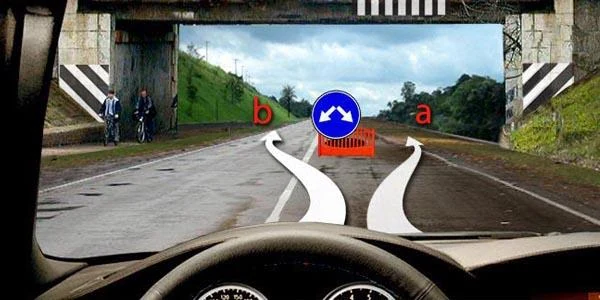

Which path is allowed? **Both.** Sign 4.2.3 lets you pass on either side.

## Key points

- Round and blue means an order. Go only where the arrows point.
- A sign that permits a left turn permits a U-turn too.
- Before an intersection, the sign acts on that intersection of carriageways only.
- At the start of a section, 4.1.1 lasts to the nearest intersection, and right turns into courtyards stay allowed.
- 4.2.1 right, 4.2.2 left, 4.2.3 either side.
- 4.6 sets a minimum speed. Don't confuse it with 3.24 or 6.2.

{{practice}}
