# Special Regulation Signs

These signs change the rules of the road you are on: which way traffic runs, who may use a lane, and which
speed limit applies. They look harmless, because most are plain blue rectangles, yet several change
what you may do.

## What do they look like?

Most are **blue squares or rectangles** with a white picture. Three variations matter:

- **Green** means sign 5.1, the motorway.
- **White** is used for the town signs that bring in built-up area rules.
- **A red diagonal** means the end of what the sign started: 5.6 ends 5.5, 5.9 ends 5.8, 5.22 ends 5.21.

Some members, such as the exit signs 5.7.1 and 5.7.2, only report how the road ahead is arranged. They
forbid no manoeuvre by themselves.

## Road types

| Sign | No. | Name | Meaning |
|---|---|---|---|
| 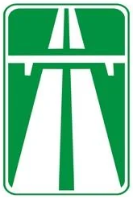 | 5.1 | Motorway | A motorway begins |
| 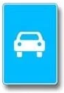 | 5.3 | Road for automobiles | Only automobiles, including buses, and motorcycles |

Mopeds, bicycles, horse-drawn carts, tractors and self-propelled machines may not use a road with sign 5.3.
On both roads, vehicles whose speed can't exceed 40 km/h are banned (points 116 and 117). Type comes first
under 5.3, though: even a fast tractor stays out.

## One-way and reversible roads

| Sign | No. | Name | Meaning |
|---|---|---|---|
| 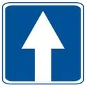 | 5.5 | Road with one-way traffic | Traffic runs one way across the full width |
| 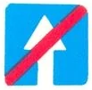 | 5.6 | End of one-way road | Oncoming traffic begins further ahead |
| 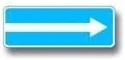 | 5.7.1 | Exit to a road with one-way traffic | The crossing road is one-way in the arrow's direction |
| 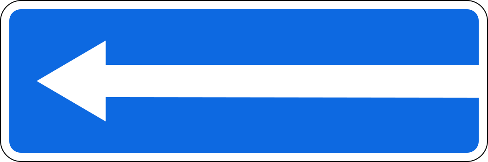 | 5.7.2 | Exit to a road with one-way traffic | The same, running left |
| 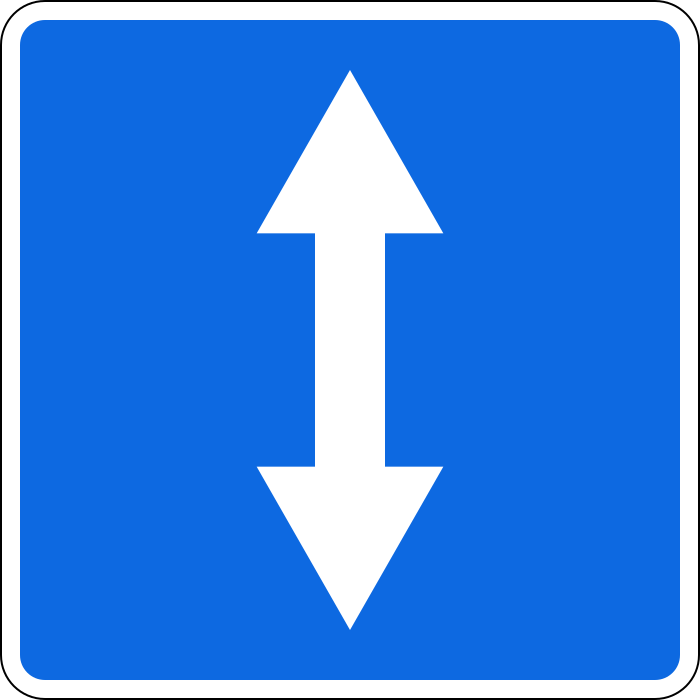 | 5.8 | Reversible traffic | The direction of one or more lanes can be reversed |
| 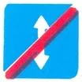 | 5.9 | End of reversible traffic | Reversible traffic ends |
| 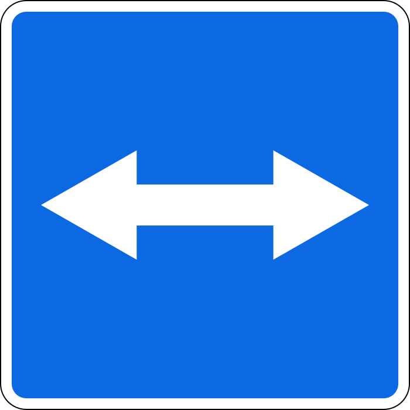 | 5.10 | Exit to a road with reversible traffic | The crossing road carries reversible traffic |

> **Common trap:** A U-turn is prohibited on a one-way road (point 50), so under 5.5 you may go straight, right
> or left, but not back. Until you pass sign 5.6, the road is still one-way.

Signs 5.7.1 and 5.7.2 prohibit nothing by themselves. They don't ban a U-turn. They just tell you that
turning against the arrow means driving against the flow.

## Lanes

| Sign | No. | Name | Meaning |
|---|---|---|---|
|  | 5.11.1 | Road with a lane for public-use transport vehicles | A lane for route vehicles runs against the general flow |
| 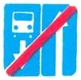 | 5.12.1 | End of the road with a lane for public-use transport vehicles | That road ends |
| 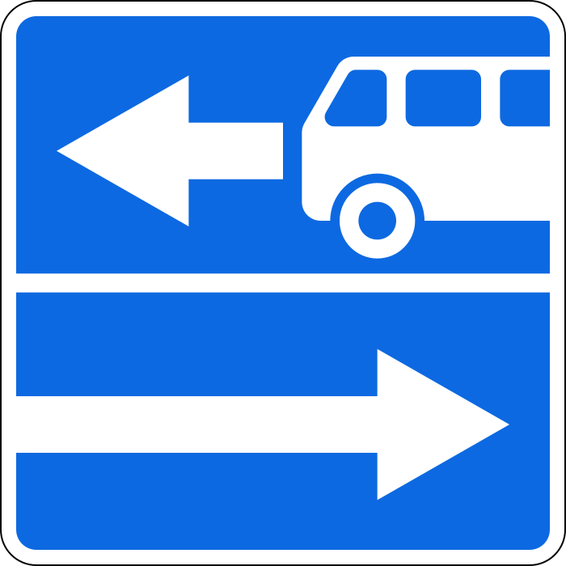 | 5.13.1 | Exit to a road with a lane for public-use transport vehicles | The crossing road has such a lane |
|  | 5.14 | Lane for public-use transport vehicles | The lane is reserved for route vehicles |
| 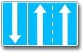 | 5.15.1 | Directions of travel by lanes | Which way each lane may go |
| 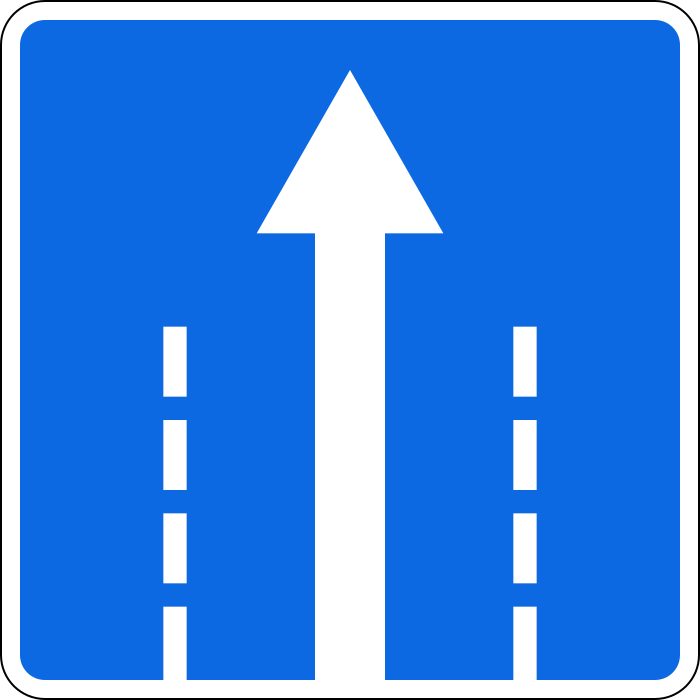 | 5.15.2 | Directions of travel by lane | The same, shown lane by lane |
| 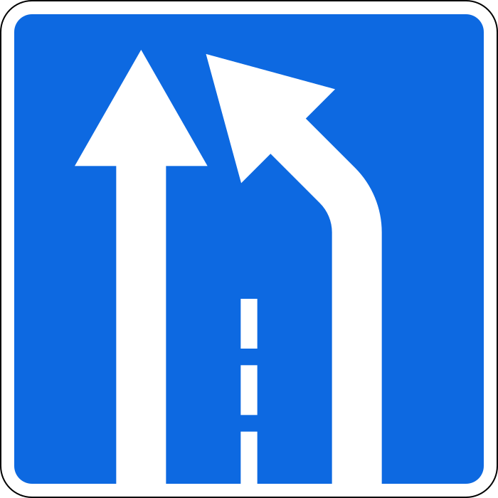 | 5.15.5 | End of lane | The lane ends, so move across |

Sign 5.15.3 "Beginning of a lane" announces an extra lane:

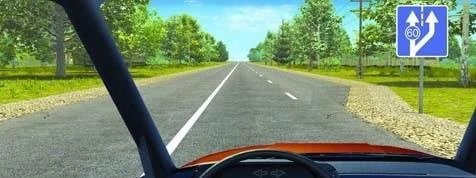

**How do I read the exit signs with a bus?** Sign 5.13.2 is the mirror image of 5.13.1. The plain arrow shows
the general traffic, and the arrow with the bus shows the reserved lane. Follow the plain arrow.

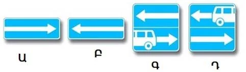

*None of these prohibits a U-turn. Only sign 3.19 does that.*

Other vehicles may not drive or stop in the lane (point 124). If a broken line separates it, you may enter it
to turn off the road, or to pick up and set down passengers, without obstructing route vehicles.

> **Remember:** Under signs 5.15.1 and 5.15.2, drive only where your lane's arrows point. No green light can
> add a direction. A sign permitting a left turn from the **left edge lane** permits a U-turn from it too, but
> a left turn from any other lane doesn't.

## Stops, crossings and bumps

| Sign | No. | Name | Meaning |
|---|---|---|---|
| 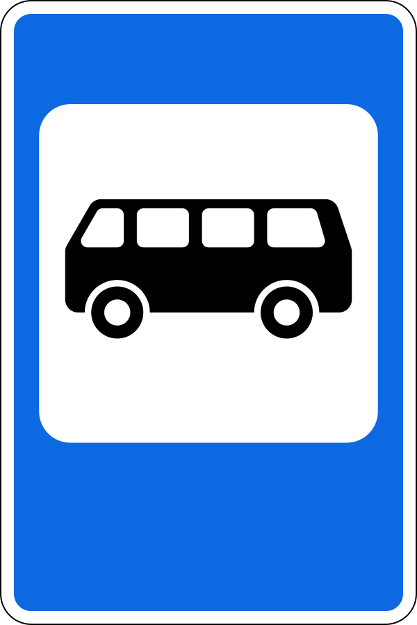 | 5.16 | Bus and (or) trolleybus stop | A stopping point for public transport |
| 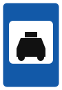 | 5.18 | Parking place for light passenger taxis | A place where taxis park |
| 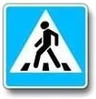 | 5.19.1 | Pedestrian crossing | Marks the crossing. With no markings, it stands at the far boundary |
| 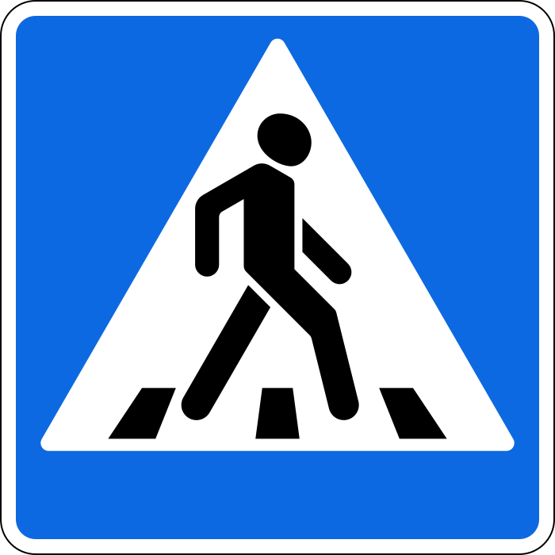 | 5.19.2 | Pedestrian crossing | Marks the crossing. With no markings, it stands at the near boundary |
| 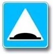 | 5.20 | Artificial bump | Marks the bump itself, at its near boundary |

> **Common trap:** The same picture in a red triangle only warns ahead. Signs 1.22 and 1.17 announce what is
> coming. Signs 5.19.1, 5.19.2 and 5.20 mark the place itself. At a crossing, you give way to pedestrians.

## Residential zones

| Sign | No. | Name | Meaning |
|---|---|---|---|
| 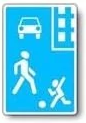 | 5.21 | Residential zone | Residential zone rules begin |
| 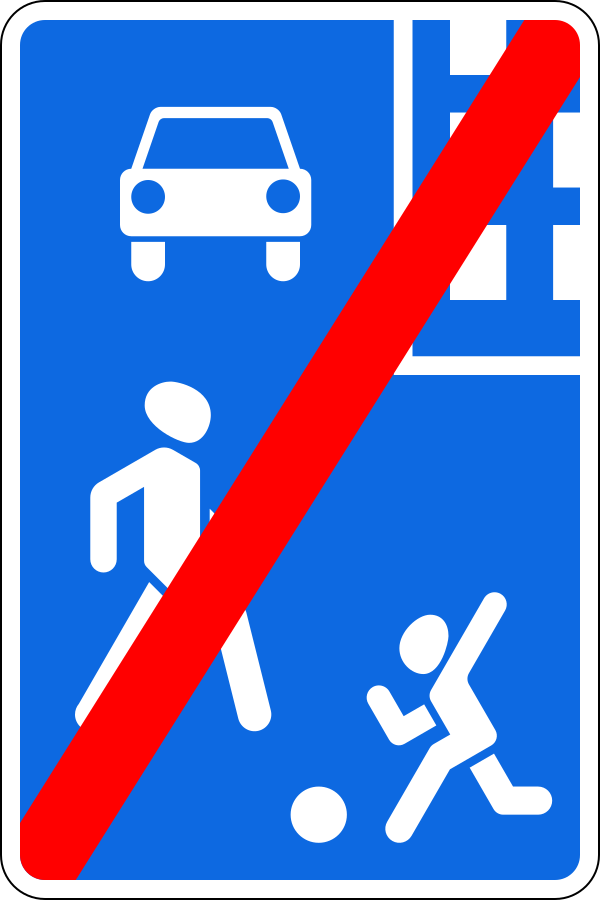 | 5.22 | End of residential zone | Those rules end |

Inside the zone the limit is 20 km/h for every vehicle. Pedestrians may walk on the pavement or the
carriageway, and they have priority. **Through traffic and learner driving are prohibited.**

Leaving gives you no priority. It takes priority away: at sign 5.22 you must give way to other vehicles and
must not obstruct pedestrians.

## Built-up areas

Color decides everything here.

| Sign | No. | Name | Meaning |
|---|---|---|---|
| 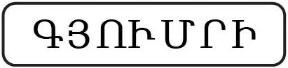 | 5.23.1 | Beginning of built-up area | Built-up area rules begin, so 60 km/h |
| 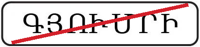 | 5.24.1 | End of built-up area | Those rules end |
| 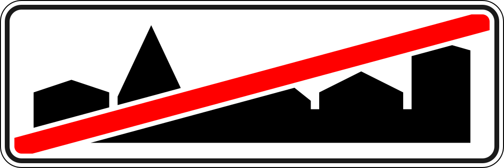 | 5.24.2 | End of built-up area | Those rules end |
| 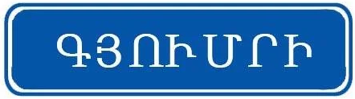 | 5.25 | Beginning of built-up area | Only gives the name. Built-up area rules do **not** apply |
| 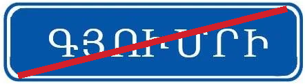 | 5.26 | End of built-up area | The named place ends. Built-up area rules don't apply here either |

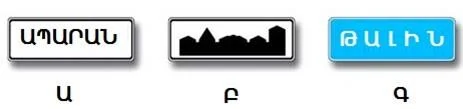

*Ա (A) is 5.23.1 and Բ (B) is 5.23.2, the skyline version. Both bring in built-up area rules. Գ (C) is 5.25,
and it doesn't.*

The rules begin at the white sign, not where the buildings begin.

## Zone signs

A white rectangle with the word ZONE (in Armenian, ԳՈՏԻ) covers a whole area. Its effect isn't ended by the
next intersection, but by the matching end sign.

| Sign | No. | Name | Meaning |
|---|---|---|---|
|  | 5.28 | End of the zone with parking restriction | Ends zone 5.27 |

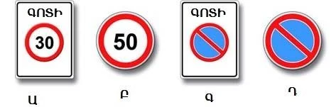

*Ա (A) is 5.31 "Zone with a maximum speed limit", which ends at sign 5.32. Գ (C) is 5.27 "Zone with parking
restriction". Բ (B) and Դ (D) are ordinary signs that last to the nearest intersection.*

Sign 5.33 "Pedestrian zone" bans all vehicles, bicycles included.

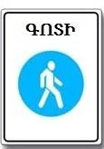

## Try it yourself

**The blue square ahead is sign 5.5.**

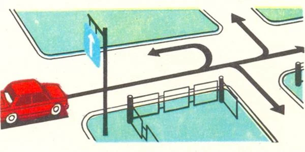

Which ways are open? **Straight, right and left.** The fourth path is a U-turn, which is prohibited on a
one-way road.

**You are leaving a residential zone, and a truck approaches from the left.**

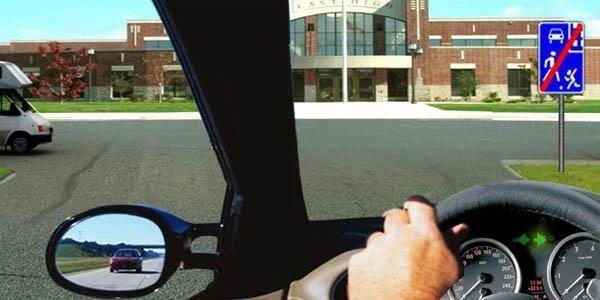

Must you give way? **Yes.** Leaving a residential zone gives you no priority.

**You are in the far left lane, and the panel above shows only a left turn.**

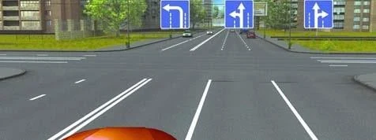

Where may you go? **Left, or a U-turn.** The left edge lane brings the U-turn with it, and the panel has no
straight arrow.

## Key points

- Blue rectangles describe the road. A red diagonal ends what the matching sign began.
- No U-turn on a one-way road. Until you pass sign 5.6, the road is still one-way.
- 5.7 and 5.13 signs ban no manoeuvre. Under a 5.13 sign, follow the plain arrow.
- Left turn permitted from the left edge lane means a U-turn is too. Only there.
- Residential zone: 20 km/h, pedestrians first, no through traffic, no learner driving, give way on leaving.
- White town sign: built-up area rules. Blue town sign: no change.
- A ZONE sign lasts until its end sign, not until the next intersection.

{{practice}}
