# Information and Service Signs

Most of these signs tell you things rather than order you. A common trick is to dress one up as a rule, so
remember that a blue rectangle or square in these two families informs or advises.

## Information signs (family 6)

Most are **blue squares or rectangles**. Sign 6.16 is white, and sign 6.19.1 is yellow.

| Sign | No. | Name | Meaning |
|---|---|---|---|
| 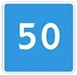 | 6.2 | Recommended speed | The preferred speed for this stretch. Advice only |
| 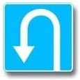 | 6.3.1 | Place for turning | A place set aside for a U-turn. Left turns are prohibited here |
| 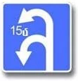 | 6.3.2 | Turning zone | The figure inside gives the length of the zone for turning |
|  | 6.4 | Parking place | Parking is provided here |
| 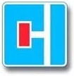 | 6.8.1 | Dead end | No through passage. Entry isn't prohibited |
| 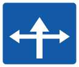 | 6.9 | Advance direction indicator | Route and direction information |
| 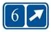 | 6.14.2 | Route number | Gives a route number |
| 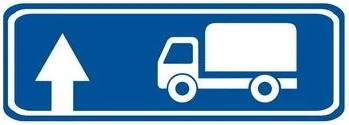 | 6.15.1 | Direction of movement for lorries | Recommended way for trucks, straight on |
| 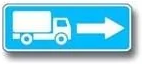 | 6.15.2 | Direction of movement for lorries | The same, to the right |
| 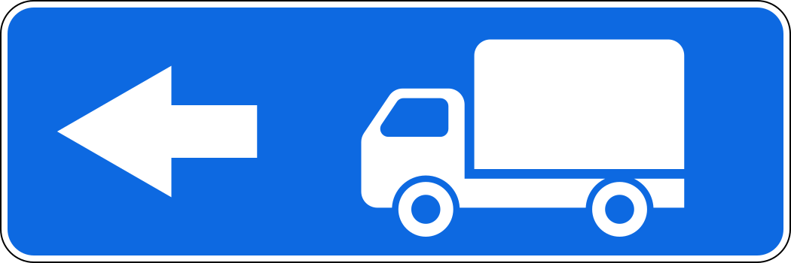 | 6.15.3 | Direction of movement for lorries | The same, to the left |
| 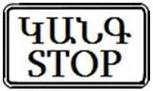 | 6.16 | Stop line | Where to stop on a prohibiting signal |
| 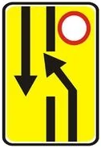 | 6.19.1 | Advance indicator of changing lanes to another carriageway | The way round a closed carriageway on a road with a dividing strip |

> **Common trap:** The number 50 on a blue square is a suggestion. It isn't a maximum (that is the red ring
> 3.24) and it isn't a minimum (that is the blue disc 4.6). This stays true with plate 8.16 "Wet surface" below
> it: "On a wet road surface it is recommended", never "permitted".

Next to a warning sign, sign 6.2 lasts for the length of that dangerous stretch.

**Sign 6.15** is advice too. It suggests a way for trucks, tractors and self-propelled machines when their
movement in some direction at the intersection is prohibited. It closes nothing. Only the prohibitory sign
does, and only in its own direction.

**Sign 6.19.1** sends you across to the other carriageway, because yours is closed ahead. It isn't an
indicator for bypassing a local obstacle. When you see it, you can't continue straight: move to the
oncoming carriageway, as it shows. Signs 6.19.1 and 6.19.2 also show the way back.

## Service signs (family 7)

Look for a **blue rectangle with a white square** inside. They point you to something useful.

| Sign | No. | Name | Meaning |
|---|---|---|---|
| 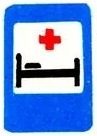 | 7.2 | Hospital | A bed with a cross |
| 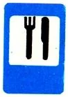 | 7.7 | Food point | Knife and fork |
| 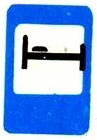 | 7.9 | Hotel or motel | A bed without a cross |
| 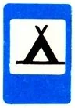 | 7.10 | Camping | A tent |
| 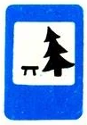 | 7.11 | Rest area | A table and a tree |
| 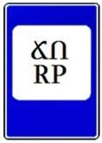 | 7.12 | Traffic police patrol post | Only tells you a post is there |

## Try it yourself

**In which case is the length of the zone for the U-turn shown?**

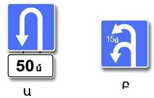

**Only Բ (B).** A figure inside the sign, 6.3.2, is the length of the zone. The separate plate in Ա (A) is
8.1.1: the distance from the sign to the place, 50 m.

**You drive the truck.** Sign 3.4 stands on the road straight ahead, and the blue sign for trucks points right.

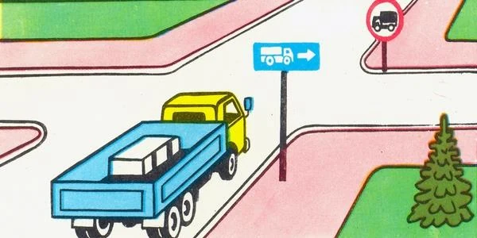

Where may you go? **Right, left, or the opposite direction.** Only straight ahead is banned. The blue sign
recommends. It doesn't compel.

**This sign stands by the road through the forest.**

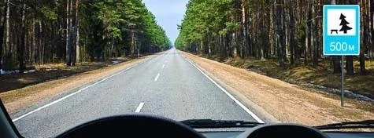

What does it say? **There is a rest area after 500 m.** The plate gives the distance to it, not the length of
a stretch. It isn't a warning about a fallen tree, because it is blue and not a triangle.

## Key points

- Blue squares and rectangles here inform or advise.
- 6.2 only recommends a speed, even with a plate.
- 6.3.1 marks a place for a U-turn, and left turns are prohibited there. 6.3.2 shows the zone's length inside the sign.
- 6.8.1 means no way through, but you may enter.
- 6.15 recommends a route for trucks and bans nothing.
- 6.19.1 is the yellow sign that moves you to the other carriageway.
- Service signs: 7.2 is a bed with a cross, 7.9 a bed without one.

{{practice}}
