# Additional Plates

A plate is the small white sign under a main sign. It changes what the sign means, so reading the sign and
skipping the plate is the fastest way to lose a mark. Each plate answers one question: how far, how long,
which way, who, or when.

## How do I recognize a plate?

Look for a **small white rectangle** fixed under another sign. On its own, a plate imposes no duty: it only
changes the sign above it.

## How far away, or how long?

This is the distinction the exam tests most. A single figure answers **how far**. Arrows at both ends of the
figure answer **how long**.

| Sign | No. | Name | Meaning |
|---|---|---|---|
| 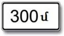 | 8.1.1 | Distance to the object | From the sign to where the danger or the rule begins |
| 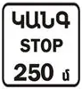 | 8.1.2 | Distance to the object | From sign 2.4 to an intersection with sign 2.5 |
| 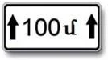 | 8.2.1 | Zone of action | The length of the section the sign covers |
| 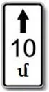 | 8.2.2 | Zone of action | The length of the zone of stopping and parking bans 3.27 to 3.30 |
|  | 8.2.3 | Zone of action | The zone of a 3.27 to 3.30 sign **ends** here |
|  | 8.2.4 | Zone of action | You are **inside** the zone of a 3.27 to 3.30 sign |

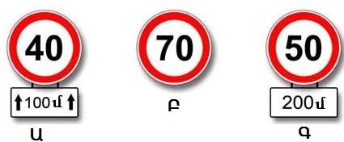

*Ա (A): 40 applies from here, for 100 m. Բ (B): 70 applies from here, to the nearest intersection. Գ (C): 50
applies only after 200 m.*

> **Common trap:** With plate 8.2.4, the ban runs on both sides of the sign. Stopping is prohibited before it
> as well as after it. With 8.2.3, the ban ends at the sign, so parking past it is allowed.

Warning signs follow the same pattern. A warning sign with 8.2.1 still stands at its normal
distance: outside a built-up area, a narrowing 100 m long begins 150 to 300 m after the sign. With 8.1.1, the
figure replaces that distance.

Plate 8.1.2 carries the word STOP as a warning that a compulsory stop is coming, not another give-way.

## Which way?

| Sign | No. | Name | Meaning |
|---|---|---|---|
| 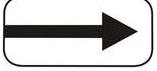 | 8.3.1 | Directions of action | The sign acts to the right. With the arrow reversed, to the left |
| 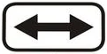 | 8.3.3 | Directions of action | The sign acts to the left and right |
| 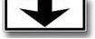 | 8.14 | Traffic lane | The sign acts only on the lane it hangs over |

These plates shrink a ban. Sign 3.2 with no plate closes every direction. With 8.3.3 under it, only left and
right are closed, so you may go straight or make a U-turn. Sign 3.5 with an arrow to the right bans motorcycles
only to the right.

## Who does it apply to?

| Sign | No. | Name | Meaning |
|---|---|---|---|
|  | 8.4.1 | Type of vehicle | Only trucks **over** 3.5 t |
| 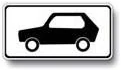 | 8.4.3 | Type of vehicle | Passenger cars **and** trucks up to 3.5 t. Not motorcycles |
| 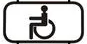 | 8.17 | Disabled persons | The sign applies only to motorised carriages and cars with the "Disabled person" sign |
|  | 8.18 | Except for disabled persons | The sign doesn't apply to those same vehicles |

> **Remember:** Plate 8.4.1 shows a truck, so a passenger car or a 3 t truck ignores the sign above it. Plate
> 8.4.3 shows a car, but it covers trucks up to 3.5 t too.

Taxis get nothing from 8.18: the exception is for those with the "Disabled person" sign only.

## When?

| Sign | No. | Name | Meaning |
|---|---|---|---|
| 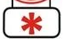 | 8.5.1 | Saturdays, Sundays and holidays | The sign applies on those days |
| 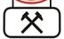 | 8.5.2 | Working days | The sign applies on working days |
| 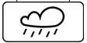 | 8.16 | Wet surface | The sign applies only while the carriageway is wet |

The asterisk isn't snow. Plate 8.16 means wet, not icy. It doesn't turn a recommendation into a limit, and
it doesn't turn a limit into advice: 40 in a red ring is a maximum on a wet road, and 40 on a blue square is
advice on a wet road.

## How do I park?

| Sign | No. | Name | Meaning |
|---|---|---|---|
|  | 8.6.1 | Manner of placing a vehicle at parking places | On the carriageway along the pavement, for **all** vehicles |
|  | 8.6.2 | Method of placing a vehicle in a parking place | At the kerb, for **passenger cars and motorcycles** only |
| 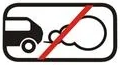 | 8.7 | Parking with the engine switched off | Park with the engine off |
| 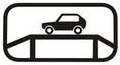 | 8.10 | Vehicle inspection place | A place to inspect vehicles |

Plates 8.6.2 to 8.6.9 all work like 8.6.2. Point 81 agrees: a truck may not park on the kerb under them.

## Plates that add meaning

| Sign | No. | Name | Meaning |
|---|---|---|---|
| 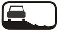 | 8.12 | Dangerous shoulder | With sign 1.25: driving onto the shoulder is dangerous because of repairs |
|  | 8.13 | Direction of the main road | The thick line is the main road's only course |
| 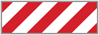 | 8.22 | Obstacle | Used with signs 4.2.1 to 4.2.3 to mark a local obstacle. In the question pictures it is red and white |

Plate 8.12 bans nothing. It says "dangerous", not "prohibited", so stopping isn't affected. On plate 8.13, a
thin line continuing straight is the secondary road. If the thick line bends left, the main road goes only
left.

## Try it yourself

**Sign 3.2 stands before the intersection with this plate.**

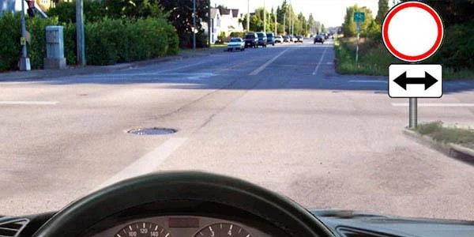

Where may you go? **Straight, or back the way you came.** The plate closes only left and right.

**You drive a passenger car.** Sign 4.1.4 hangs above the lane, with plate 8.4.1 under it.

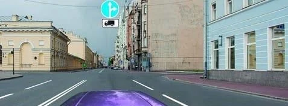

Where may you go? **Straight, left, or back.** The sign binds only trucks over 3.5 t. There is no exit on the
right, so nothing is left to turn into there.

## Key points

- A plain figure is a distance. Arrows at both ends make it a length.
- 8.2.3 ends a stopping ban. 8.2.4 says you are inside one.
- 8.3 plates limit a sign to a direction. 8.14 limits it to a lane.
- 8.4.1: trucks over 3.5 t. 8.4.3: cars and trucks up to 3.5 t.
- Asterisk: weekends and holidays. Hammers: working days. Cloud: wet surface.
- 8.6.1 is for all vehicles. 8.6.2 to 8.6.9 are for cars and motorcycles only.
- On 8.13 the thick line is the main road.

{{practice}}
