# Road Markings

Markings give orders just as signs do, and they sit right under your wheels. The practice questions often show one marking on its own, so this lesson goes through them by number.

**Horizontal** markings (numbers starting with 1) are painted on the road. **Vertical** markings (numbers starting with 2) are painted on structures beside and above it.

> **Remember:** Permanent markings are white, and temporary ones are orange. If they disagree, follow the orange marking (points 170 and 174). It shows the road as it is today, for example during repairs.

## Which lines may I cross?

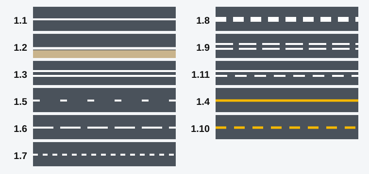

*The lines by number, simplified. Yellow lines 1.4 and 1.10 are covered further on.*

| No. | Looks like | Meaning and crossing |
|---|---|---|
| 1.1 | Solid line | Separates traffic flows and borders parking places and islands. Don't cross, except to enter or leave a parking place |
| 1.2 | Solid edge line | Shows the edge of the carriageway. Cross only to stop on the shoulder, where stopping is permitted |
| 1.3 | Double solid line | Separates opposing flows on roads with four or more lanes. Don't cross |
| 1.5 | Broken line | Separates opposing flows on roads with two or three lanes. May be crossed from either side |
| 1.6 | Dashes about three times longer than the gaps | Warns that solid line 1.1 or 1.11 is coming. Finish overtaking now |
| 1.7 | Short dashes with equal gaps | Shows the lanes inside an intersection, so you leave it in the right lane. It doesn't show permitted directions |
| 1.8 | Broad broken line | Separates a main lane from an acceleration or deceleration lane |
| 1.9 | Double broken line | Bounds reversible lanes |
| 1.11 | Solid line beside a broken line | Cross from the broken side. Cross from the solid side only to complete an overtaking or a bypass |

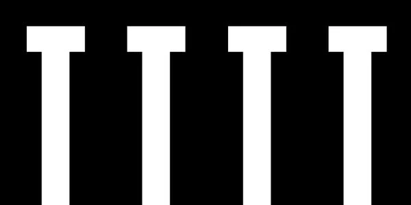

*1.1 bordering parking places. You may cross it to park or to drive out.*

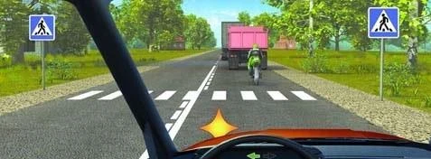

*1.1 before pedestrian crossing 1.14.1, then a broken line after it. You may cross the line only after the crossing.*

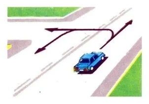

*1.3 on your left. A left turn and a U-turn both cross it, so you may only go straight.*

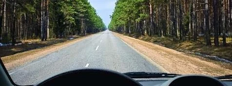

*A broken centre line. You may cross it to overtake, bypass an obstacle or make a U-turn, but the far side isn't your side. Don't drive to the left of the line or along it, and return when the manoeuvre is done.*

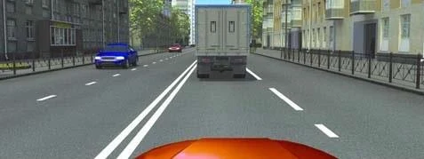

*1.6 on the right. The dashes grow longer, so the line will soon turn solid.*

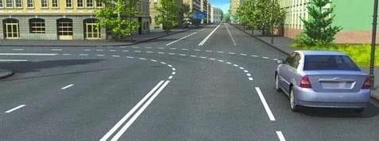

*1.7 guiding you through the intersection.*

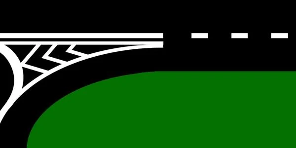

*1.8 where a slip road joins: the boundary of an acceleration lane.*

A broken line along the side of a two-lane road just shows the edge of the carriageway. It gives you no right to stop on the shoulder or to drive along it.

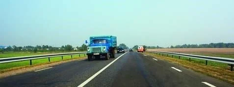

### Marking 1.9 and reversible lanes

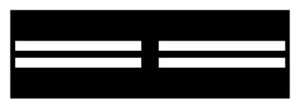

*1.9: the boundaries of lanes with reversible traffic.*

Reversible lights control these lanes. When the lights are off or absent, 1.9 separates opposing flows, and you may cross it only when it lies on your **right**. So with the lights off, you can't cross it to your left, even to overtake.

## What do the yellow lines at the edge mean?

- **1.4, solid yellow:** no stopping and no parking. It is drawn near the edge of the carriageway or on top of the kerbstone, alone or with sign 3.27 "No stopping".
- **1.10, broken yellow:** no parking. It is used alone or with sign 3.28 "No parking".

> **Remember:** Solid yellow means no stopping. Broken yellow means no parking.

## What does the zigzag mean?

**1.17** marks a stopping point for public-use vehicles. Where sign 5.18 "Parking place for light passenger taxis" stands, it also marks taxi parking.

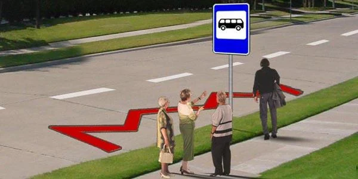

*1.17 with a bus stop sign and no sign 5.18, so here it is a stopping point only.*

## Which markings tell me to stop or give way?

- **1.12 "Stop line":** where you stop at a prohibiting light, or at sign 2.5 "Movement without stopping prohibited".
- **1.13, a row of triangles:** where you stop, if necessary, to give way to vehicles on the crossing road.
- **1.20, a large triangle:** warns that 1.13 is coming.
- **1.21, the word STOP:** warns that 1.12 is coming, where that line is used with sign 2.5. You won't see it at a traffic light.

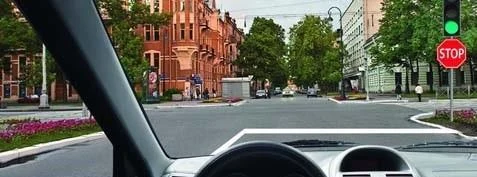

*1.12 "Stop line".*

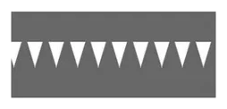

*1.13. You stop at the marking: not on it, not 5 m back from it, and not at the sign.*

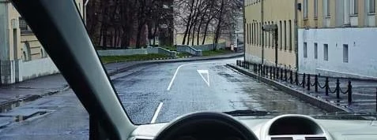

*1.20 ahead of a place to give way.*

*1.21.*

## What are the squares and grids?

- **1.14.1, broad bars:** a pedestrian crossing.
- **1.15, rows of squares:** where a cycle path crosses the carriageway.
- **1.25, a chequered band:** an artificial bump, used with sign 5.20 "Artificial bump". It warns you to slow down and prohibits nothing.
- **1.26, a yellow grid:** the part of an intersection you must not enter if a jam ahead would force you to stop there. This doesn't apply if you are turning right or left. It is used alone or with sign 1.35 "Intersection area".

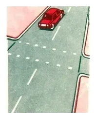

*1.15.*

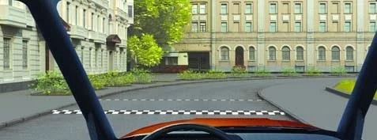

*1.25.*

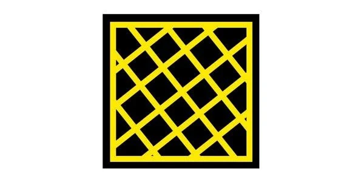

*1.26. If you would get stuck on the grid, you would block the traffic crossing your path, so wait before it.*

## What do arrows, letters and numbers on the road mean?

**1.18, lane arrows,** show the directions permitted from each lane. A left arrow in the left edge lane also permits a U-turn.

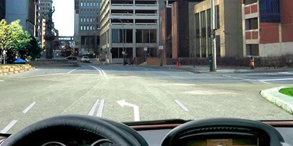

*1.18: left and U-turn are permitted, but not straight.*

If your arrow doesn't show your direction, change lanes in good time. Going straight isn't banned on this road, only from this lane.

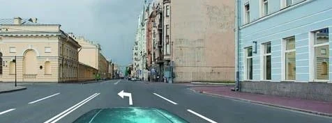

*To go straight, first move into the right lane.*

**1.19, curved arrows,** warn that your lane is ending, because the number of lanes in your direction is about to drop. They may be used with signs 1.20.1 to 1.20.3 "Narrowing of the road". They don't warn of a bend.

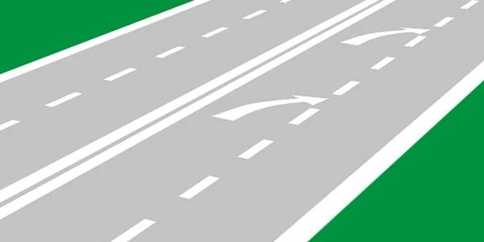

*1.19.*

**1.22** shows the number of the road or route. It shows no distance.

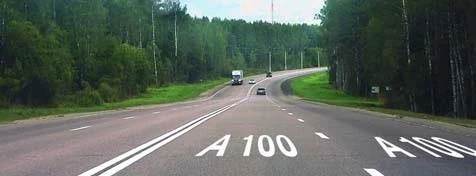

*1.22.*

**1.23, the letter A,** marks the special lane for public-use vehicles. It has nothing to do with licence category A, and it isn't a lane for taxis.

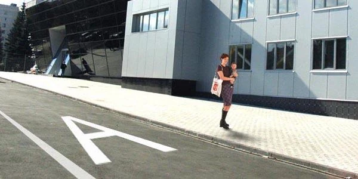

*1.23.*

**1.24.2, a number in a circle,** repeats sign 3.24 "Maximum speed limit". It is a limit, not a recommendation.

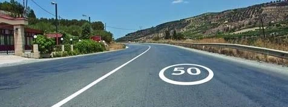

*1.24.2.*

## May I drive over a guide island?

No. **1.16** is a hatched area bordered by wide white lines. The solid border can't be crossed, so you may not enter at all, not even to stop or while reversing. Version 1.16.1 is drawn where opposing flows divide, and 1.16.3 where flows merge.

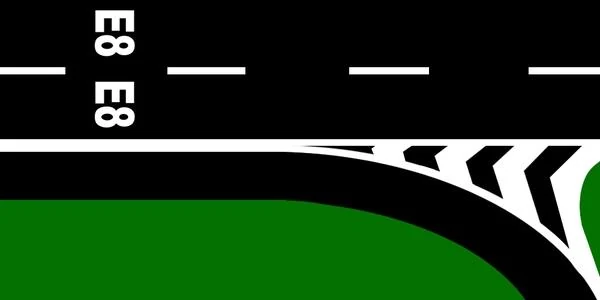

*1.16.3.*

## What are vertical markings for?

- **2.1.1 to 2.1.3, diagonal black and white stripes:** on parts of road structures that present a danger to traffic, not on everything beside the road.
- **2.2:** the lower edge of a tunnel, bridge or overpass span, the part a high vehicle would hit.
- **2.5, stripes along a barrier:** you are driving through a dangerous section, such as a tight curve or a steep descent.

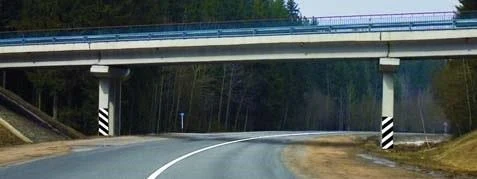

*2.1 on the overpass supports.*

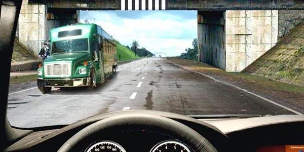

*2.2.*

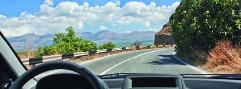

*2.5.*

Extra: When markings are hard to see

*Not from the question bank.*

Snow, rain and worn paint can hide markings. When you can't see them, slow down, look at the signs and watch how the traffic ahead is moving. Don't assume there is no line just because you can't see one.

## Try it yourself

**Which path keeps to the marking?** The line is 1.11, with its broken side towards the purple car. Path Ա (A) comes out of a side territory, and path Բ (B) belongs to the purple car.

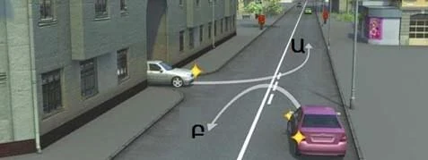

**Only Բ (B).** It crosses from the broken side. Path Ա (A) crosses from the solid side and isn't completing an overtaking.

**Which driver may cross a solid line to stop?** An oncoming car pulls over onto the shoulder, and your path crosses a hatched island on the right.

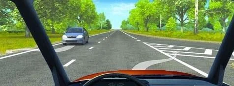

**Only the oncoming driver.** He crosses edge line 1.2 to stop on the shoulder, which is allowed. You would cross the solid border of island 1.16.2, which isn't.

**Which edge line may you cross to stop?** You are outside a built-up area. Path Ա (A) leads left and path Բ (B) leads right.

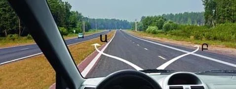

**Only Բ (B).** Line 1.2 may be crossed only to stop where stopping is permitted, and outside built-up areas that is the right-hand side of the road (points 78 and 79).

## Key points

- Solid means don't cross. The exceptions are 1.1 at a parking place and 1.2 to stop on the shoulder.
- 1.3 belongs to roads with four or more lanes, and 1.5 to roads with two or three.
- Longer dashes (1.6) warn that a solid line is coming.
- 1.11: read the side nearest you.
- Solid yellow 1.4 means no stopping, and broken yellow 1.10 means no parking.
- 1.20 announces 1.13, and 1.21 announces 1.12.
- Orange beats white.

{{practice}}
