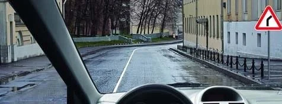
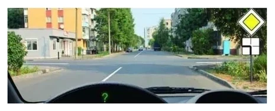
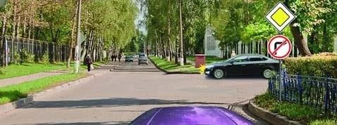
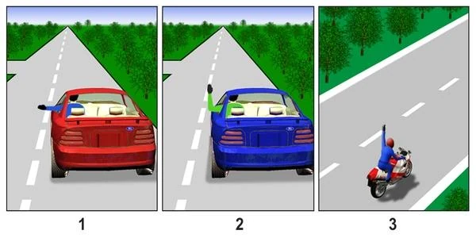
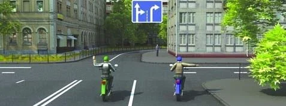
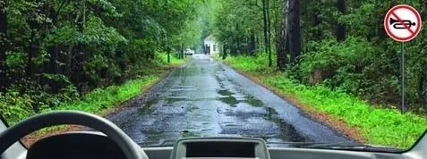
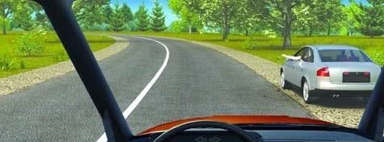
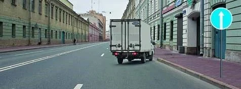

# Signalling and the Horn

A signal is the only way to tell other road users what you are about to do, and it needs time to work. The exam asks when you must signal, when you stop, and what a signal doesn't give you. The horn is simpler: the Rules allow it in just two cases.

## When must I signal?

Point 36 of the Traffic Rules says: before you move off, and before every manoeuvre, signal with the direction indicator on the side you are heading. Moving off, changing lanes, turning, making a U-turn and stopping all count. If your indicators are missing or faulty, signal by hand.

The duty has no conditions, because road users you can't see may be reading your signal. So you signal:

- By day and by night, inside and outside built-up areas.
- Whether or not anyone is behind you, oncoming or nearby.
- In a residential zone, in a parking area and at a filling station.
- When a sign forces the turn, such as sign 4.1.2 "Movement to the right".
- When you drive a route bus. An established route is no exemption.
- When your lane ends, or when you leave your lane to pass animals on the road.

## Is a signal ever not needed?

Yes, in one case: you are following a bend and staying in your lane. You aren't manoeuvring, because the road is doing the turning. That is why sign 1.11.1 "Dangerous turn" doesn't call for an indicator.

*The road simply bends. Stay in your lane and no signal is required.*

An intersection is different, even if the main road turns there. You are still leaving one road for another, so that is a turn.

*Here the main road turns left. Following it is a turn, so you must signal.*

## Which indicator?

Usually the direction is obvious. These cases are not:

- **Stopping at the left edge of a one-way road:** that edge is where you are heading, so use the left indicator.
- **Two moves in a row:** give a signal for each. To swing right and then make a U-turn to the left, signal first right, then left.
- **Roundabouts:** use the right indicator as you enter and leave, including when you go round the island to make a U-turn. A left signal would mislead other drivers.

## When does the signal start and stop?

| Type of signal | Start | Stop |
|---|---|---|
| Direction indicator | In advance, before the manoeuvre | Immediately after the manoeuvre |
| Hand signal | In advance, before the manoeuvre | Immediately before the manoeuvre starts |

Others need time to notice your signal, so it must come first. You stop a hand signal early because you need both hands on the wheel for the manoeuvre.

> **Common trap:** "Immediately before starting the manoeuvre" sounds right for an indicator, but it gives nobody time to react. The answer is "in advance". The "immediately before" wording belongs to ending a hand signal.

When you overtake, the left indicator goes with the move into the left lane. Switch it off as soon as you are in that lane, not after you have passed the other vehicle. Leaving it on tells following drivers you are still moving left.

There is one case where signalling too early misleads. You want to stop just past an intersection, and a road joins from the right.

*Switch on the right indicator only after you enter the intersection. Any earlier and it looks like you are turning into that road.*

## Does signalling give me priority?

No. A signal only warns others about what you intend to do. You must still let through everyone who has priority, and you must not begin while the manoeuvre is unsafe.

> **Remember:** A signal asks. It doesn't entitle. It gives you no advantage in any situation, whether you are starting off or changing lanes.

## What do the hand signals mean?

Hand signals replace indicators that are missing or faulty, at any time of day. If your indicators work, a hand signal doesn't replace them. Point 37 sets the meanings:

| Signal | Meaning |
|---|---|
| Left arm out to the side, or right arm bent up at the elbow | Left turn or U-turn |
| Right arm out to the side, or left arm bent up at the elbow | Right turn |
| Right or left arm raised straight up | Braking |

There is no hand signal for going straight ahead.

A memory hook: a straight arm points where you are going, a bent arm means the opposite side, and an arm straight up means braking.

*Picture 1 is a left turn, picture 2 a right turn, picture 3 braking.*

*Two ways to say the same thing: both riders are signalling a right turn.*

Extra: Check your indicators

*Not from the question bank.*

Walk round the car now and then with the indicators on, or ask someone to look for you. On many cars, an indicator that suddenly clicks much faster than usual means a bulb has failed.

## When may I use the horn?

Point 136 allows sound signals in only two cases:

- **Outside built-up areas,** to warn another driver that you intend to overtake.
- **When it is needed to prevent a road traffic accident,** anywhere.

The list is complete. The horn can't win you priority, and drivers of public transport vehicles get no extra cases.

> **Common trap:** The overtaking warning is allowed outside built-up areas, not inside them. Options that say "in built-up areas" are wrong.

## Try it yourself

**You are driving here and want to warn the driver ahead that you are about to overtake.** Sign 3.26 "Audible signal prohibited" stands on the right.

May you use the horn? **No.** Under this sign, the horn is allowed only to prevent an accident. The overtaking warning is not an exception.

**A car stands at the edge of the road, and its driver puts an arm out.**

What does it mean? **He is about to start moving.** Before moving off, a driver with no working indicators warns others by hand.

**The truck turns right into a yard, under sign 4.1.1 "Straight ahead only".** It has no indicator on.

What rule is broken? **Only the signalling rule.** Sign 4.1.1 doesn't prohibit turning right into yards and other areas next to the road, but the driver still had to signal.

## Key points

- Signal before moving off and before every manoeuvre, always, whoever is around.
- The one exception: following a bend without changing lanes.
- Indicator: on in advance, off immediately after the manoeuvre. Hand signal: off immediately before it.
- A signal gives no priority.
- Hand signals: straight arm points the way, bent arm means the opposite side, raised arm means braking. They are for missing or faulty indicators only.
- Horn: only outside built-up areas to warn of overtaking, or to prevent an accident. Under sign 3.26, only to prevent an accident.

{{practice}}
