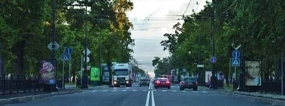
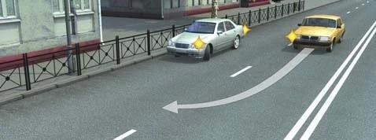
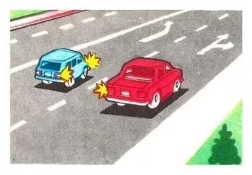
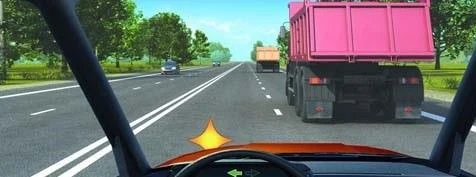
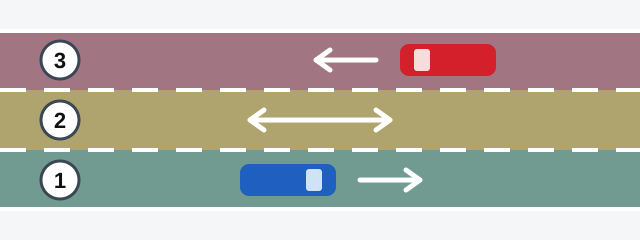
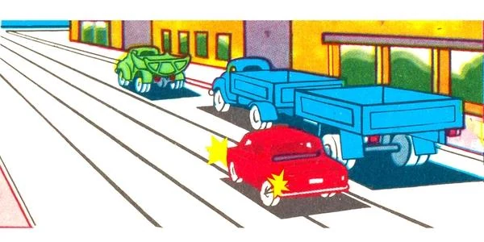
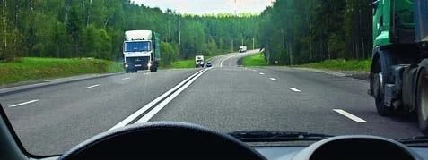
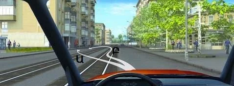

# Moving Off and Changing Lanes

Most lane questions come down to one thing: who is already there. Learn which part of the road is yours, then remember that the driver who moves gives way to the driver who doesn't.

## Which side of the road is mine?

Traffic in Armenia keeps to the right. Article 7 of the RA law "On ensuring road traffic safety" sets right-hand traffic on all roads of the Republic.

On a two-way road with no markings, the left half of the carriageway is the side for oncoming traffic (point 52). So you may not drive down the centre, even when nothing is coming. The left half is the oncoming side by definition.

Where no lines divide the road into lanes, the number of lanes depends on the width of the carriageway, the size of the vehicles and the gaps they need. A road with only a centre line can still have four lanes.

*No lane lines, but two vehicles fit abreast on each side, so this road has four lanes.*

## Who goes first when I move off?

Everyone already moving. Moving off is a manoeuvre: you signal, and the signal gives you no advantage. You may start only if you don't obstruct anyone on the road. Traffic you join never has to make room for you.

- A truck is coming up behind you in the lane: you may start only if that doesn't obstruct it.
- A driver is already making a U-turn on the road: you wait for him to finish, even though he is the one turning.
- A driver on the road is about to stop at the kerb where you are pulling out: you give way to him.
- Two cars start from a parking place at the same moment: the one behind gives way to the one ahead.

*The silver car is starting to move, so it gives way to the yellow car already on the road.*

## Who gives way when I change lanes?

Point 39 has two rules.

**Only you are changing lanes:** give way to vehicles travelling in that lane in the same direction without changing direction. This holds wherever the change comes from:

- Your lane is ending, under sign 5.15.5 "End of lane", or the road narrows under sign 1.20.2. A lane ending gives you no right to push in.
- You are returning to your lane after overtaking. Finishing an overtake gives you no priority.
- You are driving a truck crane with orange beacons. Those beacons warn others and give no priority.

**Two vehicles change lanes at the same time:** the one on the left gives way. Where each is heading doesn't matter.

*Both cars are moving into the middle lane at the same time. The red car is on the right, so the blue car gives way.*

> **Remember:** One car changing lanes: it gives way. Two at once: the left one gives way.

The same idea applies on joining a road. In an acceleration lane, you give way to vehicles on the road you are joining (point 47). The lane is there so you can match their speed, not so that they make room for you.

Extra: Check the blind spot

*Not from the question bank.*

Mirrors don't show everything beside you. Before you move off or change lanes, look in the mirrors, then glance over your shoulder at the area they miss. A motorcycle can sit there unseen.

## Which lane should I drive in?

It depends on where you are.

| Where | Rule |
|---|---|
| Outside built-up areas | Keep as far right as you can. You may not occupy the left lanes while the right ones are free (point 55). |
| In built-up areas | You may use whichever lane suits you (point 56). |

So after overtaking outside a built-up area, go back to the right lane if it is free. If trucks fill that lane, you may stay in the left one, because the right lane isn't free. In a built-up area you don't have to return at all.

*The right lane is taken, so staying in the left lane is permitted.*

> **Common trap:** After overtaking, a bare "No, I needn't return" is wrong. The correct option states the condition: only where built-up area rules apply.

**Public-use vehicles on regular passenger routes:** where there are 3 or more lanes in the same direction, on any road, they may take the left edge lane only to turn left or make a U-turn. Overtaking doesn't open it to them (point 57).

## How do three-lane roads work?

On a marked two-way road with three lanes, where the middle lane serves both directions, each lane has one job.

*Lane 1 is your lane. Lane 2 is shared: enter it only to overtake, bypass an obstacle, turn left or make a U-turn. Lane 3 is for oncoming traffic only: you may never enter it.*

This comes from point 54. You may never just drive along the middle lane. If you are turning left, the middle lane is the one you turn from, because it is the leftmost lane open to you. That holds whether the right lane is busy or free.

> **Common trap:** Each option naming one of the four reasons is true but incomplete. Choose the option that covers them all.

## May I drive on the tram tracks?

Only on tracks running in your direction, on your left, at the level of the road. Point 59 allows it in two kinds of case, provided you don't obstruct a tram:

- All the lanes in your direction are occupied.
- You are overtaking, bypassing an obstacle, turning left or making a U-turn.

If sign 5.15.1 or 5.15.2 "Directions of travel by lanes" stands before an intersection, you may not drive on the tracks within that intersection. Then even a left turn or U-turn can't be made from them.

## Try it yourself

**The blue truck fills the right lane in your direction, and you are the red car.**

May you drive on the tram tracks? **Yes.** All the lanes in your direction are occupied, so point 59 allows it, as long as you don't obstruct a tram.

**You have passed the truck on this road outside a built-up area, and the right lane ahead is free.**

Where do you continue? **Only in the right lane.** Point 55 prohibits occupying the left lanes while the right ones are free.

**A pedestrian waits at the left-hand kerb of this street with tram tracks.** You want to pick him up.

Which path? **Only Բ (B).** Path Ա (A) cuts diagonally across into the oncoming side. Path Բ (B) continues on your side, then turns left over the tracks as a proper manoeuvre.

## Key points

- Right-hand traffic. On an unmarked two-way road, the left half belongs to oncoming traffic.
- Moving off: give way to everyone already on the road.
- Changing lanes: give way to traffic in that lane. Two changing at once: the left one gives way.
- Outside built-up areas, keep right. In built-up areas, use any lane.
- Three lanes: the middle one only to overtake, bypass, turn left or make a U-turn. Never enter the far lane.
- Tram tracks in your direction: only if the lanes are full or you are manoeuvring, and not at an intersection with sign 5.15.1 or 5.15.2.

{{practice}}
