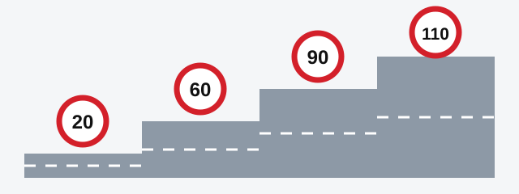
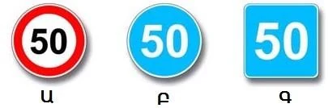
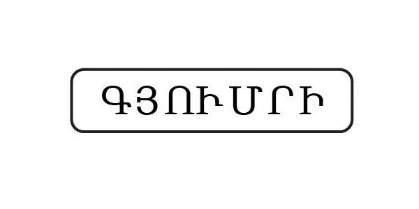
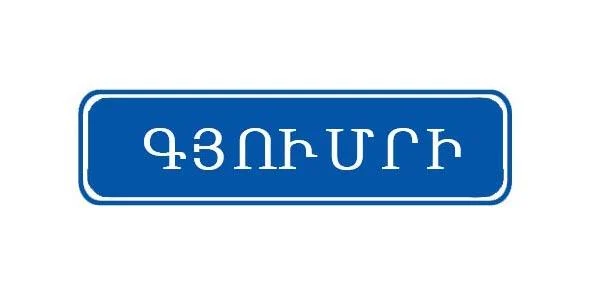
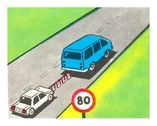
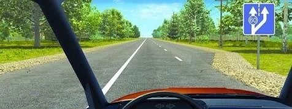

# Speed

Speed decides how much time you have when something goes wrong. The exam tests it with numbers, so this
lesson gives you one small table to learn and three rules that handle the tricky questions.

## How fast may a car go?

Three questions tell you the limit for a passenger car: are you in a built-up area, a residential zone,
or on a motorway?

*From left to right, the limits for a passenger car: 20 km/h in a residential zone or courtyard, 60 km/h
in a built-up area, 90 km/h on roads outside built-up areas, 110 km/h on a motorway.*

## What about other vehicles?

| Vehicle | Built-up area | Outside built-up areas | Motorway |
|---|---|---|---|
| Passenger car, or truck up to 3.5 t | 60 | 90 | 110 |
| Suburban, inter-regional or intercity bus | 60 | 90 | 90 |
| Other bus | 60 | 70 | 90 |
| Truck over 3.5 t | 60 | 70 | See the Traffic Rules |
| Passenger car towing a trailer | 60 | 70 | 90 |

All figures are km/h, from points 68 and 69 of the Traffic Rules. In a residential zone or courtyard,
the limit is 20 km/h for every vehicle.

> **Common trap:** An intercity bus gets 90 km/h on all roads outside built-up areas, but no more on a
> motorway. Only passenger cars and trucks up to 3.5 t get 110 km/h. Inside a built-up area, the bus is
> back to 60 km/h like everyone else.

## Which limits ignore the road?

Point 71 sets two limits that apply on every kind of road:

- **Towing a mechanical vehicle: 50 km/h**, with a rigid or flexible coupling.
- **Carrying people in a truck's equipped body, or an organized group of children: 60 km/h.**

A sign can't raise these limits. If a sign allows 80 km/h and you are towing, your limit is still 50 km/h.
The stricter limit always wins.

> **Remember:** Lifting a limit set by a sign does not lift a limit that the Rules attach to what you are
> doing. Sign 3.25 "End of the maximum speed limit zone" won't free you from the towing limit.

## How do I read a speed sign?

Three signs show a number. Only the shape and color tell you what it means.

- **Red ring, sign 3.24 "Maximum speed limit":** a ceiling. Don't go faster.
- **Blue disc, sign 4.6 "Minimum speed limit":** a floor. Don't go slower.
- **Blue square, sign 6.2 "Recommended speed":** advice. It sets no binding limit.

The town name sign matters too. It looks harmless, but its color changes your speed limit.

*Black on white, sign 5.23.1: built-up area rules apply from here, so the limit is 60 km/h.*

*White on blue, sign 5.25: built-up area rules do not apply, so the limits for roads outside built-up
areas stay in force.*

> **Common trap:** Seeing a town's name doesn't always mean 60 km/h. Check the color first.

Extra: Why twice the speed needs about four times the braking distance

*Not from the question bank.*

A moving car's energy grows with the square of its speed, and your brakes have to remove all of it. Double
your speed and there is about four times as much energy, so braking takes about four times the distance.
Reaction distance comes on top of that: the car keeps moving at full speed while you notice the danger
and move your foot.

## Is staying under the limit enough?

No. The limit is the most you may do, not what you should do. Point 65 tells you to take into account the
condition of the road surface and the visibility ahead. Point 66 asks for a speed that keeps the vehicle
fully under your control.

You also must not:

- Exceed your vehicle's technical maximum speed.
- Exceed the speed on a "Speed limit" identification sign fitted to your vehicle.
- Drive very slowly without need, if this obstructs other vehicles.
- Brake sharply, unless it is needed to prevent an accident.

## When must I slow down?

The Rules require you to reduce speed when:

- An obstacle or danger to traffic arises (point 67).
- You are dazzled (point 129).
- You approach a vehicle with a "Transport of children" sign while children are boarding or alighting
  (point 156).
- You approach a vehicle with blue and red flashing beacons and a special sound signal, or a stationary
  vehicle with flashing beacons on (points 29 and 30).

## Try it yourself

**You are driving the blue van.** You are towing the white car on a flexible coupling, and a sign shows 80.

What is your limit? **50 km/h.** The sign allows 80, but point 71 limits towing to 50, and the stricter
limit wins.

**You are towing a car, and this sign appears ahead.** The main lane requires at least 60 km/h, and an
extra lane begins on the right.

Which lane may you use? **Only the right one.** Towing limits you to 50 km/h, so you can't reach the 60 km/h
the main lane requires.

## Key points

- Passenger car: 20 in a residential zone, 60 in a built-up area, 90 outside, 110 on a motorway.
- Intercity bus: 90 on all roads outside built-up areas, including motorways.
- Towing: 50 km/h. People in a truck body or organized groups of children: 60 km/h. No sign raises these.
- Red ring means maximum, blue disc means minimum, blue square means advice.
- A black-on-white town sign means 60 km/h. A white-on-blue one doesn't.
- The limit is a ceiling: match your speed to the road, visibility and your control of the vehicle.

{{practice}}
