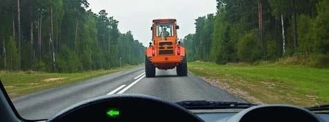
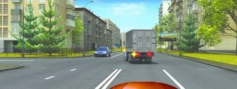
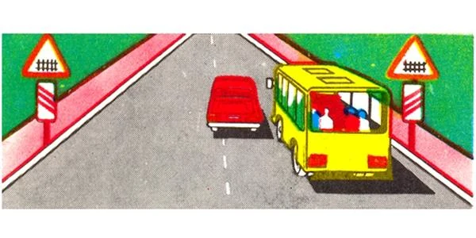
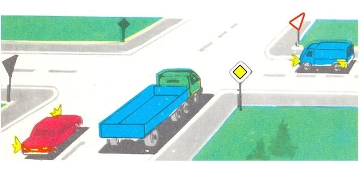
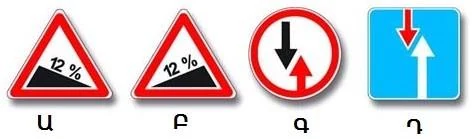
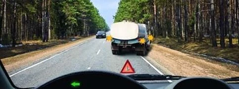
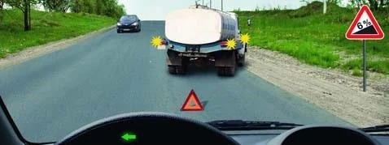
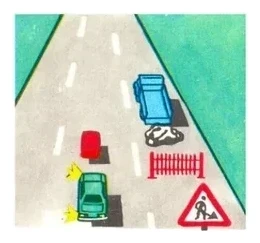

# Overtaking and Oncoming Traffic

Overtaking puts you on the wrong side of the road for a while, so the Rules decide when you may start and where you may never do it. This lesson also covers who gives way when two vehicles can't pass each other.

## What must I check before I start?

On a road with one lane each way, overtaking means using the oncoming lane. Point 73 asks for all of this at once:

- The oncoming lane is free for a sufficient distance.
- The driver behind you hasn't started to overtake you.
- The driver ahead hasn't signalled a left turn.
- You can return to your lane safely, without obstructing anyone.

The marking must allow it too. You may cross a broken line. With a solid line combined with a broken one, marking 1.11, you may not start an overtake from the solid side. A slow tractor ahead doesn't change that.

*The solid side of the marking is yours, so you may not move out to overtake.*

Your vehicle type and the other's speed don't ban it by themselves: a truck may overtake a bus travelling at 60 km/h where no prohibition applies.

## Which side do I overtake on?

The left (point 74). There is one exception: if the driver ahead has signalled a left turn and started the manoeuvre, you pass on the right. You also have the choice of waiting until he has gone.

*You may pass on the right or wait. Both are permitted.*

Passing on the right needs a lane of carriageway. Point 61 prohibits driving on the shoulder, so if there is only a shoulder beside him, wait.

## Where is overtaking prohibited?

| Place | Rule |
|---|---|
| Intersections | Prohibited, regulated or unregulated (point 77) |
| Railway crossings | Prohibited on them and up to 100 m before them |
| Pedestrian crossings | Prohibited, whether or not anyone is crossing |

The railway ban has a clear start and end. Outside built-up areas, the first sign 1.1 "Railway crossing with a barrier" stands 150 to 300 m before the crossing, so beside it you may still overtake if the line allows. The ban ends at the crossing: you may start straight after it, with no 100 m wait.

*These are the first warning signs, before the 100 m zone starts, so this overtake is allowed.*

For an intersection, the whole overtake must be finished before you reach it. A warning sign ahead means you may overtake only if you can complete it before the intersection.

**What if I am on the main road?** The questions that ask this directly say the ban still holds. Priority lets you go first at the intersection, and it doesn't let you overtake there. The explanation of question 1097 words the ban differently, but no main road appears in its picture, so its answer is the same either way.

*The red car is on the main road, but the truck is at the intersection, so overtaking is prohibited.*

## May I overtake someone who is overtaking?

No. If the vehicle ahead is overtaking or bypassing an obstacle, you may not overtake it. What it is doing decides this, not how fast it is going.

> **Common trap:** Many options offer "if its speed is less than 30 km/h". In these questions that condition is never the answer. Speed doesn't open a ban at an intersection, at a crossing, or behind a vehicle that is overtaking.

## What do the overtaking signs mean?

*Sign 3.20 "Overtaking prohibited": no overtaking, by any type of vehicle. You may still overtake slow-moving vehicles, horse-drawn carts, two-wheeled motorcycles without a sidecar, mopeds and bicycles.*

*Sign 3.22 "Overtaking by lorries prohibited": motorcycles, passenger cars, buses and trucks with a permissible maximum mass up to 3.5 t may still overtake.*

Under sign 3.20, the question is what the vehicle ahead is. A truck stays a truck at any speed. Under sign 3.22, the question is what you are driving.

## What if someone is overtaking me?

You have no duty to give way, but you must not obstruct him by speeding up or by any other action (point 75). The ban covers only obstructing an overtake: speeding up to clear an intersection is fine.

Extra: Why an oncoming car arrives sooner than it looks

*Not from the question bank.*

If you and an oncoming car each travel at 90 km/h, the gap between you closes at 180 km/h, which is 50 metres every second. Overtaking also takes longer than most drivers expect. If you are in doubt, stay behind.

## Who gives way when we can't pass each other?

Three cases cover it:

- **Narrow section with sign 2.6 or 2.7:** follow the sign.
- **Slope with sign 1.13 or 1.14:** the driver going down gives way, wherever the obstacle is (point 46).
- **Anything else:** the driver with the obstacle on his side gives way (point 46).

*From left to right: 1.13 "Steep descent", 1.14 "Steep ascent", 2.6 "Priority of oncoming traffic" and 2.7 "Priority over oncoming traffic". The first and third make you give way.*

**Narrow sections:** sign 2.7 gives you priority, and the oncoming driver faces sign 2.6. Sign 2.6 doesn't close the road. You may enter if this doesn't obstruct anyone coming the other way.

**Slopes:** stopping on a climb and moving off again is much harder, so the climbing vehicle goes first. Public-use vehicles get no special priority here.

> **Remember:** The slope rule beats the obstacle rule. Going downhill, you give way even if the rocks are on the other side. Climbing, you go first even if the broken-down truck is on your side.

Check which sign you have. Sign 1.13 makes you give way, but a falling rocks sign is no slope sign, so the obstacle rule applies.

**Fixed obstacles:** on a two-way road with no signs, markings or dividing strip, pass safety islands, bollards and bridge supports on the right (point 64). Going left would put you in the oncoming lane.

## Try it yourself

**You are the car behind the tanker.** It has stopped in your lane with hazard lights on and a warning triangle behind it. A car is coming the other way.

Must you give way? **Yes.** The obstacle is on your side, and no slope sign applies.

**Same tanker, but now sign 1.14 "Steep ascent" stands beside the road.**

Must you give way? **No, you may go first.** The driver coming down gives way, even though the obstacle is on your side.

**You are in the green car, and the red car ahead is going round roadworks.**

May you overtake? **No.** The red car is bypassing an obstacle, so overtaking it is prohibited.

## Key points

- Before overtaking: free oncoming lane, nobody overtaking you, no left signal ahead, safe return. All of them.
- Overtake on the left, or on the right if the driver ahead has signalled and started a left turn. Never on the shoulder.
- No overtaking at intersections, on pedestrian crossings, or on railway crossings and up to 100 m before them.
- Never overtake a vehicle that is overtaking or bypassing an obstacle. A speed of 30 km/h changes nothing.
- Being overtaken: don't speed up or obstruct.
- Who gives way: follow signs 2.6 and 2.7. On a marked slope, the driver going down. Otherwise, the driver with the obstacle on his side.

{{practice}}
