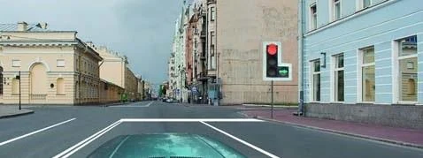
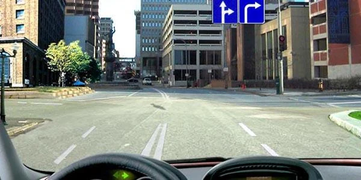
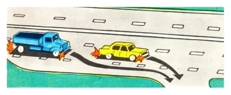
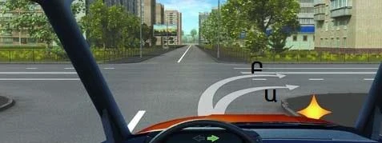
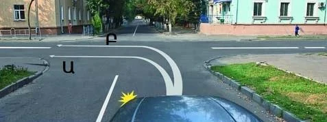
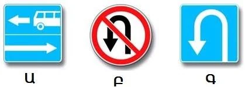
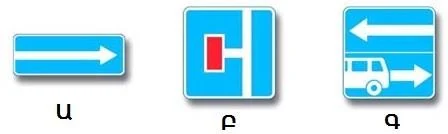
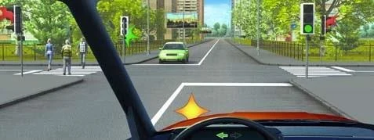
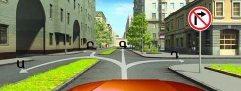
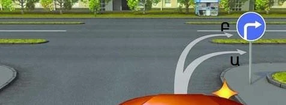

# Turning

A good turn starts well before the corner, in the right lane and at the right edge. This lesson covers where to position your car, what path to take, who to let through and which signs really stop you.

## Which lane do I turn from?

Point 40 says: move into the edge lane for your direction in advance. Turning right, use the right edge lane. Turning left or making a U-turn, use the left edge lane.

Waiting until the last moment means cutting across other lanes. So even a green arrow doesn't save you if you are in the wrong lane.

*The right lane is free, and you are in the left one. You may not turn right from here, despite the green arrow.*

The same rule applies on a one-way section, where the left lane also belongs to your direction. Move across first, then turn left.

**Exception:** a sign or marking can allow the turn from other lanes too. Where sign 5.15.2 "Directions of travel by lane" or the arrows on the road permit a right turn from your lane, you may stay there. You may also move to the right lane. Both are correct.

*Both lanes may turn right here, so you may turn from either.*

Three special lanes also affect turns:

- **Deceleration lane:** if there is one, move into it first, then slow down, and turn from it (point 47). This way you don't hold up traffic in the main lane.
- **Lane for route vehicles with a broken line:** if it runs along the right edge and is marked with a broken line, you must move into it to turn right (point 124).
- **Tram tracks on your left, at road level:** normally you turn left from the tracks without obstructing a tram (point 40). If sign 5.15.1 or 5.15.2 stands before the intersection, you turn from a lane instead.

*The blue truck does it correctly. The yellow car breaks the rule by turning from the main lane.*

## What path do I take?

Point 41 sets one rule for all turns: when you leave the intersection of carriageways, you must not end up on the side of oncoming traffic. Right turns have a second rule: stay as close as possible to the right edge.

**Turning right:** hug the kerb. A wide swing is prohibited.

*Ա (A) follows the right edge and is permitted. Բ (B) swings wide and isn't.*

**Turning left:** the Rules don't set a path inside the intersection. Only the finish matters. Any path that brings you out on your own side of the crossing road is allowed, into any of its lanes.

*Ա (A) cuts the corner and ends in the oncoming half. Բ (B) ends in your own half, so only Բ (B) is permitted.*

> **Remember:** Right turn: the path matters, so stay close to the edge. Left turn: the exit matters, so don't finish on the oncoming side.

**Turning into a one-way road:** there is no oncoming side, so any left-turn path that ends correctly is fine.

**Crossing a road with a dividing strip:** it has two carriageways. A right turn goes into the nearer carriageway. A path that crosses the strip brings you out on the carriageway for oncoming traffic, which is prohibited.

## Who do I let through?

When you turn at an intersection, you can meet three groups.

| Who | When | Point |
|---|---|---|
| Pedestrians crossing the road you are entering, and cyclists on a cycle path | Every turn, right or left | 87 |
| Oncoming vehicles going straight or turning right | Turning left on green | 90 |
| Trams, whatever direction they are going | When the signal lets trams and other vehicles move together | 92 |

Going straight on, you meet none of these turning duties.

On green, don't wait at the stop line. Enter the intersection, give way there, then finish your turn.

> **Common trap:** Oncoming right-turners count too. An option limiting the duty to oncoming traffic going straight is wrong.

Where a traffic light is working, the priority signs at the intersection don't decide the order. The manoeuvre does, so a bus turning left waits for oncoming traffic.

Outside an intersection, a left turn or U-turn means you give way to oncoming vehicles and to trams travelling in the same direction (point 44).

Extra: Keep your wheels straight while you wait

*Not from the question bank.*

While you wait to turn left, keep the front wheels pointing straight ahead until you can go. If a car hits you from behind, straight wheels push you forward along your own side. Wheels already turned could push you into oncoming traffic.

## Which signs stop a left turn?

Only some do. Warning signs warn, and information signs inform.

| Sign | Left turn? |
|---|---|
| 1.11.1 "Dangerous turn" and similar warning signs | Allowed: they only warn |
| 6.8.1 "Dead end" | Allowed: the road just has no through passage |
| 3.19 "No U-turn" | Allowed: it bans only the U-turn |
| 6.3.1 "Place for turning" | Prohibited |
| 5.7.1 "Exit to a road with one-way traffic", arrow pointing right | Prohibited: you would drive against the flow |

Sign 5.13.1 "Exit to a road with a lane for public-use transport vehicles" needs a closer look. The plain arrow shows the general traffic, and the arrow with the bus shows the bus lane.

*In the first sign the plain arrow points right, so general traffic flows right and a left turn into this road is prohibited. Place for turning (right) also prohibits a left turn. No U-turn (middle) doesn't.*

*Here the third sign's plain arrow points left, so a left turn is allowed. Dead end (middle) allows it too. The first sign, with its arrow to the right, doesn't.*

## Try it yourself

**You are turning left on green.** A car is coming towards you, and pedestrians are crossing the road on your left.

Who do you give way to? **Both.** Point 90 covers the car, and point 87 covers the pedestrians.

**You face this sign, and four paths are drawn.**

Which are allowed? **Ա (A) or Գ (C).** The sign rules out Դ (D), and Բ (B) ends on the oncoming carriageway of the divided road.

**Sign 4.1.2 "Movement to the right" stands here, and the crossing road has a dividing strip.**

Which path? **Only Ա (A).** It enters the nearer carriageway close to the right edge. Բ (B) crosses to the far carriageway, which is for oncoming traffic.

## Key points

- Move to the correct edge lane in advance, unless a sign or marking allows other lanes.
- Enter a deceleration lane first, then slow down.
- Right turn: stay close to the right edge. Left turn: don't finish on the oncoming side.
- Turning left on green: enter, then give way to oncoming vehicles going straight or right, and to trams.
- Every turn: give way to pedestrians crossing and cyclists on a cycle path.
- Warning and information signs don't ban turns. Sign 6.3.1 and a one-way arrow pointing right do stop a left turn.

{{practice}}
