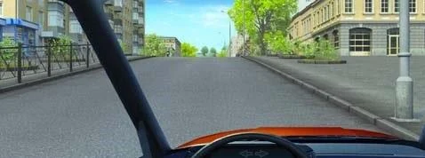
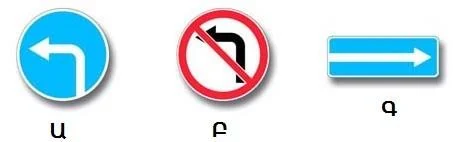
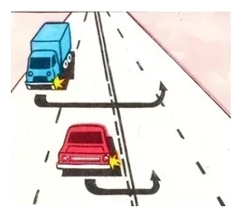
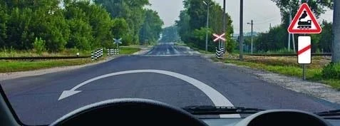
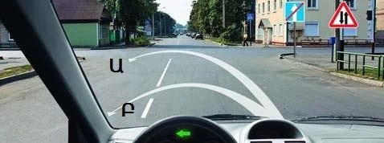
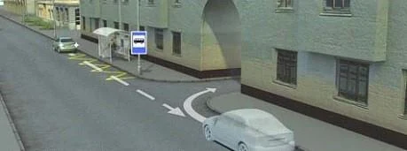

# U-turns and Reversing

Both manoeuvres put you against the flow of traffic, so the Rules list the places where you may not do them. Learn one short list and you can answer nearly every question here, because the same list covers U-turns and reversing.

## Where is a U-turn prohibited?

Point 50 lists these places:

- On pedestrian crossings.
- In tunnels.
- On and under bridges, overpasses and elevated roads.
- At railway crossings.
- Where visibility in even one direction is less than 100 m.
- At stopping points for public-use transport.
- On roads with one-way traffic.

These bans attach to the place, not to the traffic. It doesn't help that no bus is at the stop, or that you would obstruct nobody. On a bridge, good visibility doesn't help either: the 100 m test belongs to its own line of the list.

> **Common trap:** On a one-way road, the answer is "in no case". Neither visibility nor an empty road makes a U-turn lawful, because it would point you into the whole flow.

The one-way ban lasts until the one-way section ends. Signs 5.6 "End of one-way road" and 1.21 "Two-way traffic" tell you that it ends ahead, so where they stand you are still on a one-way road.

## When is a U-turn allowed?

A U-turn is allowed unless a sign, a marking or point 50 stops it. So at an ordinary intersection, or on a straight open road, you may turn.

**The visibility test:** where you can see at least 100 m in both directions, you may turn. A bend or a crest can take this away, so the right answer is often "permitted if visibility is 100 metres or more". Whether you can turn in one manoeuvre isn't a test the Rules apply.

*The crest limits how far you can see. Turn here only if you can see 100 m both ways.*

Warning signs prohibit nothing. A sign warning of bends, of a pedestrian crossing or of a railway crossing only tells you what lies ahead. The ban starts at the crossing itself, so a U-turn before it is allowed.

## Which signs and lines matter?

| Sign | U-turn? |
|---|---|
| 3.19 "No U-turn" | Prohibited. This is the sign that bans it. |
| 3.18.2 "No left turn" | Allowed: it bans only the left turn |
| 4.1.3 "Movement to the left" | Allowed: signs that permit a left turn also permit a U-turn |
| 5.7.1 "Exit to a road with one-way traffic" | Allowed: it bans nothing |
| 6.3.1 "Place for turning" | Allowed at that place. A plate reading 200 m tells you how far ahead it is. |
| 5.15.1 "Directions of travel by lanes" | Allowed only if the left edge lane has a left-turn arrow |
| 3.1 "No entry" on the road you would finish in | That path is prohibited. Choose one that doesn't enter that road. |

*All three signs allow a U-turn.*

**Sign 4.1.1 "Straight ahead only":** while it applies, you may only go straight on, so a U-turn on the stretch before the intersection is prohibited. Once you have passed straight through the intersection, the sign has ended and you may turn. The questions disagree about a U-turn at the intersection itself, so this lesson leaves that open. Learn those pictures from their practice answers.

**Lines:** a U-turn may cross a broken line. It may not cross a solid one.

## Where do I start the U-turn?

Start from the left edge lane (point 40). If you are in the wrong lane and a solid line keeps you from the left one, you can't make that U-turn lawfully at all.

*The red car has taken the lane beside the centre line, so it is correct. The blue truck turns across another lane.*

- **Same-direction tram tracks on your left, at road level:** turn from the tracks without obstructing a tram, unless signs 5.15.1, 5.15.2 or marking 1.18 say otherwise (point 40).
- **Road with a dividing strip:** go round the end of the strip and finish on the correct side. Don't end up on the side for oncoming traffic (point 41).
- **Pedestrian crossing nearby:** your path must not run across it.

Where nothing else limits you, the Rules set no specific U-turn path, so any path that leaves you correctly placed is allowed.

A traffic officer's signal may permit the U-turn, but it gives you no priority. If your paths cross and the Rules fix no order, give way to a vehicle approaching from your right (point 45).

## When may I reverse?

Only when it is safe and obstructs nobody (point 48). If you can't see behind you, ask someone to help. A horn or hazard lights only warn others. They don't show you what is behind.

Point 49 prohibits reversing:

- At intersections.
- When driving out onto a road from an adjacent area.
- At all the places in point 50: pedestrian crossings, tunnels, bridges, railway crossings, public transport stops and the rest.

> **Remember:** Where a U-turn is prohibited by point 50, reversing is prohibited too. "If it doesn't obstruct anyone" doesn't rescue it.

So you may not back up to a passenger on a bridge, in a tunnel or at a bus stop. On a clear stretch with none of these, you may. If you overshoot your turn at an intersection, don't reverse: carry on and turn round where it is allowed.

The ban depends on the place, not the lane. Reversing outside the right edge lane isn't prohibited by itself.

Reversing into a yard entrance to turn round is permitted if it obstructs nobody and isn't at one of the banned places.

Extra: Look before you get in

*Not from the question bank.*

Small children and low objects can be hidden behind a car, even with a reversing camera. Walk round the car before you reverse, reverse slowly, and keep looking through the rear window as well as at the mirrors.

## Try it yourself

**The arrow shows a U-turn before this railway crossing.**

Is it allowed? **Yes.** The ban covers the crossing itself, and you are not on it. No train condition applies.

**You want to make a U-turn past these two signs.**

Which path? **Neither.** You are still on the one-way road, so a U-turn is prohibited on both.

**You want to reverse into the yard on the right, and a bus stop with its marking is close by.**

Is it allowed? **No.** Reversing is prohibited at public transport stops, even if you obstruct nobody.

## Key points

- No U-turn on pedestrian crossings, in tunnels, on or under bridges, at railway crossings, at public transport stops or on one-way roads.
- No U-turn with under 100 m of visibility in even one direction.
- Only sign 3.19 bans U-turns by name. "No left turn" doesn't.
- Start from the left edge lane, and never cross a solid line.
- Reverse only when it is safe. If you can't see, get help.
- Reversing is prohibited at intersections, when driving out from an adjacent area and at all the point 50 places.

{{practice}}
