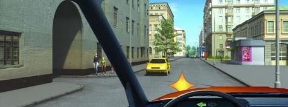

# Yards and Side Entrances

A yard gate or a filling station exit looks like a small intersection, but it isn't one and it gives you no rights. In both directions, the road users you cross go first.

## Who goes first when I come out?

They do. Point 38 says that when you drive out onto a road from an adjacent area, such as a yard or a filling station, you must:

- Give way to all vehicles travelling on the road.
- Not obstruct pedestrians.

*Coming out through these gates, you give way to drivers and pedestrians, on both sides.*

> **Common trap:** "Drivers approaching from the right" is an intersection rule. It doesn't apply here, because this isn't an intersection.

So if you are already on the road, you have priority over a truck leaving a filling station. It stays that way even if the truck's driver gives a hand signal.

## Who goes first when I go in?

Point 38 also covers entering an adjacent area from the road. Give way to cyclists whose path you cross, and don't obstruct pedestrians.

Turning left into a yard, you cross the oncoming side as well, so you must also give way to oncoming vehicles (point 44).

Sign 4.1.1 "Straight ahead only" doesn't prohibit turning right into a yard. You must still signal.

## Try it yourself

**You are turning right into a yard.** A cyclist is riding along on your right, and pedestrians are near the entrance.

Who do you give way to? **The cyclist and the pedestrians.** Both are on the path of your turn.

**You are turning left into the courtyard.** A yellow car is coming towards you, and two pedestrians stand by the entrance.

Who do you give way to? **The driver and the pedestrians.** Point 44 covers the car, and point 38 covers the pedestrians.

## Key points

- Coming out of a yard: give way to vehicles on the road, and don't obstruct pedestrians.
- Going in: give way to cyclists, and don't obstruct pedestrians.
- Turning left into a yard: give way to oncoming vehicles too.
- A yard exit isn't an intersection, so intersection rules don't help.

{{practice}}
