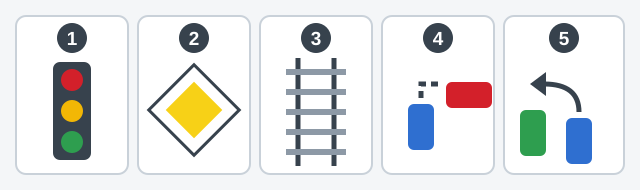
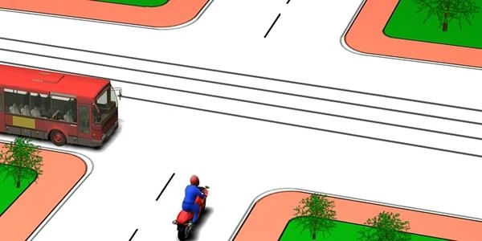
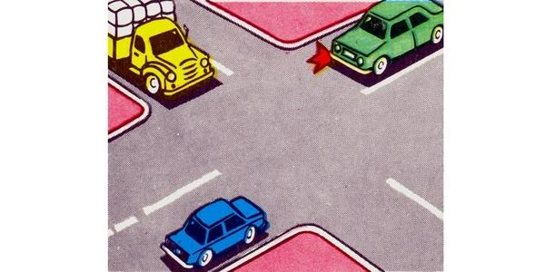
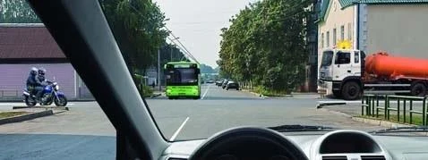
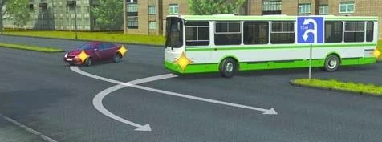
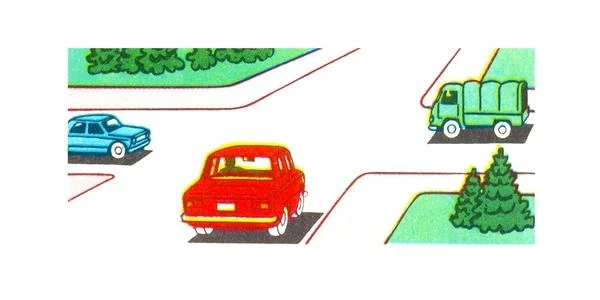
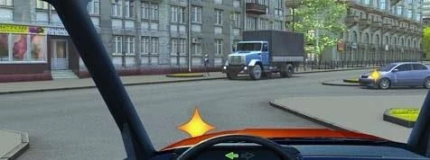
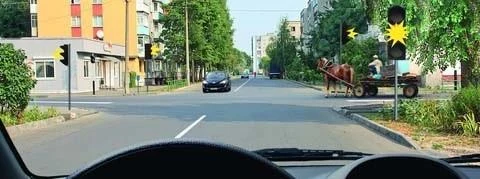

# Intersections: Equal Roads

Passing-order questions ask you to sort several vehicles into a queue, and at an intersection of equal
roads no sign gives you the answer. This lesson gives you a five-step method you can repeat on every
picture, then teaches the two steps that settle equal roads.

## What is the five-step method?

Five words, always in this order: **Light, Sign, Rail, Right, Left.**

*Tiles 1 to 5 are the five steps: Light, Sign, Rail, Right, Left.*

| Step | Ask | What follows |
|---|---|---|
| 1. Light | Does an officer or a working traffic light set the order? | Follow the signal. A light that is off or flashing yellow doesn't count, so go on. |
| 2. Sign | Do priority signs or road surfaces make one road main? | The secondary road waits for the main road. Run steps 3 to 5 inside each group. |
| 3. Rail | Is a tram on a road equal to yours? | The tram goes before non-rail vehicles. |
| 4. Right | Is a vehicle approaching from your right? | Give way to it. |
| 5. Left | Are you turning left or making a U-turn, with someone oncoming going straight or right? | Give way to them. |

Steps 3 to 5 add up, so you may owe the way to several vehicles at once. When you have run the steps,
**build the queue:**

1. Whoever waits for nobody goes first.
2. Cross them off and ask again.
3. Vehicles whose paths don't cross go together.

This lesson covers steps 1, 4 and 5. Trams at Intersections covers step 3. Main and Secondary Roads and
When the Main Road Turns cover step 2.

## When are roads equal?

An intersection is *regulated* when an officer or a traffic light sets the order (point 89). If neither
does, it is *unregulated*. A light that is off, or flashing yellow, leaves the intersection unregulated
(point 95). Flashing yellow permits you to move, so don't wait for a green.

An unregulated intersection with no priority signs is an intersection of equal roads. Sign 1.6
"Intersection of roads of equal importance" warns you that one is coming.

> **Common trap:** A "Dead end" sign beside the crossing road sets no priority. It only tells you the road
> has no way through, so a truck coming out of that road on your right still goes first.

## Who goes first? The vehicle on the right

Point 98 gives one test: at an intersection of equal roads, give way to vehicles approaching from your
right. The test ignores everything else:

- **Size:** A bus gives way to a motorcycle on its right.
- **Type:** A bicycle or a horse-drawn cart counts like any other vehicle.
- **Direction:** Your direction gives you no advantage. Going straight or turning left, you still give
  way to the right.

*The motorcycle is on the bus's right, so the bus gives way.*

The rule works in one direction only. A vehicle on your left has no advantage over you, whether you are
going straight, turning left or turning right.

## How do I read the pictures?

- **Sit in each driver's seat.** Pictures are often drawn at an angle. Ask what lies on that driver's right
  hand, not on the right of the page.
- **Look for the green arrow on the dashboard.** It shows the way you intend to go.
- **Look for yellow stars on a vehicle.** They are its lit indicators.

## What if I'm turning left?

Point 99 adds a second duty. When you turn left or make a U-turn, you give way to vehicles coming from the
opposite direction that are going straight or turning right. You cross their path, so you wait, either
before the intersection or inside it, and then finish your turn.

| When you turn left, who else is there? | What you do |
|---|---|
| Oncoming, going straight or turning right | Give way |
| Oncoming, also turning left | Neither gives way. You may both turn at once, passing left side to left side |
| On your right | Give way (step 4 still applies) |
| Only on your left | Go first |

The duty covers cyclists too. If a car turning left and an oncoming cyclist turning right are heading for
the same entrance, the car gives way.

Turning right is simpler. Your path doesn't cross an oncoming vehicle going straight, and an oncoming car
turning left into the same road must give way to you.

> **Common trap:** "You are turning left, so you always go last" is false. With only a car on your left,
> you go first.

## What if three or more arrive together?

Build the queue. Find the vehicle with nobody on its right, because it goes first. The vehicle that had
it on the right goes next, and so on round the intersection.

Two vehicles go together when their paths don't cross. That covers vehicles head-on to each other going
straight, and vehicles side by side in adjacent lanes.

*Blue and green face each other and go straight, so they go together. Blue is on yellow's right, so
yellow goes last.*

## What if everyone has someone on the right?

With a vehicle on all four roads, each driver has someone on the right, and the test goes round in a
circle. The Rules don't settle this case, so the drivers pass showing mutual respect.

> **Remember:** One free road breaks the circle. If nothing can approach from the right, as on a one-way
> crossing road, the queue has a start.

Extra: Never assume the other driver will give way

*Not from the question bank.*

Having priority doesn't stop the other car. Before you go, check that the driver who should wait is
actually slowing down. A moment of doubt costs you a few seconds, and that is cheap.

## What if paths cross away from an intersection?

Point 45 uses the same idea. Where paths cross and the Rules set no order, the driver who has a vehicle
approaching from the right gives way.

*Sign 6.3.1 "Place for turning" allows both to turn round here. The car is on the bus's right, so the bus
gives way.*

## Try it yourself

**You are the red car.** There are no signs. A green truck waits on the road to your right and a blue car
on the road to your left.

Who crosses last? **The blue car.** Light: none. Sign: none. Rail: no tram. Right: the truck has nobody on
its right, so it goes first. You have the truck on your right, so you go second. The blue car has you on
its right, so it goes last.

**You are turning left.** The arrow on the dashboard shows your turn. A truck comes towards you and a blue
car approaches from the right.

Who do you give way to? **Both.** Right: the car is on your right. Left: you are turning left across the
truck, which is coming straight towards you.

**The traffic light flashes yellow.** A dark car comes towards you and a horse-drawn cart approaches from the
right.

What do you do? **Cross, giving way to the cart.** Light: flashing yellow doesn't count, and no green is
coming. Sign: none. Right: the cart is a vehicle like any other, and it is on your right.

## Key points

- Five steps, in order: Light, Sign, Rail, Right, Left. Then build the queue.
- A light that is off or flashing yellow leaves the intersection unregulated.
- On equal roads, give way to the right. Size, type and direction don't matter.
- Turning left or making a U-turn, give way to oncoming vehicles going straight or right.
- Two oncoming drivers turning left may turn at once.
- Paths that don't cross go together.
- Four vehicles in a circle: the Rules don't settle it, so pass showing mutual respect.

{{practice}}
