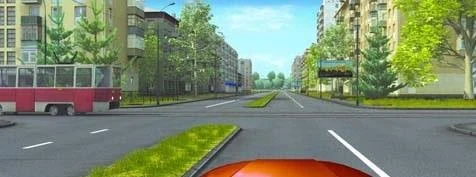
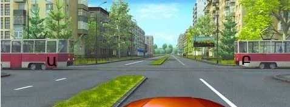
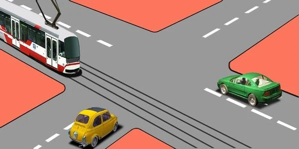
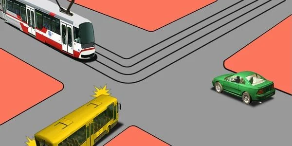
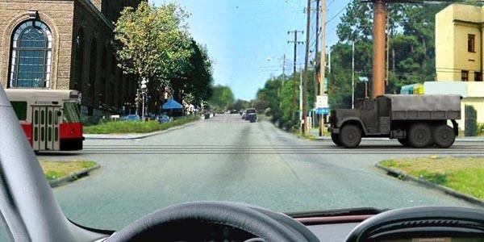
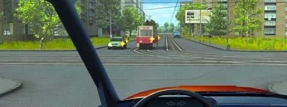

# Trams at Intersections

A tram is step 3 of the method, Rail, and it beats the right-hand rule. Learn where that priority applies
and where it ends, and these questions become some of the easiest at an intersection.

## Who goes first, the tram or me?

The tram. At an intersection of equal roads, a tram has priority over non-rail vehicles, whatever
direction it is going (point 98). Point 100 adds that this covers non-rail vehicles going the same way as
the tram or the opposite way.

So it doesn't matter where the tram comes from or where you are going:

| Where is the tram? | Do you give way? |
|---|---|
| Coming from your right | Yes |
| Coming from your left | Yes, although the right-hand rule wouldn't ask you to |
| Oncoming and turning left | Yes, although a left-turning vehicle would normally wait for you |
| Beside you, going your way, as you go straight or turn left | Yes |

*The tram comes from the left, and you still give way. On equal roads, the rails come first.*

Two trams at once? You give way to both. Each tram has priority over your car, wherever it comes from.

> **Common trap:** "We can go through at the same time as the tram" sounds fair when it runs beside you. It
> is wrong: you give way to it.

Extra: Why trams need the extra room

*Not from the question bank.*

A tram can't steer around you: it has to stay on its rails, and all it can do is brake. It is also heavy,
so it needs a long distance to stop, and its passengers may be standing. Don't cut in front of one.

## What happens after the tram?

The tram only settles Rail. Steps 4 and 5 still apply to everyone else, so non-rail drivers sort themselves
by the right-hand rule. If a tram is on your left and a truck on your right, you give way to both. Either
one alone isn't the full answer.

Paths that don't cross still go together. A tram and a car on the same road, going opposite ways and both
straight, pass at the same time.

*The tram and the green car go together. The yellow car gives way to the tram, and to the green car on its
right, so it goes last.*

If you are going straight, an oncoming car turning left isn't someone you wait for: it waits for you. If it
shares the road with an oncoming tram, you give way to the tram alone.

## Where does tram priority end?

Tram priority applies at intersections of equal roads. Step 2 comes before step 3, so a tram on a secondary
road gives way to vehicles on the main road, like any other vehicle.

> **Remember:** Sign first, then rail. Check for priority signs before you give a tram the way.

A trolleybus isn't a tram. It runs on wires, not rails, and has no special priority.

## Try it yourself

**A tram, a green car and a yellow bus reach an intersection with no signs.** The tram comes from the top
left, and the green car is on the bus's right.

What is the order? **Tram, car, bus.** Light and Sign: none. Rail: the tram goes first. Right: the car is
on the bus's right, so it goes second and the bus goes last.

**You want to turn left.** A tram approaches from your left and a truck from your right.

Who do you give way to? **All of them.** Rail: the tram has priority. Right: the truck is on your right.

**You are going straight.** An oncoming tram is indicating left. Beside it, an oncoming car is also
indicating left.

Who do you give way to? **Only the tram.** Rail: its priority covers its left turn. Left: the car turning
left has to give way to you.

## Key points

- On equal roads, a tram goes before non-rail vehicles, whatever its direction.
- It doesn't matter whether the tram comes from the right, the left, ahead or beside you.
- With two trams, give way to both.
- After the tram, the right-hand rule and the left-turn rule still sort everyone else.
- A tram and a vehicle on paths that don't cross go together.
- A tram on a secondary road gives way to the main road. A trolleybus has no tram priority.

{{practice}}
