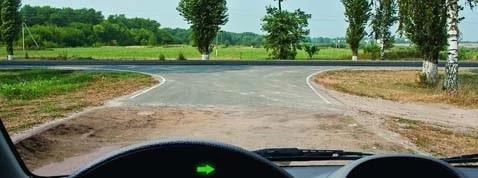
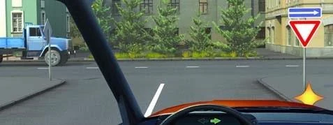
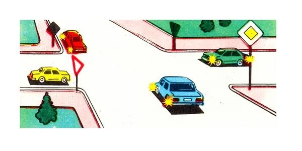
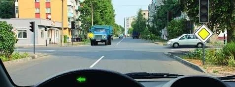
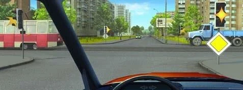

# Intersections: Main and Secondary Roads

Step 2 of the method, Sign, splits the traffic into two groups, and the whole order follows from that split.
Find the main road first, because it switches off the right-hand rule between the two groups.

## How do I know which road is main?

Three signs tell you, and step 1 hands over to them when the traffic light is off or flashing yellow.

| Sign | Name | What it means for you |
|---|---|---|
|  | 2.1 "Main road" | You are on the main road. |
|  | 2.4 "Give way" | You are on the secondary road. Give way to traffic on the crossing road. |
|  | 2.5 "Movement without stopping prohibited" | You are on the secondary road. Stop, then give way. |

Pictures show the signs other drivers see, too. A dark diamond is the back of sign 2.1, so that driver is
on the main road.

The road surface can also decide. A road with a hard surface, such as asphalt concrete or cement concrete,
is the main road in relation to an earth road (point 3). A short surfaced stretch just before the
intersection doesn't change that: the earth road stays secondary.

If you can't tell whether there is a surface, because of darkness, mud or snow, and there are no priority
signs, consider yourself on a secondary road (point 101). That is the safe guess.

## Who goes first?

Point 96: a driver on the secondary road gives way to vehicles on the main road, whatever direction they
then take. Going straight gives you no advantage over a main-road car that is turning.

The right-hand rule doesn't apply between the two groups, because it belongs to equal roads.

> **Common trap:** A truck comes out of an earth road on your right, and you are on the asphalt. You don't
> give way: it does. "It came from the right" only works on equal roads.

## How do I sort each group?

Run steps 3 to 5 inside each group, as if the group were on equal roads.

**On the main road,** the left-turn rule still applies. If you turn left or make a U-turn on the main road,
you give way to oncoming vehicles going straight or turning right. A secondary-road car on your right
gives way to you. Being on the main road doesn't excuse you from an oncoming vehicle.

**On the secondary road,** point 97 makes drivers treat each other by the rules for equal roads. Give way
to the right, and give way to oncoming traffic when you turn left. If you make a U-turn from a road with
sign 2.4, you give way to the main road and to the oncoming vehicle as well.

**Trams** follow the same split. A tram on the main road goes first. A tram on the secondary road gives way
to the main road, but still goes before a car on the secondary road.

## Does giving way mean stopping?

Not always. Giving way means not forcing the driver with priority to change speed or direction. Say you
are at sign 2.4, turning right onto a one-way road, and a truck is passing in its left lane. Your turn takes
you into the right-hand lane, so you may turn at the same time, if you don't obstruct it.

> **Remember:** "Only after the truck has passed" is stricter than the Rules. The test is whether you
> obstruct it.

## What if there is a white plate under the sign?

Plate 8.13 "Direction of the main road" means the main road bends at this intersection. Everyone on the
secondary road still waits for everyone on the main road. The next lesson shows how to read the plate.

## Try it yourself

**Four cars meet at the signs shown.** Red and blue are on the main road, and yellow and green see sign 2.4.
Red turns right, blue turns left, yellow goes straight and green turns left.

Who crosses third? **The yellow car.** Sign: red and blue go before yellow and green. Left: inside the
main group, blue turns left and waits for red, so red goes first and blue second. Left again: inside the
secondary group, green turns left and waits for yellow. Yellow is third and green is last.

**You are on the main road, turning left.** A truck comes towards you and a white car waits on the right.

Who do you give way to? **The truck only.** Sign: the white car is on a secondary road, so it waits for
you. Left: the truck is oncoming on your own main road, and you turn across it.

**You are going straight, and the light flashes yellow.** You see sign 2.1. A tram comes from the left and a
truck from the right.

Who goes first? **You.** Light: flashing yellow doesn't count. Sign: you are on the main road, so both give
way to you. The tram gets no priority here, because that belongs to equal roads.

## Key points

- Sign 2.1 puts you on the main road. Signs 2.4 and 2.5 put you on the secondary road.
- A hard surface is main over earth. A short surfaced stretch doesn't change that.
- Can't see the surface and no signs? Consider yourself on a secondary road.
- The secondary road waits for the main road, whatever direction anyone takes.
- The right-hand rule doesn't apply between main and secondary roads.
- Inside each group, use Rail, Right and Left.
- Giving way means not obstructing, so you may sometimes go at the same time.

{{practice}}
