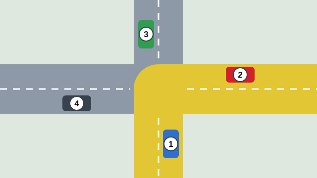
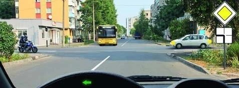
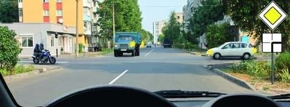
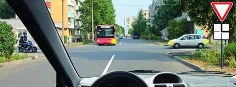
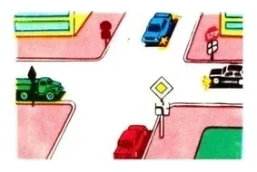

# When the Main Road Turns

These pictures look crowded, but each one is a sorting job you already know. Once you can read the plate,
you only need two groups and the three steps from the equal-roads lesson.

## How do I read plate 8.13?

Plate 8.13 "Direction of the main road" hangs under a priority sign. It draws the intersection from above,
with your road at the bottom.

- **Thick line:** the main road, here bending to the left.
- **Thin lines:** the secondary roads.

Sign 2.1 above the plate puts you on the thick line. Signs 2.4 and 2.5 put you on a thin line.

## How do I work out the order?

1. **Place everyone on the plate.** A vehicle ahead is at the top. A vehicle on your left is on the left arm,
   and a vehicle on your right is on the right arm.
2. **Make two groups.** Thick line and thin lines.
3. **Thick goes before thin**, whatever direction anyone takes (point 96).
4. **Inside each group, use equal-road rules** (point 97): Rail, Right, Left.

*All four cars go straight. Cars 1 and 2 are on the main road (yellow), and 3 and 4 are on secondary roads.
Car 2 is on the right of car 1, so 2 goes first and 1 second. Car 4 is on the right of car 3, so 4 goes
third and 3 last.*

## What if I'm on the main road?

Sign 2.1 is above the plate. Your duty depends on which way the thick line bends.

| The main road bends | Vehicle on your right | Vehicle on your left | Oncoming vehicle |
|---|---|---|---|
| To the right | On the main road: you give way | On a secondary road: it gives way | On a secondary road: it gives way |
| To the left | On a secondary road: it gives way | On the main road: it gives way, because you are on its right | On a secondary road: it gives way |

This holds whether you go straight, turn left or make a U-turn. Following the bend gives you no extra
priority, and leaving it costs you none. Only the right-hand test decides between two main-road vehicles.

*The main road bends left and you turn left. The motorcycle is on the main road too, but you are on its
right. The bus and the white car are on secondary roads. You give way to no one.*

> **Common trap:** The main road bends away, and you turn left or make a U-turn. The oncoming vehicle is now
> on a secondary road, so it gives way to you. Point 99 only covers oncoming vehicles on an equal road.

## What if I'm on the secondary road?

Sign 2.4 or 2.5 is above the plate. You give way to everyone on the thick line, wherever they are going.
That usually means two vehicles, so an answer naming only one is wrong.

A vehicle on the other thin line shares your group, so you and it use the right-hand rule:

- **It is on your right:** you give way to it too.
- **It is on your left:** it gives way to you.

If you can pass without obstructing the vehicle with priority, you may turn. The turn isn't banned: you
just have to give way first.

## Who else changes the order?

- **A tram on a thin line** goes after the thick line, like any other vehicle. Being a tram gives it no
  advantage over a main road.
- **A tram on the thick line with you** has priority over you, even from the left. A car on that same left
  side doesn't.
- **A tram among secondary-road vehicles** goes before the non-rail ones.
- **An ambulance with beacons and siren off** is an ordinary vehicle.
- **A trolleybus** is a non-rail vehicle with no special priority.
- **A cyclist** on the main road with you counts in the right-hand test like anyone else.

Flashing yellow changes nothing here: the intersection is unregulated, so the signs decide.

When no paths cross, nobody waits. A bus turning left and a car turning right along the main road can pass
together, along with a truck turning right from the secondary road.

## Try it yourself

**You are going straight, under sign 2.1 with a plate bending right.** A white car is on your right, a
truck comes towards you and a motorcycle is on your left.

Who do you give way to? **The white car.** Sign: you and the car are on the thick line, while the truck and
the motorcycle are on thin lines and wait for you. Right: the car is on your right.

**You are at sign 2.4, and the plate shows the main road coming from ahead and bending to your right.** A bus
is ahead, a white car on your right and a motorcycle on your left.

Who do you give way to? **The bus and the car.** Sign: both are on the thick line. Right: the motorcycle is
on a thin line like you, and you are on its right, so it gives way to you.

**Four vehicles meet.** Red and green are on the main road, and it bends here. Blue and black are on
secondary roads, with sign 2.5 beside the black car.

What is the order? **Red, green, blue, black.** Sign: red and green go first. Right: red is on green's
right, so red leads. Right again: blue is on black's right, so blue goes third and black last.

## Key points

- Thick line: main road. Thin lines: secondary roads. Your road is at the bottom of the plate.
- Sign 2.1 puts you on the thick line, and signs 2.4 and 2.5 put you on a thin line.
- Thick goes before thin, whatever direction anyone takes.
- Inside each group, use Rail, Right and Left.
- Main road bending right: give way to the vehicle on your right.
- Main road bending left: you give way to no one, unless a tram shares the main road with you.
- On a thin line: give way to everyone on the thick line, and to a vehicle on your right.
- A tram gets priority only against others in its own group.

{{practice}}
