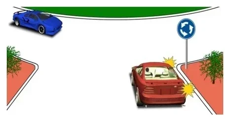
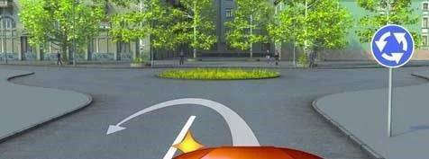
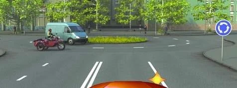
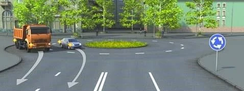
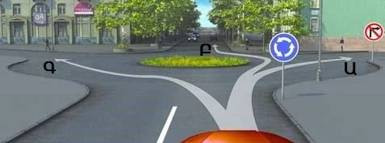

# Roundabouts

A roundabout turns the right-hand rule upside down, and that is what the exam tests. Learn who waits, which
way you go round and which lane you need, and these are quick marks.

## Who goes first?

Whoever is already on the circle. When you enter an intersection marked with sign 4.3 "Roundabout", you give
way to vehicles travelling in it (point 98.1). In the five-step method, the sign settles this at step 2.

*The red car is entering, so it gives way to the blue car on the circle.*

> **Common trap:** "The red car is on the blue car's right" is the wrong answer here. The right-hand rule
> doesn't apply at an intersection with sign 4.3.

## Which way do I go round?

Follow the arrows of sign 4.3, passing the island on your right. Don't cut across the front of the island,
even for a U-turn: you must go round it.

*This U-turn is prohibited: the path cuts across the front of the island.*

## Which lane do I use?

- **Entering:** any lane, whatever you plan to do next. Point 40 normally sends you to the edge lane before
  a turn, but it makes an exception for entering a roundabout.
- **Leaving:** the right edge lane. Leaving is a right turn like any other.

> **Remember:** Any lane in, edge lane out.

## Try it yourself

**You are entering past sign 4.3.** A light truck and a motorcycle with a sidecar are already on the circle.

Who do you give way to? **Both.** Everyone on the circle has priority over you.

**Two vehicles leave along the arrows.** The truck is in the edge lane. The car crosses its path from the
inner lane.

Who breaks the rules? **The car.** It left from a lane that isn't the edge lane.

**Sign 3.18.1 "No right turn" stands beside sign 4.3.** Paths Ա, Բ and Գ start in front of you.

Which may you take? **Only Բ.** Ա is the banned right turn, and Գ passes the island on the left.

## Key points

- At sign 4.3, the vehicle entering gives way to vehicles on the circle.
- The right-hand rule doesn't apply there.
- Go round the island in the direction of the arrows, keeping it on your right.
- Enter from any lane. Leave from the right edge lane.

{{practice}}
