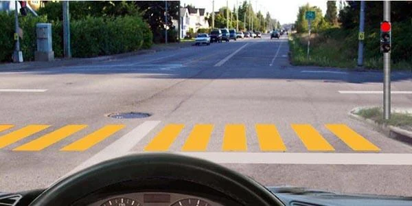
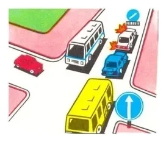
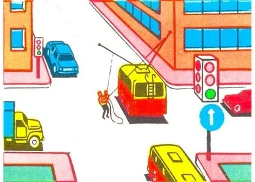
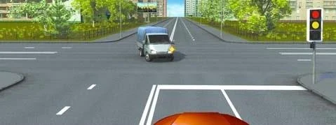

# Entering an Intersection

Before you work out who goes first, you must check whether you should enter at all. Even with a green
light, you need a clear way out on the far side.

## How fast should I approach?

Slowly enough to stop. Point 86.1 asks you to be particularly attentive, and to drive at a speed that lets
you stop and let through vehicles with priority. Staying under the limit isn't enough.

## What does the traffic light ask of me?

An intersection is regulated when a traffic light or an officer sets the order (point 89).

- **Prohibiting signal:** stop before marking 1.12 "Stop line" (point 18). Only without a stop line do you
  look to the crossing carriageway or the traffic light.
- **Green signal:** carry on without stopping, even if you can see a stop line. The line works only with
  a prohibiting signal.

Green doesn't clear the intersection for you. When it comes on, you give way to pedestrians and vehicles
still finishing their crossing (point 94).

## May I enter a blocked intersection?

No. Point 88 prohibits entering if a jam will force you to stop there and obstruct crossing traffic. That
applies:

- **Even on green:** a permitting signal doesn't override a blocked intersection.
- **To everyone:** a bus on an established route gets no exception.
- **Whatever is blocking the way:** a queue beyond the intersection, or a vehicle stranded in it.

If only the road straight ahead is blocked, you may still enter to turn or make a U-turn, because you leave
onto a clear road and block nobody.

*The queue would leave the yellow bus standing in the intersection, so it must wait.*

> **Remember:** Before you enter, ask where your vehicle will stop. If the answer is "inside the
> intersection", wait.

## Try it yourself

**You are driving the bus, and your light is green.** A trolleybus stands in the intersection with its poles
off the wires, and a workman is putting them back.

May you enter? **No.** You couldn't clear the intersection, and the green light and your route change
nothing.

**The light is about to turn green, and a light truck is still crossing.**

Who goes first when the green comes on? **The truck.** You give way to vehicles finishing their crossing.

## Key points

- Approach at a speed that lets you stop for vehicles with priority.
- Stop at the stop line on a prohibiting signal. On green, carry on.
- On green, still give way to those finishing their crossing.
- Never enter if a jam would stop you inside the intersection.
- That covers everyone, including buses on established routes.
- With the way straight ahead blocked, you may still enter to turn or make a U-turn.

{{practice}}
