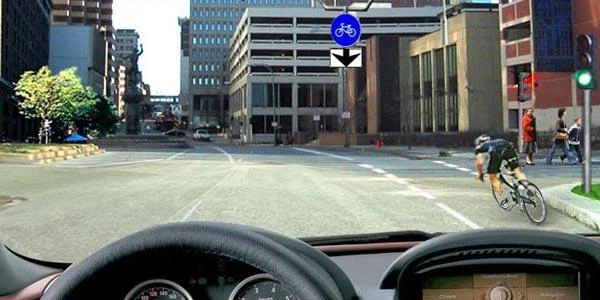
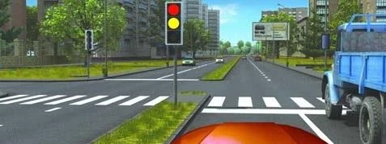
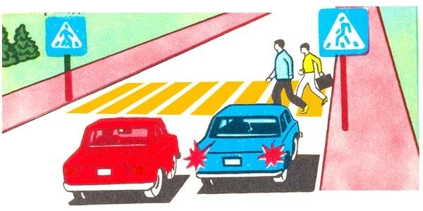
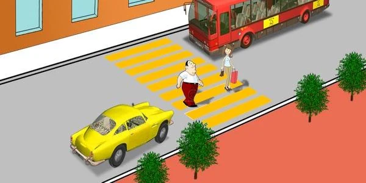

# Pedestrians and Crossings

A person on foot has no protection if you misjudge a crossing, so the Rules make you wait. The exam tests
three moments: you are turning, the light has just changed, or another vehicle has stopped at a crossing.

## Who do I give way to when I turn?

When you turn right or left and leave an intersection, point 87 makes you give way to pedestrians crossing
the carriageway **and** to cyclists on the cycle path. It applies to every turning driver, in both directions.

*Turning right here, you give way to the pedestrians and the cyclist, not to just one of them.*

> **Common trap:** "Stop before the stop line to keep clear of pedestrians" is wrong on a green. The green
> lets you enter, so go in and stop there if you need to, so you don't obstruct them.

## The light has turned green. Can I go at once?

Not until you have checked. Point 94 makes you give way to pedestrians who have not finished crossing.

*The truck hides part of the crossing. When the green comes on, make sure nobody is still crossing there.*

## What if another vehicle stops before a crossing?

At an unregulated pedestrian crossing, marked by signs 5.19.1 and 5.19.2 and zebra markings, you must give
way to pedestrians crossing (point 103). If a vehicle in an adjacent lane slows down or stops before the
crossing, it hides the crossing from you. Slow down, stop if necessary, and continue only after making sure
there are no pedestrians in front of it (point 104).

*The blue car has stopped and pedestrians are crossing, so the red car must not continue.*

> **Common trap:** You don't wait for the bus to move off. The condition is that no pedestrians are on the
> crossing, not what the bus does next.

## What about children getting on or off a vehicle?

Reduce speed when you approach a vehicle with a "Transport of children" sign while children are boarding
or alighting (point 156).

## Try it yourself

**You are driving the yellow car.** The bus has stopped and two pedestrians are on the crossing.

Who must stop? **You.** The bus has already stopped, so the duty now falls on the approaching car.

## Key points

- Turning right or left: give way to pedestrians and to cyclists on the cycle path.
- A new green doesn't end your duty to pedestrians still crossing, including ones you can't see.
- If a vehicle has stopped before an unregulated crossing, go on only once the crossing is clear.

{{practice}}
