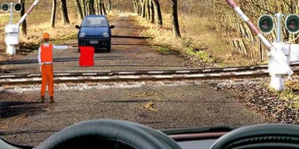
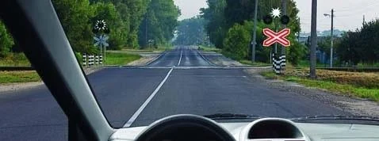
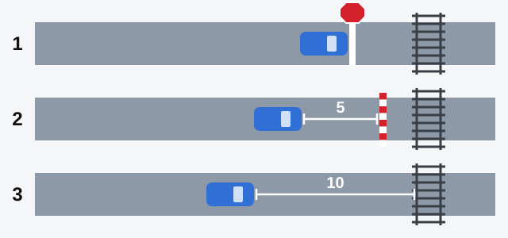
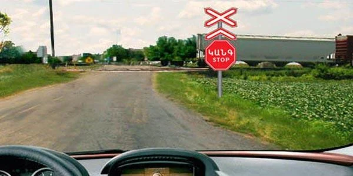
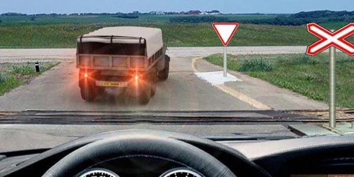

# Railway Crossings

A train can't steer around you, so a railway crossing leaves little room for your own judgement. The Rules
tell you where to cross, where to wait and when to stay out, and the exam checks those details closely.

## Where may I cross, and what do I watch?

You may cross railway tracks only at railway crossings, giving way to the train (point 109). You don't
choose your own spot, however convenient or clear it looks.

As you approach, point 110 tells you to follow all of these, and to make sure no train is coming:

- The instructions of the crossing attendant, the person in charge of the crossing.
- The traffic lights, signs and markings of the crossing.
- The position of the barrier.

## When must I stay out?

Point 113 prohibits entering a crossing in each of these cases:

| What you see | What it means |
|---|---|
| Barrier closed or closing | Stay out, whatever the traffic light shows |
| Traffic light showing a prohibiting signal | Stay out, whatever the barrier is doing |
| Attendant giving a prohibiting signal | Stay out, even if the barrier is open |
| Congestion beyond the crossing | Stay out if it would force you to stop on the crossing |

The attendant prohibits entry by standing with the chest or back towards you, by showing a baton, a red
lamp or a flag raised above the head, or by holding the arms out to the sides.

*The barrier is open, but the attendant has his back to you. You must not enter.*

> **Common trap:** "No train is coming" changes nothing in any of these cases. Nor does it help that the
> attendant is also stopping the car coming the other way: the same signal stops you.

### What does the white lamp mean?

A flashing round moon-white signal permits you to cross (point 15). If the moon-white and red signals are
both off, you may cross within the limits of visibility, provided no train is approaching.

*The white lamp is lit and no red signal is showing, so you may cross.*

## Where exactly do I stop?

Point 111 gives a chain. Work down it and use the first step that fits your crossing.

*1: at the stop line 1.12, sign 2.5 "Movement without stopping prohibited" or the traffic light. 2: if
there are none, no less than 5 m from the barrier. 3: if there is no barrier either, no less than 10 m from
the nearest rail.*

At step 1 you stop right at the line or sign, with no extra gap. The X-shaped sign that marks the crossing
fixes no stopping place, so don't stop at it if a sign 2.5 stands further on. This chain is for railway
crossings. For sign 2.5 at an intersection, see the lesson on priority signs.

> **Common trap:** 5 m is measured from the barrier and 10 m from the rail. "5 m from the nearest rail" is
> wrong, and so is stopping right at the barrier. The Rules give no 1.5 m, 2.5 m, 3 m or 7 m distance here.

## What else is forbidden?

- **Opening the barrier yourself or going around it.** There's no exception for an official assignment, for
  a crossing with no attendant present, or for your own view that no train is near.
- **Pulling into the oncoming lane** to pass the vehicles waiting before a crossing.
- **Moving agricultural, road, construction and other machines** across a crossing unless they are in
  transport condition, set up for travel rather than work. A barrier makes no difference to this.
- **Crossing without the permission of the head of the railway section** with slow-moving machines at a
  speed lower than 8 km/h, or with tractors coupled to rollers.

> **Did you know?** The Rules set no 30 km/h limit for crossing. The exam offers one as a wrong answer.

## What if I'm forced to stop on a crossing?

Point 112 tells you to stay by your vehicle and give the general alarm signal, which is **one long and
three short** sound signals, repeated. Think of it as a long beep, then beep-beep-beep. It's the same for
every driver, bus drivers included.

To stop a train, make a **circular movement of the hand**. In daytime, hold a bright-coloured cloth or any
clearly visible object. At night, use a torch or a lantern.

Extra: Your passengers come first on a blocked crossing

*Not from the question bank.*

If your vehicle is stuck on the tracks, get your passengers out and send them well away from the rails. A
vehicle can be replaced. People should not stand near it while a train may be coming.

## Try it yourself

**A red-and-white STOP sign stands before a multi-track crossing, and a train is passing.**

What do you do? **Stop before the sign, then cross when it is safe.** Sign 2.5 makes the stop compulsory.

**The truck ahead has stopped just past the rails.** No train is in sight.

May you cross? **No.** You would have to stop on the crossing, which point 113 prohibits.

## Key points

- Cross only at railway crossings, and follow the attendant, lights, signs, markings and barrier.
- Barrier closed or closing, a prohibiting light or attendant, or a queue past the rails: stay out.
- Stop at the line, sign or light. Otherwise 5 m from the barrier. Otherwise 10 m from the nearest rail.
- Never open or go around a barrier.
- Stuck on a crossing: stay by the vehicle and sound one long and three short.
- Stop a train with a circular movement of the hand.

{{practice}}
