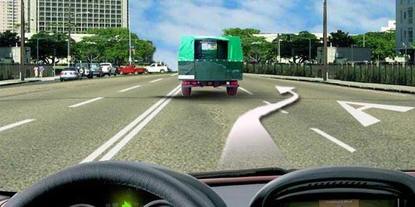
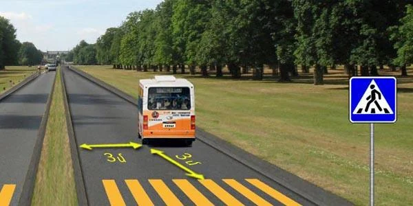
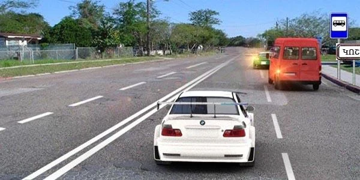
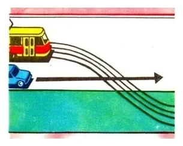
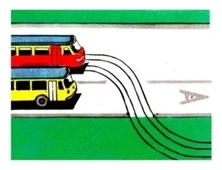
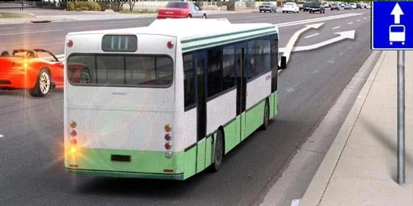

# Trams and Public Transport

Buses, trolleybuses and trams carry many people along fixed routes, so the Rules give them their own lanes,
their own stops and priority in a few exact places. The exam tests when you may enter their lane and who
goes first at a stop.

## What counts as a public-use vehicle?

Under Article 2 of the RA law, it is a tram, trolleybus or bus that carries passengers along a route with
stopping points. A stopping point is a place on the route for boarding and alighting, equipped with the
corresponding signs.

So a taxi is not a public-use vehicle, and neither is a tourist bus: it doesn't run on an established route
with fixed stops.

## How do I recognise their lane?

Three things mark it:

*Sign 5.14 "Lane for public-use transport vehicles" acts on a lane of the road you are on.*

*Sign 5.11.1: the left edge lane is for public-use vehicles running against the flow of traffic.*

The third is the large letter **A** painted on the lane, marking 1.23.

Only public-use vehicles may travel in this lane. That means trolleybuses and public-use buses, not every
bus. Point 124 prohibits the movement and stopping of other vehicles there.

## When may I enter that lane?

Look at the line that separates it from the rest of the carriageway.

| Line | Driving along the lane | Entering to turn off the road | Entering to set down or pick up passengers |
|---|---|---|---|
| Solid | No | No | No |
| Broken | No | Yes, giving way to public-use vehicles | Yes, at the right edge, without obstructing them |

*The line is broken, so you may follow the arrow to let passengers off. You may not do it to overtake the
truck.*

Sign 5.11.1 works the same way. If its lane is separated by a broken marking, you may cross it to turn off
the road, for example into a courtyard, giving way to the public-use vehicles.

> **Common trap:** Read the verb. A tourist bus may *enter* lane A over a broken line to turn or to let
> passengers off, but it may not *travel* along it.

## Where may a bus stop?

Public-use vehicles may stop only at their stopping points, except in a forced stop (point 85). A route bus
gets no right to halt wherever the driver chooses, even to pick up someone waiting.

*This is not a stopping point, so a bus on a scheduled route may not stop here for passengers.*

## Must I let a bus pull out?

Inside built-up areas, yes. Point 125 makes you give way to trolleybuses and buses starting off from
equipped and marked stopping points.

*The white car must give way, even though the bus is moving into its lane.*

The bus driver has a duty too: move off only after making sure you are giving way. An indicator is what
the driver must use. A sound signal isn't required.

> **Common trap:** This priority exists only in built-up areas. On a road with the blue town sign 5.25, the
> rules for built-up areas don't apply, so the bus leaving the stop must give way to you.

## Who goes first when a tram crosses the road?

Outside intersections, where tram tracks cross the carriageway, the tram has priority over non-rail
vehicles (point 123). The only exception is a tram leaving a depot. Going straight ahead gives you no
advantage.

*The tracks cross the car's path and the tram is not leaving a depot, so the car gives way.*

## Try it yourself

**You are driving the bus on an established route.** The tram tracks curve across the road ahead.

Must you give way? **Yes.** Being on a route gives a bus no priority over a tram here.

**The bus is moving left out of its lane, and the red car is moving right into it.**

Who goes first? **The bus.** A driver entering the lane must give way to public-use vehicles. Also, when two
vehicles change lanes at once, the one on the left gives way (point 39).

## Key points

- Public-use vehicles are route trams, trolleybuses and buses. Taxis and tourist buses aren't.
- Solid line: stay out of the lane. Broken line: enter only to turn or for passengers, never to travel.
- Public-use vehicles stop only at their stopping points, except in a forced stop.
- In built-up areas, give way to buses and trolleybuses leaving a marked stop.
- Outside built-up areas, that priority doesn't exist.
- Outside intersections, a tram crossing the road goes first, unless it is leaving a depot.

{{practice}}
