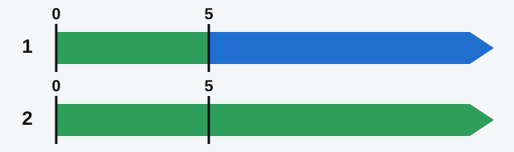
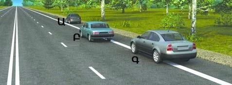
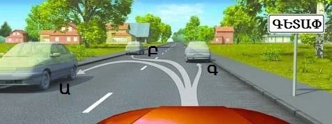
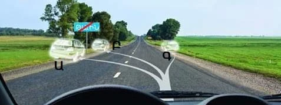
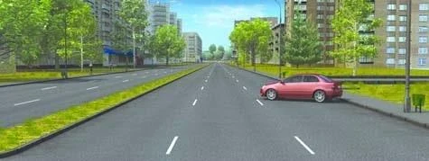
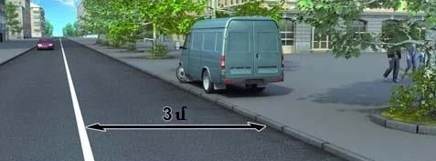
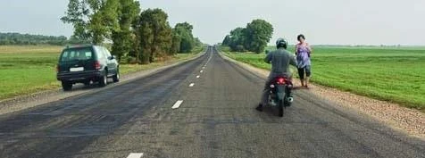

# Where to Stop and Park

Many questions here turn on one word: was that a stop, or was it parking? Learn the difference first, then
the side of the road and the way the vehicle must stand.

## Stopping or parking: which am I doing?

Both mean deliberately bringing your vehicle to a standstill. The RA law separates them by two things only:
time and purpose.

| | Stopping | Parking |
|---|---|---|
| **Time** | Up to 5 minutes | More than 5 minutes |
| **Passengers, loading** | As long as boarding, alighting, loading or unloading needs, even past 5 minutes | Not parking, however long it takes |

*Green is stopping and blue is parking, with time in minutes. Bar 1 is an ordinary halt. Bar 2 is a halt
for passengers, or for loading or unloading.*

Try it on real halts:

| You halt... | It is |
|---|---|
| For 3 minutes to check a map | Stopping |
| For 20 minutes to unload the van | Stopping |
| For 10 minutes to wait for a friend | Parking |

A halt to prevent a collision is not parking either, whatever its length.

> **Remember:** A ban on stopping also bans parking. A ban on parking doesn't ban stopping.

## Which side of the road?

Use the right-hand side (point 78). The place depends on what the road offers:

1. Next to the pavement, or on the shoulder.
2. Only if there is neither, at the edge of the carriageway.

If there is a shoulder, the whole vehicle goes on it. You may cross the edge line 1.2 to do this.

*Car Ա (A) stands fully on the shoulder, which is correct. Car Բ (B) is on the carriageway and Գ (C) is on
the line with its left side still on the carriageway. Both are wrong.*

## When may I use the left side?

Only in a built-up area, and only on one of these roads (point 79):

- A one-way road.
- A road with one lane in each direction and no tram tracks in the middle.

Trucks with a permissible maximum mass over 3.5 t may stop on the left only to load, unload, or set down and
pick up passengers. Buses have no such limit. Outside built-up areas, you can't use the left side at all,
so check the town sign.

*Black on white: built-up area rules apply on this road, so all three places are allowed.*

*Blue, crossed out, sign 5.26: built-up area rules don't apply, so only Գ (C) on the right-hand shoulder has
stopped correctly.*

> **Common trap:** Permission to use the left side doesn't cancel other rules. A car on the left of a
> one-way road is still wrong if it stands too close before a crossing or blocks a courtyard entrance.

## How must the vehicle stand?

Parallel to the edge of the carriageway, in a single row (point 80). There are two exceptions:

- A place, such as a local widening of the carriageway, where a marking permits another arrangement.
- Two-wheeled vehicles without a sidecar, which may stand two abreast.

*Angled, with no marking that allows it. Stopping like this is not permitted, for passenger cars too.*

## May I stand on the pavement?

No. Point 84 prohibits stopping on pavements, and that covers parking too. Only light passenger cars,
motorcycles, mopeds and bicycles may use the pavement edge, and only where sign 6.4 "Parking place" stands
with a plate showing that manner of parking (point 81). The lesson on stopping signs covers those plates.

*No sign 6.4 and no plate here, so this driver has broken the rules of stopping.*

## Where may I take a long rest?

Outside built-up areas, parking for a long rest, an overnight stay or the like is allowed only in places
specially provided for parking, or beyond the limits of the road (point 82).

> **Common trap:** The shoulder feels like a safe answer, but it isn't one. Neither is the right side of the
> carriageway.

Also outside built-up areas, you must not park on the carriageway of a road marked with sign 2.1 "Main road",
at any hour (point 86). A stop to pick up passengers is still fine.

## Where do big vehicles park in residential zones?

Buses other than minibuses, and trucks over 3.5 t, may park in residential zones and courtyards only in
places provided for it, with the corresponding signs and marking (points 121 and 122).

Extra: Before you open a door

*Not from the question bank.*

Check your mirror and look over your shoulder before you open a door on the traffic side. A cyclist or a
motorcycle may be passing close to you. Ask passengers to get out on the kerb side where they can.

## Try it yourself

**You are on an open road between fields.** A car stands on the left, and a motorcycle stands on the
carriageway beside a free shoulder.

Who broke the rules? **Both.** Outside a built-up area the left side is not allowed, and the motorcycle
should have pulled onto the shoulder.

## Key points

- Stopping: up to 5 minutes, or as long as passengers, loading or unloading need. Parking: anything longer.
- Stand on the right: next to the pavement or on the shoulder, and at the edge only if there is neither.
- Left side: built-up areas only, on one-way roads or roads with one lane each way and no central tram tracks.
- Stand parallel to the edge in a single row, and stay off the pavement unless sign 6.4 and a plate allow it.
- Long rest outside built-up areas: a provided place or beyond the road, not the shoulder.

{{practice}}
