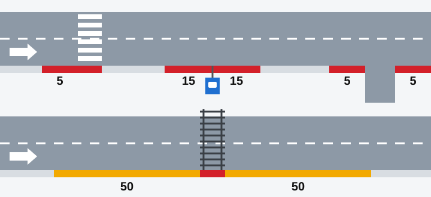
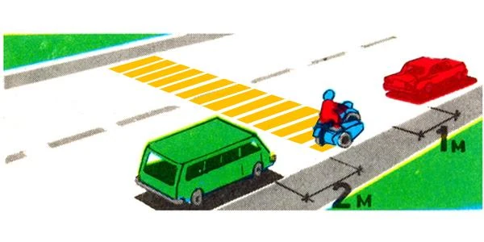
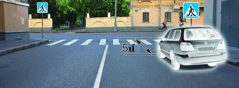
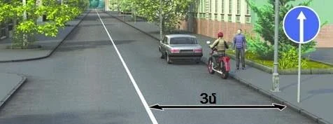
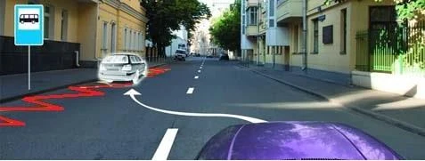
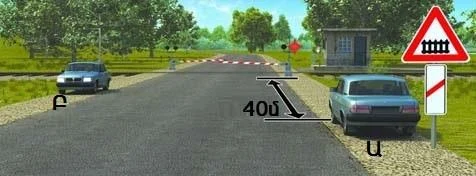

# Places You Must Not Stop

A vehicle standing in the wrong place blocks the view or the way for everyone else. This lesson puts every
place and distance into one table, because the exam asks for exact figures.

## How do the two lists fit together?

Point 84 lists where **stopping** is prohibited. Point 86 then says **parking** is prohibited in all those
places, and adds a few more of its own. So every place in the first list is closed to both.

The reason for your stop doesn't help. Picking up a passenger is still a stop.

## The table to learn

| Place | Stopping | Parking |
|---|---|---|
| Railway crossing | Prohibited on the crossing only | Prohibited on it and closer than **50 m**, on both sides |
| Pedestrian crossing | Prohibited on it and closer than **5 m** before it | Same as stopping |
| Intersection, including a roundabout | Prohibited in it and closer than **5 m** from the edge of the intersecting carriageway | Same as stopping |
| Stopping point of public-use vehicles | Prohibited within marking 1.17, or closer than **15 m** from the indicators if there is no marking | Same as stopping |
| Beside a solid line (not an edge line), a dividing strip or the opposite edge of the carriageway | Prohibited if less than **3 m** would remain | Same as stopping |
| Dangerous turn with visibility under **100 m** | Prohibited on the carriageway | Same as stopping |
| Tunnels; on and under bridges, flyovers, elevated roads and overpasses | Prohibited | Same as stopping |
| Pavements | Prohibited | Same as stopping, unless sign 6.4 and a plate allow it |
| Where you would make others' movement impossible, such as across an entrance | Prohibited | Same as stopping |
| Carriageway of a road with sign 2.1 "Main road", outside built-up areas | Allowed | Prohibited |

*Traffic runs left to right. Red means no stopping or parking, and amber means stopping is allowed but
parking isn't. Top road: a pedestrian crossing, a stopping point with no marking, and a side road. Bottom
road: a railway crossing.*

> **Remember:** The Rules say "closer than" and "less than". At exactly 5 m, 15 m or 3 m you are outside
> the ban.

> **Common trap:** Don't swap the numbers. 50 m near a railway crossing is for parking, never stopping.
> 15 m belongs to stopping points, and the 100 m before a crossing is about overtaking.

## Pedestrian crossings: before, not after

The 5 m applies only before the crossing, in your direction of travel. Just past it, stopping is allowed.

*The van is too close and the motorcycle is on the crossing. The red car is correct, because it is past it.*

Measure to the near edge of the crossing, the one you are approaching.

*The 5 m here reaches the far edge, so it includes the crossing itself. The real gap is under 5 m, so
stopping is prohibited.*

## The 3 m rule

This leaves room for others to pass. Measure from your **vehicle** to the line, not from the kerb.

*The whole strip is 3 m wide. With a vehicle standing in it, less than 3 m remains, so nobody may stop here.
A motorcycle is narrower, but it still leaves less than 3 m.*

A strip 4 m wide fails the same way once a car stands in it. Only a solid line counts, and not one marking
the edge of the carriageway. A broken line sets no such limit.

## Stopping points

This area is kept for route transport, so only the driver of a public-use vehicle may stop there.

*Sign 5.16 and the zigzag marking 1.17 show the stopping point. Stopping is prohibited along the marking.*

## Bends and bridges

The bend rule covers the carriageway only, and a dangerous-turn sign bans nothing by itself. So you may stand
clear of the carriageway at the edge of the road, even near the bend. In tunnels and on bridges, there's no
such way out.

Extra: Why a car before a crossing is a danger

*Not from the question bank.*

A car standing just before a crossing hides people who are about to step out, and it hides approaching
traffic from them. A child is the hardest to see. Past the crossing, the same car hides much less.

## Try it yourself

**Two cars stand on the approach to a railway crossing.** Car Ա (A) is 40 m away, and car Բ (B) is on the
other side of the road.

Did either break the rules of stopping? **No.** Stopping is banned only on the crossing itself. If they are
parked, though, **both** are in breach, because they are inside the 50 m zone.

## Key points

- Wherever stopping is prohibited, parking is too.
- Railway crossing: no stopping on it, and no parking on it or within 50 m on either side.
- Pedestrian crossing: nothing on it or closer than 5 m before it. Just past it is fine.
- Intersection: 5 m. Stopping point: marking 1.17, or 15 m from the indicators.
- Leave at least 3 m to a solid line, measured from your vehicle.
- No stopping in tunnels, or on or under bridges, even for a passenger.

{{practice}}
