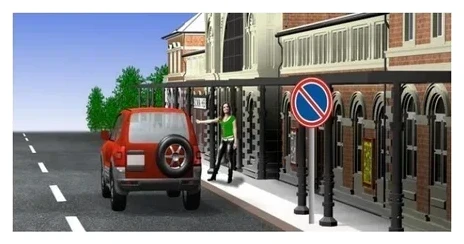
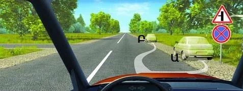
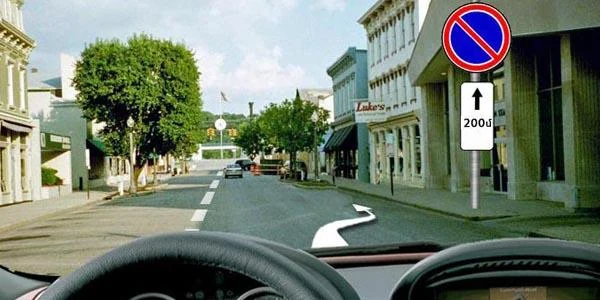
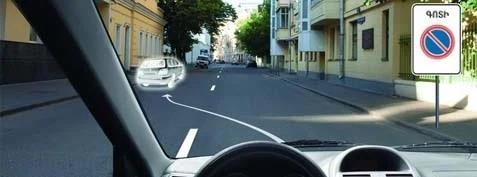
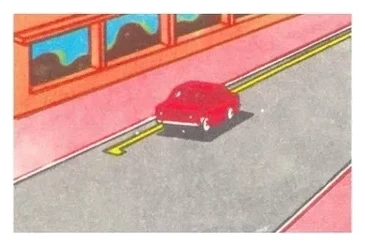
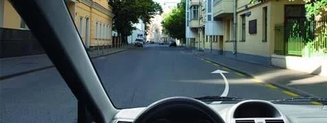
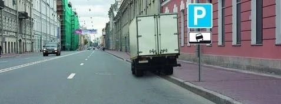
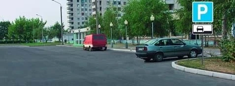
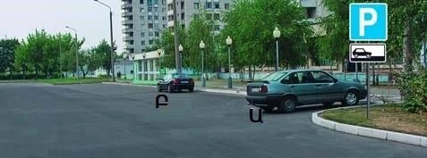
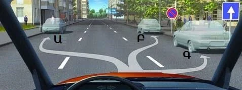

# Stopping Signs and Lines

Most stopping questions come down to reading a sign or a yellow line correctly. Learn what each one bans,
where its effect ends and who is exempt, and these questions become quick marks.

## How do I tell the signs apart?

Count the stripes across the disc.

*Sign 3.27 "No stopping": two crossing stripes. It bans stopping and parking.*

*Sign 3.28 "No parking": one stripe. It bans parking only.*

> **Remember:** Under sign 3.28 you may still stop. Picking up a passenger is stopping. So is unloading, for
> as long as the work takes.

> **Common trap:** The exam offers "permitted if it lasts up to 5 minutes" for unloading under sign 3.28.
> That limit is irrelevant, because a halt to unload is stopping however long it lasts.

*Stopping here is allowed. Sign 3.28 doesn't ban it, the 3 m rule counts solid lines and not broken ones,
and this is not an odd or even day sign.*

### Odd and even days

*Sign 3.29 "No parking on odd days of the month": one vertical bar.*

*Sign 3.30 "No parking on even days of the month": two vertical bars.*

Where the two signs are used together, on opposite sides of the street, vehicles move from one side to the
other between 19:00 and 21:00. So on an odd day, parking on the side with sign 3.29 is prohibited during
the day and becomes possible after 19:00.

## Where does a sign start and end?

Signs 3.27 to 3.30 work like this, unless a plate or a marking says otherwise:

- **They start at the sign.** A place before the sign is not covered.
- **They cover only the side of the road where they stand.**
- **They end at the nearest intersection after the sign.** A secondary road joining yours counts.
- **In a built-up area with no intersection,** they end at the end of the built-up area.

*The triangular sign above announces a side road ahead. Ա (A) is inside the zone. Բ (B) is past the side
road, so it may stop there.*

### Plates that change the zone

| Plate | What it tells you |
|---|---|
| 8.2.2, an up arrow and a distance | The zone runs that far ahead of the sign |
| 8.2.3, one down arrow | The zone ends here, so the ban is behind you |
| 8.2.4, two arrows | You are inside the zone, so the ban runs both before and after the sign |

*Plate 8.2.3: past this sign you are free of it. Before it, you are still in the zone.*

*Plate 8.2.4: no stopping on either side of the sign.*

*A plate 8.2.2 of 200 m under sign 3.28. You may still stop here to pick up passengers.*

> **Common trap:** Sign 3.27 with a down arrow looks like a ban starting. It is the opposite. Parking is
> allowed past the sign, and the ban covers the road before it.

Sign 3.27 used with the solid yellow marking 1.4 has a simpler rule: the ban runs only as far as the
marking does.

### Parking zones

*Sign 5.27 "Zone with parking restriction" starts an area of restricted parking.*

*Sign 5.28 "End of the zone with parking restriction". The next intersection doesn't end the zone: only
this sign does.*

## Who is exempt?

**Signs 3.28 to 3.30** don't apply to:

- Vehicles driven by, or carrying, disabled persons of groups I and II.
- Taxis with the meter switched on.
- Postal special-communication vehicles with the prescribed colour scheme.

Public-use vehicles are not on this list.

**Sign 3.27** has none of these exemptions. With no plate under it, it binds everyone. A plate can change that:

*Plate 8.18 "Except for disabled persons": the sign doesn't apply to cars carrying the "Disabled person"
identification sign. The plate looks for the sign on the car.*

*Plate 8.4.1 "Type of vehicle": sign 3.28 with this plate applies only to trucks over 3.5 t. A car and a
motorcycle may park there, but a 4 t truck may not.*

## What do the yellow lines mean?

| Line | Where you see it | What it bans | Used with |
|---|---|---|---|
| Solid yellow, marking 1.4 | Along the edge of the carriageway or on the top of the kerb | Stopping and parking | On its own, or with sign 3.27 |
| Broken yellow, marking 1.10 | Along the edge of the carriageway | Parking only | On its own, or with sign 3.28 |

Think of it as a pair: a solid line matches two stripes, and a broken line matches one.

*No sign is needed. The solid yellow line alone bans stopping here.*

*Broken yellow: stopping is allowed for every vehicle.*

> **Common trap:** You can't escape a solid yellow line by mounting the pavement. Stopping on the pavement
> is prohibited too, and motorcycles get no exception.

## How does a parking place sign work?

*Sign 6.4 "Parking place". A plate under it shows how to stand, and you must stand that way (point 80).*

| Plate | How you stand | Who may |
|---|---|---|
| 8.6.1 | On the carriageway, along the kerb | All vehicles |
| 8.6.2 to 8.6.9 | Using the pavement edge | Light passenger cars and motorcycles |

*Plate 8.6.1.*

*Plate 8.6.2.*

Point 81 allows the pavement edge only to light passenger cars, motorcycles, mopeds and bicycles.

> **Common trap:** The exam offers "yes, if the permissible maximum mass exceeds 3.5 tonnes". The ban depends
> on the type of vehicle, not its mass. A truck under 3.5 t may not park on the pavement edge either.

*The plate allows this manner to cars and motorcycles only, so the truck driver is in breach.*

## Try it yourself

**The same street, two different plates.** First, plate 8.6.1.

Who broke the rules? **The passenger-car driver.** The plate puts vehicles on the carriageway, along the
edge. The van stands that way and the car doesn't.

Now the plate shows a car on the pavement edge.

Who broke the rules? **Բ (B).** Ա (A) stands as the plate shows, and Բ (B) doesn't.

**You are on a one-way road, and sign 3.28 stands on the right.**

Where may you park? **Ա (A) or Գ (C).** Ա (A) is on the left, where the sign doesn't reach, and one-way roads
allow the left side. Գ (C) is before the sign. Բ (B) is past it, on the same side.

## Key points

- Sign 3.27 and solid yellow 1.4 ban stopping and parking. Sign 3.28 and broken yellow 1.10 ban parking only.
- Signs 3.27 to 3.30 run from the sign to the nearest intersection, on their own side of the road only.
- Down arrow: the zone ends here. Two arrows: you are inside it. Up arrow and distance: its length ahead.
- Disabled drivers and taxis with the meter on are exempt from signs 3.28 to 3.30. Nobody is exempt from
  3.27 unless a plate says so.
- Sign 6.4 with plate 8.6.1 is for all vehicles. Parking on the pavement edge is never for trucks.

{{practice}}
