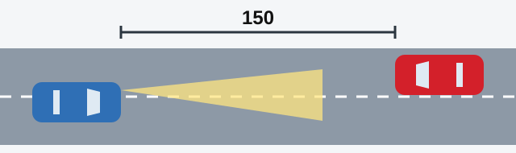
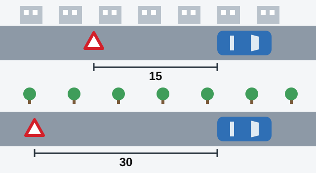

# Using Your Lights

Lights do two jobs: they help you see, and they tell others you are there and what is happening. The exam
tests which light belongs to which situation, so this lesson goes through them one situation at a time.

The Traffic Rules speak of dipped headlights and main-beam headlights. The practice questions call them
the "low beam" and the "high beam". They mean the same thing.

## Which lights do I need in the dark?

In the dark, and whenever visibility is insufficient, every moving mechanical vehicle must have **main beam
or dipped headlights** on (point 127). This applies however well the road is lit, and in tunnels too. A bus
on an established route is no exception.

> **Common trap:** Answers saying "only the low beam" or "only the high beam" are wrong. The Rules ask for
> one or the other and leave the choice to you.

## When must I dip my lights?

Main beam reaches far, and it blinds anyone who looks into it. Point 128 tells you when to switch to dipped
headlights:

- On a lit road in a built-up area.
- **Not less than 150 m from an oncoming vehicle**, or further if its driver flashes the lights at you.
- Anywhere else main beam could dazzle another driver.

*Dip your lights while the oncoming vehicle is still at least 150 m away.*

## What if I am dazzled?

Your first move is the **hazard warning lights** (point 129). Then, without changing lane, slow down and
stop if you need to. The hazard lights warn the drivers behind that you are slowing.

> **Common trap:** "Switch to low beam" is the wrong first step here. You dip your lights *before* you meet
> an oncoming vehicle. A sound signal isn't the answer either.

Extra: Where to look when headlights blind you

*Not from the question bank.*

Don't stare at the bright lights. Look towards the right-hand edge of the road and use it to hold your
position. After the glare passes, your eyes need a few seconds to recover, so don't speed up straight away.

## Which vehicles use dipped headlights by day?

Point 133 requires dipped headlights in daylight so that a moving vehicle stands out:

- **Motorcycles and mopeds:** always, while in traffic, with no conditions.
- **Public transport vehicles** in a specially designated lane against the main flow.
- **Vehicles carrying organized groups of children.**
- **The towing vehicle** when towing.

> **Remember:** By day, a children's bus uses dipped headlights. Main beam would dazzle other drivers, and the
> hazard lights and interior lights are not what the Rules ask for.

## When may I use fog lamps and spotlights?

**Rear fog lamps** may be used only in insufficient visibility (point 131). Being in a convoy, in a tunnel or
unloading is not a reason to switch them on.

**Spotlights and search lamps** may be used only outside built-up areas, when there are no oncoming or
same-direction vehicles (point 134). Inside built-up areas, only drivers of vehicles with blue, or blue and
red, flashing beacons and a special sound signal may use them, on an official assignment. Darkness or poor
visibility alone doesn't allow it, and neither does your own sense that you need one.

## When must hazard lights be on?

Point 22 lists four cases:

| Situation | Who switches them on |
|---|---|
| Road traffic accident | The vehicle involved |
| Forced stop where stopping is prohibited | The stopped vehicle |
| Dazzled by headlights | The dazzled driver |
| Towing | The towed mechanical vehicle |

Entering a tunnel or driving in an organized motorcade is not on the list.

> **Common trap:** Many questions end with "in both cases" or "in all the listed cases". If each option is
> one of these four situations, that last answer is the right one.

## Where does the "Emergency stop" sign go?

The sign must warn approaching drivers in time (point 23). A flashing red lamp can do the same job.

*Place the sign not less than 15 m from the vehicle in a built-up area, and 30 m from it outside built-up
areas.*

There is one special case. If the hazard lights are missing or faulty during towing, the sign goes **at the
rear of the towed vehicle** (point 24), where drivers coming up from behind can see it.

Extra: Staying safe while you place the sign

*Not from the question bank.*

Get everyone out on the side away from traffic and away from the vehicle. Carry the sign in front of you,
facing the oncoming drivers, and stay close to the edge of the road. A reflective vest makes you much easier
to see at night.

## Try it yourself

**You are driving at night on an unlit road with main beam on.** A car appears ahead, coming towards you.

When must you dip? **Not less than 150 m away.** If its driver flashes the lights, dip sooner.

**The car then passes you with its main beam on, and you can't see.** What comes first? **Hazard warning
lights.** Then stay in your lane, slow down, and stop if you need to.

## Key points

- In the dark or in insufficient visibility: main beam or dipped headlights, however well the road is lit.
- Dip at not less than 150 m from an oncoming vehicle.
- Dazzled: hazard lights first, stay in lane, slow down, and stop if needed.
- By day, motorcycles and mopeds always use dipped headlights, as do children's buses and public transport
  in a contraflow lane.
- Rear fog lamps: only in insufficient visibility.
- Hazard lights: accident, forced stop where stopping is prohibited, dazzle, towed vehicle.
- "Emergency stop" sign: not less than 15 m in a built-up area, 30 m outside.

{{practice}}
