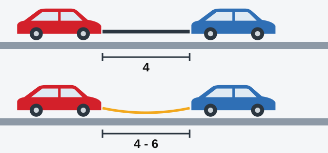
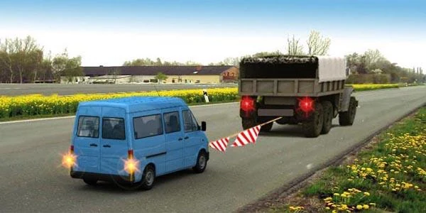

# Towing

A towed vehicle has no engine helping its brakes or steering, so two vehicles now depend on one link. The
exam tests four things: how far apart the vehicles stay, who may ride, when towing is banned, and which
lights to use.

## What are the three ways to tow?

- **Rigid coupling:** a solid bar. It fixes both the distance and the direction between the vehicles.
- **Flexible coupling:** a rope or cable. It only pulls.
- **Partial loading:** the towed vehicle rests partly on the towing vehicle.

## How far apart must the vehicles be?

Point 140 sets the distance for the two couplings.

*Rigid coupling (top): not more than 4 m. Flexible coupling (bottom): 4 to 6 m.*

Too short, and the vehicles can collide. Too long, and the towed vehicle struggles to follow the same line.

> **Remember:** Both couplings meet at 4 m. Rigid stops there. Flexible starts there and goes up to 6 m.

## Who may ride?

Ask two questions: which method is being used, and is the person in the towed or the towing vehicle? All of
this is point 139.

| Method | Place | People allowed? |
|---|---|---|
| Rigid or flexible | Towed bus or trolleybus | No |
| Rigid or flexible | Body of a towed truck | No |
| Rigid or flexible | Cabin of a towed truck | Yes |
| Rigid or flexible | Towed passenger car | Yes |
| Rigid or flexible | Towing bus | Yes |
| Rigid or flexible | Body of a towing truck | Yes |
| Partial loading | Cabin or body of the towed vehicle | No |
| Partial loading | Body of the towing vehicle | No |
| Partial loading | Cabin of the towing vehicle | Yes |

The ban on a towed bus has no exceptions. The type of coupling doesn't change it, and neither does the number
of seats or passengers. A towed vehicle must also have a driver at the wheel (point 138).

*This minibus is being towed, so nobody may ride in its saloon, whatever the number of seats.*

> **Common trap:** The figure of 8 passengers has nothing to do with towing. It belongs to carrying people in
> a truck. Also, don't confuse the two buses: the *towed* bus carries nobody, but the *towing* bus may carry
> passengers.

## When is towing banned?

**On ice,** a flexible coupling is prohibited (point 143). A rope can't hold the towed vehicle on line or keep
the two braking together on a slippery surface. A rigid coupling and partial loading stay allowed, and the
same goes for a towed bus.

**With motorcycles,** the question is the side car. A motorcycle without a side car may not tow and may not be
towed. A motorcycle with a side car may do both, and the Rules attach no coupling requirement to it.

> **Common trap:** "Towing on ice is prohibited" is too broad, and "Towing on ice is permitted" is too. Only
> the flexible coupling is banned.

## Which lights are used?

- **Towed vehicle:** hazard warning lights (point 22). Main beam and dipped headlights are not the answer here.
- **Towing vehicle:** dipped headlights by day (point 133).
- **Hazard lights missing or faulty:** put the "Emergency stop" sign at the rear of the towed vehicle (point
  24). This position is fixed, not left to the driver, because that's where drivers coming from behind see
  it.

The speed limit for towing a mechanical vehicle is in the Speed lesson.

Extra: Towing smoothly

*Not from the question bank.*

Before you move, agree how the two drivers will signal each other. Start very gently to take up the slack,
and brake early and softly so the towed vehicle doesn't run up behind you. If the towed vehicle's engine is
off, its driver will need much more force on the brake pedal and the steering wheel.

## Try it yourself

**You are towing a bus on a rope, and the road ahead is icy.** May you carry on? **No.** A flexible coupling
is prohibited on ice. With a rigid coupling you could, but there still couldn't be any passengers in the
towed bus.

**You are towing a truck by partial loading, and a friend wants a lift.** Where may your friend sit? **Only
in the cabin of the towing vehicle.** Partial loading rules out everywhere else, including the towing
vehicle's body.

## Key points

- Rigid coupling: not more than 4 m. Flexible coupling: 4 to 6 m.
- Nobody rides in a towed bus or trolleybus, or in the body of a towed truck.
- A towed passenger car and the cabin of a towed truck may carry people on a rigid or flexible coupling.
- Partial loading: people ride only in the cabin of the towing vehicle.
- On ice, a flexible coupling is prohibited. Rigid and partial loading are allowed.
- Motorcycles without a side car may neither tow nor be towed.
- The towed vehicle shows hazard lights. If they fail, the "Emergency stop" sign goes on its rear.

{{practice}}
