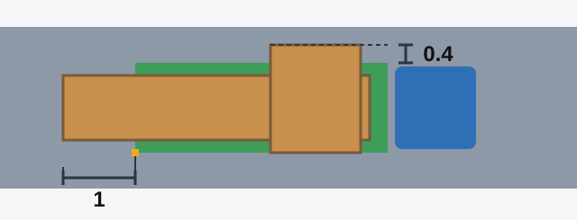

# Carrying People and Loads

What you carry changes how your vehicle behaves and what other drivers can see. The exam checks who may
travel where, and exact numbers for loads that stick out.

## Where may people travel?

**In a cargo trailer: nowhere.** Point 158 prohibits it outright. There is no exception, not even for someone
accompanying the load.

**In the body of a truck not equipped for people:** only someone accompanying the load or travelling to
receive it, and only on a seat placed below the level of the sides (point 154). Point 153 fixes those seats
at least 0.3 m below the top edge of the side and 0.3 to 0.5 m above the floor.

**In a truck that follows the rules for carrying people:** a driver with categories B and C may carry up to
**8 passengers**. More than that also requires category D or DE, or sub-category D1 or D1E (point 150).

**In a bus:** on intercity and tourist routes, and when carrying organized groups of children, the number of
people must not exceed the number of seats (point 152).

> **Common trap:** The exception in the truck body doesn't reach the trailer. Someone accompanying a load may
> ride in a flat-sided truck, but never in a cargo trailer. It also has nothing to do with the type of road.

## What about children?

Children under 12 must not be carried (point 159):

- On the rear seat of a motorcycle.
- In the body of a truck with a sided body. A van-bodied truck is the exception.

An organized group of children in a bus needs at least **one adult escort** in the cabin (point 155). The
bus also uses dipped headlights by day. The Safe Driving lesson covers children in the front seat of a car.

## What must a load never do?

Distribute a load and secure it if needed. Point 164 prohibits carrying a load that:

- Restricts your field of vision.
- Makes the vehicle harder to handle or reduces its stability.
- Covers lights, reflectors, number plates or identification signs, or makes hand signals hard to see.
- Makes considerable noise, raises dust, or soils the road and the environment.

> **Remember:** If the load can't be carried this way, you must fix the problem or stop driving (point 165).
> Taking it "just to the nearest unloading place" is not allowed.

Extra: Packing a load so it stays put

*Not from the question bank.*

Put the heaviest items low and near the centre of the vehicle. Fasten everything so that it can't slide,
because hard braking throws a loose load forward with great force. Stop after a short distance and check the
straps again, since loads settle.

## When must a load be marked?

Point 162 has two thresholds, and the load must go **over** them to need marking.

*More than 1 m beyond the front or rear of the vehicle, or more than 0.4 m to the side beyond the outer edge
of the side marker light.*

Over either threshold, mark the load with:

- **By day:** the "Oversized load" identification sign.
- **In the dark and in insufficient visibility:** the sign, plus white lamps in front and red lamps or
  reflectors at the rear.

| Load sticks out | Threshold | Mark it? |
|---|---|---|
| 1.2 m at the rear | 1 m | Yes |
| 0.6 m at the rear | 1 m | No |
| 0.5 m to the side | 0.4 m | Yes |
| 0.3 m to the side | 0.4 m | No |

> **Common trap:** The Rules set no limit of 0.8 m at the rear, and no ban on a load rising above the sides of
> the platform. Don't apply the side figure of 0.4 m to the rear, or the rear figure of 1 m to the side.

## Try it yourself

**You are carrying pipes that stick out 1.2 m behind your truck.** It is getting dark. What do you need? **The
"Oversized load" sign, plus white lamps in front and red lamps or reflectors at the rear.** 1.2 m is over the
1 m threshold.

**You are halfway to the depot when the load shifts and covers your rear lights.** What now? **Fix it or stop
driving.** You can't carry on, even for a short distance.

## Key points

- Nobody rides in a cargo trailer.
- Truck body not equipped for people: only people with the load, on seats below the level of the sides.
- Categories B and C: up to 8 passengers in a truck.
- Children under 12: not on a motorcycle's rear seat or in a sided truck body.
- Organized group of children in a bus: at least one adult escort.
- Mark a load over 1 m at the front or rear, or over 0.4 m at the side.
- If a load breaks the rules, fix it or stop.

{{practice}}
