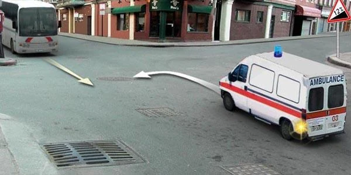
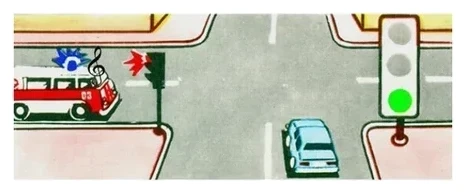
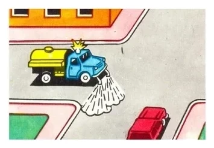
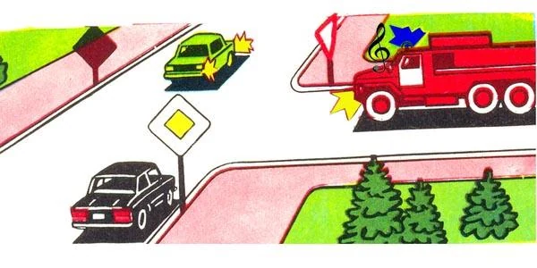
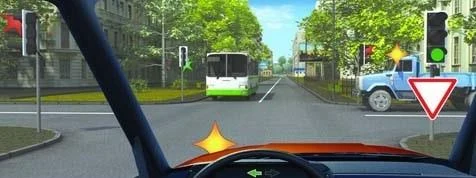
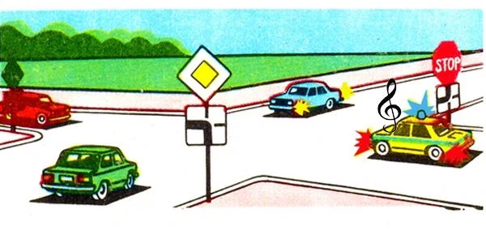

# Emergency and Special Vehicles

Beacons come in several colors, and each one asks something different of you. Learn the colors and most of
this lesson's questions answer themselves.

## What does each beacon ask of me?

| What you see | What you do | Point |
|---|---|---|
| Blue beacon and special sound signal, approaching | Give way so it passes unobstructed | 28 |
| Blue and red beacons and special sound signal, approaching | Reduce speed and give way to it and to the vehicles it escorts | 29 |
| Stationary vehicle with blue, or blue and red, beacons | Reduce speed so that you can stop immediately | 30 |
| Stationary vehicle with a red beacon, in your direction | Stop, and continue only after receiving permission | 31 |
| Yellow or orange beacon | Take care: it warns of danger and gives no priority | 32 |
| Moon-white beacons and special sound signal | The vehicle is under attack and is calling police officers and others. It gives no priority | 35 |

> **Common trap:** "Reduce speed and give way" is the blue and red rule. For blue alone, the answer is simply
> "give way". Red stationary means stop, not just slow down.

Public transport gets no exemption. Running on an established route doesn't excuse a bus driver from any of
these duties.

## What gives a vehicle priority?

**The blue beacon and the special sound signal together** (point 26). The beacon alone gives no priority, and
neither does the sound signal alone. Blue and red beacons work the same way, only with the sound signal. The
driver may use that priority only after making sure that others are actually giving way.

The paint doesn't count. An "Ambulance" with its beacon and sound signal off is an ordinary vehicle, so the
bus in this picture doesn't have to give way to it.

Once both are on, you give way. It doesn't matter that you have a green light, that you are on the main road,
or that it is coming out of an adjacent area or from behind a stop sign.

*The car has the green light, and the ambulance has priority anyway. The car's driver must give way.*

## What do yellow and orange beacons really mean?

They warn you about danger and give **no priority** (point 32). Point 34 lets some such vehicles depart from
certain rules, signs and markings when safety is ensured, but that gives them no priority over you.

*The road machine has a yellow beacon, so it gets no priority. It follows the ordinary rules. The right of
priority here belongs to the passenger car's driver.*

> **Remember:** Blue plus sound means give way. Yellow, orange and moon-white give nobody priority.

Extra: Making way calmly

*Not from the question bank.*

When you hear a siren, check your mirrors before you do anything else. Signal, move over smoothly and keep
your movements predictable, so the emergency driver can read what you will do. Don't stop where you block a
junction, and after it has passed, look out for a second vehicle following it.

## How do I work out the order at an intersection?

1. The vehicle with its blue beacon and sound signal on goes first.
2. Everyone else follows the normal rules: traffic light, then signs, then the right-hand rule.

The emergency vehicle comes on top of your other duties and doesn't replace them. When you turn left on green,
you give way to oncoming traffic **and** to the emergency vehicle. If the lights are out and your left turn
follows a main road that bends, a truck on the secondary road must wait for you, but the police car with its
beacon and sound signal on still goes first.

## Try it yourself

**You are the black car on the main road, going straight.** A fire engine has its beacon and sound signal on.
The oncoming green car is signalling left.

When do you go? **Second.** The fire engine goes first. The green car turns left, so it waits for you.

**You are turning left on green.** The bus is oncoming, and a truck with a yellow beacon comes from the right.

Who do you give way to? **Only the bus.** The light is what counts here, so the sign beside it doesn't apply.
You give way to oncoming traffic when turning left. The truck's yellow beacon gives it nothing.

**You are the blue car, on the secondary road.** A police car with its beacon and sound signal on stands by the
stop sign. The green and red cars are on the main road.

When do you go? **Last.** The police car goes first, even from behind a stop sign. Then the two cars on the main
road go, and you follow.

## Key points

- Blue beacon and sound signal: give way. Add reduced speed for blue and red.
- Stationary red beacon: stop and wait for permission.
- Priority needs the beacon and the sound signal together. The vehicle's paint means nothing.
- Priority beats a green light, a main road and a stop sign.
- Yellow, orange and moon-white beacons give no priority.
- Turning left on green: give way to oncoming traffic and to an emergency vehicle.

{{practice}}
