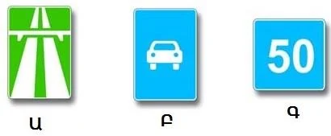

# Motorways and Mountain Roads

A motorway only works if everything on it moves fast. That is why the Rules keep slow vehicles and people on
foot off it completely.

## Who is banned from a motorway?

- **Pedestrians.** Walking is prohibited in any direction, on any stretch, inside or outside built-up areas
  (point 116). Walking along the edge facing traffic is the habit for ordinary roads, not for a motorway.
- **Vehicles whose speed, by their technical characteristics or condition, does not exceed 40 km/h** (point
  116). The ban covers the whole motorway, so keeping to the right-hand lane doesn't make it legal.

> **Common trap:** This ban comes from the Rules, not from a sign on the road. It applies even if no "Minimum
> speed limit" sign is in sight.

## Which signs bring these rules?

Two signs do, because point 117 extends the motorway requirements to sign 5.3.

*Sign A is 5.1 "Motorway". Sign B is 5.3 "Road for automobiles". Both keep out vehicles that can't exceed 40
km/h. Sign C, the blue square with a number, is 6.2 "Recommended speed", which sets no such ban.*

The Speed lesson has the motorway speed limits.

Extra: Joining and leaving a fast road

*Not from the question bank.*

Use the whole slip road to match the speed of the traffic before you merge, and look for your gap early. When
you leave, move across in good time and slow down on the exit lane, not on the main carriageway. After a long
fast stretch, your speed feels lower than it is, so check your speedometer.

Extra: Long descents on mountain roads

*Not from the question bank.*

Choose a low gear before the descent starts and let the engine hold your speed. Long, constant braking
overheats the brakes until they stop working well. Brake firmly in short bursts instead, and slow down before
each bend, not in it. Watch for falling stones, and remember that a bend can hide a vehicle in the middle of
the road.

## Try it yourself

**Your car has a fault and can't go above 35 km/h.** You come to a road with sign 5.3. May you use it? **No.**
The same ban applies as on a motorway, because of your vehicle's condition.

## Key points

- Pedestrians are prohibited on motorways, whatever the direction.
- Vehicles that can't exceed 40 km/h are prohibited, by their design or by their condition.
- The ban comes from the Rules, so it needs no extra sign.
- Signs 5.1 and 5.3 both bring this ban. Sign 6.2 doesn't.

{{practice}}
