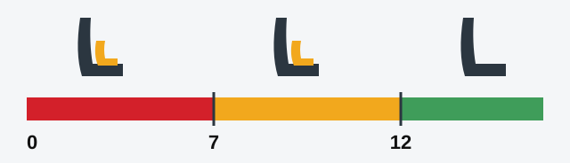

# Safe Driving

Knowing the rules gets you a licence, but your habits get you home. This lesson covers what the exam asks
about belts, children and helmets, and the extras below hold the habits that keep you out of trouble.

## Who must wear a seat belt?

A learner at the wheel counts as a driver, so a learner must wear a belt during training. Article 24 of the RA
law releases only one person: the driving instructor, and only while the learner is driving.

> **Common trap:** "Not if it makes driving difficult" and "not if the instructor permits it" are wrong. The
> law has no such conditions.

## Where may children sit?

A child can sit in the front seat of a passenger car without a child restraint device only from **12 years of
age** (point 159).

*Under 7 (red): a child restraint is compulsory. From 7 up to 12 (yellow): the front seat is allowed only
with a restraint that fits the child's weight and height. From 12 (green): the front seat is allowed without
one.*

## Who needs a helmet?

Anyone travelling on the carriageway by motorcycle, moped or bicycle must wear a fastened helmet (Article 24
of the RA law). Protective goggles aren't required.

## Try it yourself

**A 10-year-old wants to sit in the front of your car, and you have no child restraint device.** May they?
**No.** Until they are 12, the front seat requires a restraint.

## Good habits

These extras aren't exam material, but they matter on every drive.

Extra: Leave room in front of you

*Not from the question bank.*

The gap ahead is your thinking and braking time. Pick a fixed point such as a pole. When the car ahead passes
it, count how long you take to reach it, and leave at least a few seconds. Leave more at night, in rain, on
snow or behind a large vehicle. If someone is too close behind you, ease off gently to make extra room in
front.

Extra: Tiredness

*Not from the question bank.*

Tired drivers react late and can fall asleep for a moment without knowing it. Yawning, heavy eyes, drifting
in the lane or missing a turning are all warnings. Opening a window or turning up the radio doesn't fix them.
Stop somewhere safe and rest, and take regular breaks on long journeys.

Extra: Alcohol and drugs

*Not from the question bank.*

Alcohol slows your reactions, narrows your attention and makes you feel more capable than you are. The same
goes for many drugs, including some medicines, so read the leaflet or ask a pharmacist. Coffee, cold air or a
shower won't sober you up: only time does that. If you plan to drink, don't plan to drive.

Extra: Phones and distraction

*Not from the question bank.*

A glance at a screen can cover a long stretch of road with nobody watching it. Even a hands-free conversation
takes attention away from driving. Put the phone out of reach, set the navigation before you leave, and stop
if a call or message really can't wait.

Extra: Night and bad weather

*Not from the question bank.*

At night you can see only as far as your lights reach, so slow down enough to stop within that distance. In
rain, tyres grip less, and the first minutes after a dry spell are the most slippery. On snow and ice, do
everything gently: steer, brake and accelerate one at a time. In fog, slow down and keep the edge of the road
in view.

Extra: Road manners

*Not from the question bank.*

Signal early, let people merge, and thank those who help you. If another driver makes a mistake or gets
angry, don't compete or reply. Give them space and let them go. Always watch for people who may not have seen
you, such as children, older pedestrians and cyclists.

Extra: Saving fuel and cutting pollution

*Not from the question bank.*

Smooth driving uses less fuel. Look far ahead, ease off early and avoid hard acceleration. Keep your tyres at
the right pressure, remove roof racks and unneeded weight, and switch off the engine during long waits. Regular
servicing keeps exhaust fumes down. A cold engine pollutes most, so combine short trips into one.

## Key points

- A learner driver must wear a belt. Only the instructor is released, while the learner drives.
- Children reach the front seat without a restraint at 12.
- Under 7, a child restraint is compulsory.
- Riders on motorcycles, mopeds and bicycles need a fastened helmet on the carriageway. Goggles aren't required.

{{practice}}
