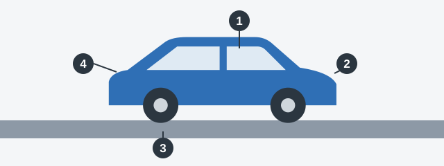
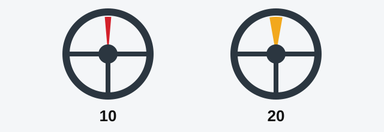

# Brakes and Steering

A fault you find on the driveway is an inconvenience, but the same fault at speed can be a crash. This chapter
turns the exam's list of faults into a check you can do before you drive, starting with the two systems that
control the car.

## How does the list work?

Annex 2 to the Traffic Rules lists the faults and conditions that prohibit operating a vehicle. "Operating"
here means using it on the road. If a fault is on the list, the vehicle must not be used. If it isn't, it
doesn't count: an audio player that doesn't work, for example, isn't on the list.

*The four stops of the check. 1: from the seat, test brakes and steering (this lesson). 2: walk round the
lights and glass. 3: look at each wheel and tyre. 4: go through the engine and equipment.*

> **Common trap:** Most of these questions end with "In both cases". Test each option on its own. An option can
> be perfectly normal, such as a tyre that's still above its limit.

## Stop 1: Brakes

- **Hydraulic brakes:** the seal of the brake line must be intact. A broken seal lets the fluid escape.
- **Pneumatic (air) brakes:** the pressure gauge must work.
- **Parking brake:** it must hold the vehicle still on the gradient set by the standard.

## Stop 1: Steering

The steering has some free play: how far the wheel turns before the road wheels respond. Too much, and your
steering arrives late.

*The limit is 10 degrees for a passenger car and for a bus built on a passenger car base, and 20 degrees for
any other bus.*

> **Remember:** The base decides. A free play of 15 degrees prohibits operating a bus built on a passenger car
> base, but it is within the limit on an ordinary bus.

Operation is also prohibited if:

- Steering parts or assemblies move in ways the design doesn't provide for.
- Threaded connections aren't tightened or secured in the prescribed manner.
- The power steering booster provided by the design is faulty or missing.

Extra: Feeling for faults from the driver's seat

*Not from the question bank.*

With the engine running and the wheels straight, turn the steering wheel gently each way until the road wheels
begin to move. A long dead zone, clunks or stiff spots need a mechanic. Press the brake pedal firmly: it should
feel solid and not sink slowly to the floor. Oily patches under the car are worth investigating too.

## Try it yourself

**The mudguards are missing from a car with 12 degrees of free play.** Which is the fault? **Both.** The
limit for a car is 10 degrees, and missing mudguards or splash guards provided by the design are also on the
list.

## Key points

- Annex 2 is a list: a fault prohibits operation only if it's on it.
- A broken hydraulic brake seal or a dead pneumatic brake pressure gauge prohibits operation.
- Free play limit: 10 degrees for a car or a bus on a car base, 20 degrees for other buses.
- Loose steering connections and a faulty power steering booster prohibit operation.

{{practice}}
