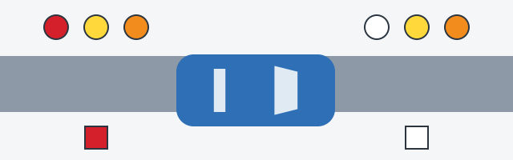

# Lights and Glass

You need to see, and others need to see you and read what you are about to do. This is stop 2 of the check, a
slow walk round the vehicle with someone working the switches if you can.

## Do the lights work?

Section 3 of Annex 2 prohibits operating a vehicle if:

- External lights don't work in the prescribed mode.
- External lights or reflectors are **dirty**.
- Bulbs or diffusers are missing.
- Bulbs or diffusers don't match the type of that light.
- Rear fog lamps are connected to the brake lights.

Wired to the brakes, fog lamps light up at every brake application, and the driver behind can't tell the signals
apart.

> **Common trap:** The fault is rear fog lamps that *are* connected to the brake lights. Lamps that are not
> connected are fine. Dirty front and rear protective devices are fine too: only dirty lights and reflectors
> are on the list.

## Are the colors right?

Colors tell other drivers which way you are facing, so remember the two ends of the car.

*Circles show the light colors allowed. Squares show the only reflector color allowed. Front is on the right,
rear is on the left.*

| Device | Front | Rear |
|---|---|---|
| Lights | White, yellow or orange | Red, yellow or orange |
| Reflectors | White only | Red only |

White at the rear has only two proper places: reversing lamps and the number plate light.

So these are **faults**: red turn indicators at the front, white turn indicators at the rear, red reversing
lamps, yellow reflectors at either end, and white reflectors at the rear.

These are **not faults**: yellow or orange turn indicators at the front, yellow front fog lamps, white reversing
lamps, white number plate lights, white reflectors at the front and red reflectors at the rear.

> **Remember:** Lamps give you three colors at each end. Reflectors give you one: white in front, red behind.

Lamps from another make fitted to a vehicle that is out of production aren't a fault in themselves.

## Can you see out?

Now look at the glass:

- The windows provided by the design must be there.
- The windscreen washers provided by the design must work.
- The window heating and blowing devices provided by the design must work.
- Nothing may be fitted that restricts your view from the driver's seat.

Curtains depend on which window you mean.

| Window | Curtains allowed? |
|---|---|
| Windscreen or front side windows | No |
| Rear window or rear side windows | Only if both side mirrors are there |

While you are in the seat, press the horn. It must work.

Extra: Checking lights on your own

*Not from the question bank.*

Reverse up to a wall or a shop window at dusk and you can see your brake and reversing lamps reflected in it.
Keep a cloth in the door pocket for lamps and number plates, since road spray covers them quickly on wet days.
Replace worn wiper blades before the first autumn rain, not after it.

## Try it yourself

**Your bus has white reflectors at the rear and two chocks on board.** Does this prohibit operation? **Yes,
because of the reflectors.** Rear reflectors must be red.

## Key points

- Faulty or dirty lights and reflectors prohibit operation, as do missing or wrong bulbs and diffusers.
- Rear fog lamps must not be connected to the brake lights.
- Front lights: white, yellow or orange. Rear lights: red, yellow or orange.
- Reflectors: white in front, red behind.
- Front windows may never be curtained. Rear windows may be, if both side mirrors are there.

{{practice}}
