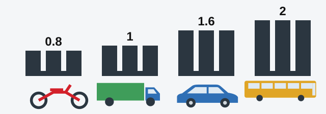

# Wheels and Tyres

Your tyres are the only part of the vehicle that touches the road, and everything you do with the wheel and the
pedals passes through them. This is stop 3 of the check: walk round and look at each wheel in turn.

## How much tread is enough?

The tread is the pattern cut into the tyre. Its remaining height is the number the exam cares about most, and
the limit depends on the vehicle (section 4 of Annex 2).

*The smallest allowed tread height, in millimetres: motorcycle 0.8, truck 1.0, passenger car 1.6, bus 2.0.*

| Vehicle | Minimum (mm) |
|---|---|
| Motorcycle | 0.8 |
| Truck | 1.0 |
| Passenger car | 1.6 |
| Bus | 2.0 |

A trailer follows the vehicle that tows it, so a passenger car's trailer also needs 1.6 mm.

The figure is a minimum, so a tyre exactly on it is still allowed. Only below it does the vehicle have to stop.

| Tyre | Limit (mm) | Prohibited? |
|---|---|---|
| Car at 1.8 mm | 1.6 | No |
| Car at 1.6 mm | 1.6 | No |
| Truck at 1.6 mm | 1.0 | No |
| Truck at 1.4 mm | 1.0 | No |
| Motorcycle at 1.6 mm | 0.8 | No |
| Motorcycle at 0.6 mm | 0.8 | Yes |
| Bus at 2.5 mm or 2.2 mm | 2.0 | No |
| Bus at 1.8 mm, 1.6 mm or 0.8 mm | 2.0 | Yes |

> **Common trap:** 1.6 mm sounds like the magic number, but it belongs to cars. On a bus, 1.6 mm is too little.
> On a truck or motorcycle, it's plenty.

## Is the tyre damaged or wrong?

Operation is prohibited if a tyre:

- Has local damage, such as a puncture, cut or tear, that **exposes the cord** or separates the carcass. Such a
  tyre can burst at speed.
- Doesn't match the vehicle model in **size or permissible load**. It would carry a load it wasn't built for.

## Do the tyres on each axle match?

Two wheels on one axle must grip alike. If they don't, the vehicle pulls to one side under braking. So a single
axle must not have:

- Different sizes, constructions or models.
- Different tread patterns.
- New tyres with retreaded ones.
- Frost-resistant tyres with non-frost-resistant ones.

> **Remember:** "Same axle" is the phrase to watch for. When it appears with a mismatch, the vehicle must not be
> used.

## Is the wheel sound?

Operation is prohibited if:

- There are cracks in the wheel rim or disc.
- **Even one** bolt or nut fastening the wheel is missing. The others are then overloaded, and the wheel can
  come off.
- The fastening holes visibly differ from their proper shape and dimensions.

Extra: Looking after your tyres

*Not from the question bank.*

Check the pressure when the tyres are cold, using the figures in the vehicle handbook. Low pressure wears the
edges of the tread and heats the tyre up, and high pressure reduces grip. A cheap tread gauge measures depth
better than your eye. Look for bulges in the sidewall, which often mean hidden damage, and don't forget the
spare.

## Try it yourself

**A car has one missing wheel bolt and tyres at 1.8 mm.** What's the problem? **The bolt.** The tread is above
1.6 mm, but one missing bolt is enough on its own.

**A bus has tyres at 1.8 mm, and its hydraulic brake line has a broken seal.** Which prohibits operation? **Both.**
The bus needs 2.0 mm, and the broken seal is a fault in its own right.

**The engine runs unevenly, and a tyre shows its cord.** Which one prohibits operation? **Only the tyre.** An
engine that works with interruptions isn't on the list.

## Key points

- Minimum tread: motorcycle 0.8 mm, truck 1.0 mm, car 1.6 mm, bus 2.0 mm.
- A trailer follows the vehicle that tows it.
- A tyre exactly at the minimum is allowed.
- Exposed cord, or the wrong size or load rating, prohibits operation.
- Tyres on one axle must match in size, construction, model and tread pattern, and must not mix new with
  retreaded or frost-resistant with non-frost-resistant.
- One missing wheel bolt is enough. So is a cracked rim or disc, or a damaged fastening hole.

{{practice}}
