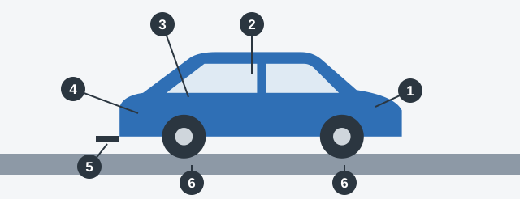

# Engine and Equipment

This is the longest part of the list, and the last stop of the check. It covers everything else: what leaks, what
locks, what protects you and what must be on board.

Don't try to memorize it as a list. Walk round the vehicle in order, and each item has a place.

*The walk: 1 engine and hood, 2 inside the cabin, 3 fuel cap and doors, 4 equipment on board, 5 tow hitch, 6
around the wheels.*

## 1. Open the hood

Section 5 of Annex 2 names only a few engine faults, so learn them exactly:

- Harmful substances in the exhaust gases are above the norms set by RA legislation.
- The seal of the **crankcase ventilation** system is broken.
- The seal of the **fuel supply** system is broken, which leaks fuel and is a fire hazard.
- The engine's external noise is above the standard.

Other seals matter too. Operation is also prohibited when the seals or joints of the engine, gearbox, final drive or
rear axle have lost their tightness.

The hood lock provided by the design must work.

> **Common trap:** An engine that runs with interruptions, is hard to start or runs at an unstable temperature may
> worry you, but none of these is on the list. The engine faults that count are about exhaust, seals or noise.

## 2. Sit inside

From the driver's seat, check everything that protects you and everything you depend on:

- **Seat belts** provided by the design must be there, must work, and must have no visible tears in the webbing.
- **Head restraints** provided by the design must be there. They protect your neck in a rear-end collision.
- **Seat adjustment:** the mechanism for the driver's seat must work.
- **Speedometer:** it must work. So must a tachograph or anti-theft device provided by the design.
- **Horn:** it must work and conform to the standard. It's your only way of warning people by sound.
- **Your view:** nothing may be fitted that restricts it from the driver's seat.

| Doesn't work | On the list? |
|---|---|
| Speedometer | Yes |
| Horn | Yes |
| Fuel level indicator | No |
| Engine coolant temperature gauge | No |
| Passenger car interior light | No |
| Bus interior light | Yes |
| Audio player | No |

> **Remember:** Of the gauges on the dashboard, the speedometer is the one you must have working. The fuel and
> temperature gauges aren't on the list.

## 3. Walk round the body

These parts stop things from coming open or falling off:

- Locks on the body doors and cabin doors must work.
- The fuel tank cap provided by the design must work.
- The spare wheel holder must work, because a loose spare can fall off on the road.
- Mudguards and splash guards provided by the design must be there.
- The rear protective device provided by the design must be there.

The check is about whether they are there. Being dirty isn't a fault.

Two more conditions apply to the vehicle as a whole:

- Nothing may be fitted that could injure road users.
- The vehicle's design must not be changed without the permission of the body that registers vehicles.

## 4. Check what's on board

| Item | Must be carried by |
|---|---|
| First-aid kit | Bus, passenger car, truck, motorcycle with a side car |
| Fire extinguisher | Bus (see Bus Equipment) and truck |
| "Emergency stop" sign | Bus, passenger car, truck, wheeled tractor |

A motorcycle without a side car doesn't need the "Emergency stop" sign. Fog lamps aren't compulsory, so not having
them is no fault.

## 5. Check the coupling

If you tow, the towing or coupling device of a tow hitch or trailer must work. Safety cables or chains provided by
the design must be there and in working order. A failure here lets the trailer break loose.

## Motorcycles and training cars

On a motorcycle, operation is prohibited if:

- The footrests provided by the design are missing.
- The safety bars provided by the design are missing.
- The transverse handhold for the passenger on the saddle is missing.
- There's play in the joints between the frames of the motorcycle and its side car.

A vehicle used for practical driving instruction must carry its identification sign. The "Doctor" sign is
different: it's displayed at the driver's own wish, so it isn't a fault when it's missing.

Extra: A one-minute check for every day

*Not from the question bank.*

You don't need tools. Walk once round the car, look under it for fresh drips, and glance at the tyres and lamps.
Inside, adjust your seat and mirrors, then fasten your belt. Once a week, or before a long trip, open the hood and
check the oil, coolant, brake fluid and washer fluid against their marks. Stop as soon as it is safe if a warning
light comes on while you're driving, and check the handbook.

## Try it yourself

**A truck has white reflectors at the front, and its towing device is faulty.** Which is the problem? **Only the
towing device.** White is the correct color for front reflectors.

**A car has no first-aid kit, and its reversing lamps are red.** Which prohibits operation? **Both.** Cars must
carry a first-aid kit, and reversing lamps must be white.

**A motorcycle with a side car has tyres at 0.6 mm and no first-aid kit, and the passenger's handhold is gone.**
Which prohibits operation? **All three.** Each one is a ground on its own.

## Key points

- Engine faults on the list: exhaust gases over the norm, broken crankcase or fuel seals, excess noise.
- A hard-starting engine, an uneven engine or an unstable temperature isn't on the list.
- Belts must be there, work and have no tears. Head restraints must be there.
- The speedometer and horn must work. The fuel and temperature gauges don't count.
- Door locks, the hood lock, the fuel cap and the spare wheel holder must work.
- Bus, car and truck carry a first-aid kit and an "Emergency stop" sign. Buses and trucks carry a fire extinguisher.
- Changing a vehicle's design needs the permission of the registering body.

{{practice}}
