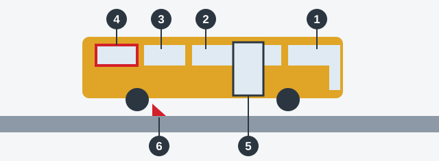

# Bus Equipment

A bus carries dozens of people who rely on the driver and on its safety equipment. So a bus has its own extra items
on the check, and a passenger's way out in an emergency is one of them.

## What must a bus carry?

*1: driver's cab. 2: saloon. 3: stop-request signal. 4: emergency exit. 5: door and its control drive. 6: anti-roll
chock.*

| Item | How many |
|---|---|
| Fire extinguisher | At least 2: one in the driver's cab, one in the saloon |
| Medical first-aid kit | Must be on board |
| "Emergency stop" sign | Must be on board |
| Anti-roll chocks, on a bus over 5 t | At least 2 |

> **Remember:** Think in pairs. A bus with one fire extinguisher falls short, and one chock is also fewer than the two
> the Rules set. Two or more chocks is what they ask for, so that's no fault.

## What must work?

Walk through the saloon from the front door to the back. All of these must work:

- **Emergency exits**, and the devices that put them into operation.
- **Emergency door openers.**
- **The door control drive.**
- **The stop-request signal.**
- **The interior lighting devices of the saloon.**

If passengers can't get out, an accident becomes much more dangerous. That's why these appear on a list that
ignores a hard-starting engine.

> **Common trap:** An interior light that doesn't work prohibits operating a bus, but not a passenger car.

Extra: A bus driver's minute before the doors open

*Not from the question bank.*

Check that nothing blocks the aisle or the exits, and that extinguishers still have their seals and pressure.
Know how each emergency exit opens. In a real evacuation, passengers will look to you first, so a calm, clear
voice helps as much as any equipment.

## Try it yourself

**A bus has tyres at 2.2 mm and no first-aid kit.** Does this prohibit operation? **Yes, because of the kit.** The bus
limit is 2.0 mm, so the tyres are fine.

**A bus has white number plate lights, and the "Emergency stop" sign is missing.** What's the problem? **Only the
sign.** White is the proper color for number plate lights.

## Key points

- Bus: at least two fire extinguishers, one in the cab and one in the saloon.
- First-aid kit and "Emergency stop" sign must be on board.
- Bus over 5 t: at least two anti-roll chocks.
- Emergency exits, door openers, door drive, stop-request signal and interior lights must all work.
- Minimum tread for a bus: 2.0 mm.
- Reversing lamps must be white, and front turn indicators must not be red.

{{practice}}
