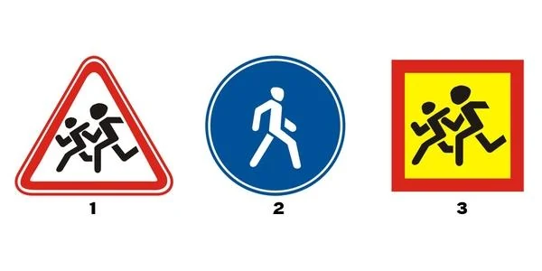
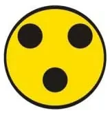
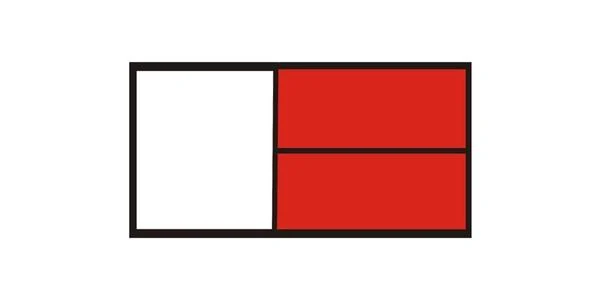
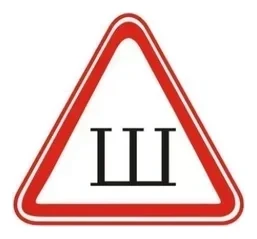
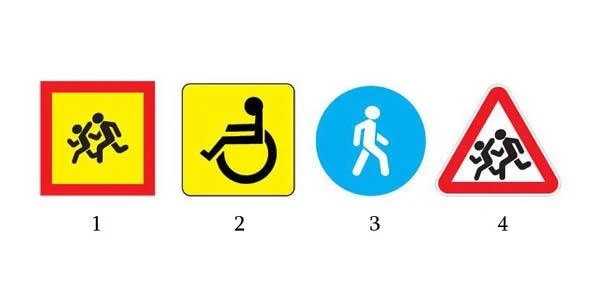
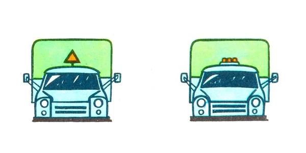

# Vehicle Identification Signs

Some signs are fitted to the vehicle, not to the roadside. They tell you something about that vehicle, its driver or
its load, so that you can adjust how you drive around it.

## What's an identification sign?

Point 175 and Form No. 3 of the Traffic Rules set these signs. The test is simple: if it's fixed to the vehicle, it's
an identification sign. A road sign stands at the roadside.

*Number 1 is road sign 1.23 "Children". Number 2 is road sign 4.5.1 "Footpath". Only number 3, the yellow square, is
fitted to a vehicle.*

> **Common trap:** The same running children appear in both. The red-bordered triangle is a road sign. The yellow
> square with a red border is the "Carriage of children" identification sign.

## Which signs should I know?

| Sign | What it looks like | Where it goes | What it tells you |
|---|---|---|---|
| "Carriage of children" | Yellow square, red border, figure from sign 1.23 | Front and rear | An organized group of children is on board |
| "Deaf driver" | Yellow disc with three black circles | Front and rear | The driver is deaf or deaf-and-mute |
| "Dangerous goods" | Rectangular panel showing the load's hazards | Front and rear | The vehicle carries dangerous goods |
| "Road train" | Three orange lamps in a row | Cab roof | This is a truck with a trailer, a wheeled tractor or an articulated bus |
| "Studs" | White triangle, red border, letter Ш | Rear | The tyres are studded |

*"Deaf driver".*

*"Dangerous goods". It isn't a marking for heavy or large loads.*

*"Studs". It looks like a warning sign, but it says nothing about the road ahead.*

## Which signs are compulsory?

- **"Carriage of children":** compulsory when carrying organized groups of children. Displaying it at the front is
  correct, not a fault.
- **Practical driving instruction sign:** a training vehicle without it must not be used.
- **"Oversized load":** needed on a load past the limits in the lesson on carrying loads.
- **"Doctor" and "Disabled person":** displayed at the driver's own wish, so leaving them off is not a fault. The
  "Disabled person" sign is a yellow square with the symbol from plate 8.17.

The Rules have no sign for a driver with up to 3 years of experience.

> **Remember:** Ask where the sign is. On a vehicle, it tells you about that vehicle. At the roadside, it tells
> you about the road.

Extra: Driving around marked vehicles

*Not from the question bank.*

Give extra room to any vehicle carrying dangerous goods, and don't park beside it. Around a children's bus, slow
down and expect children to appear from behind it. Studded tyres can throw small stones, so stay further back on
loose or icy surfaces.

## Try it yourself

**Which sign goes on the front and rear of a vehicle carrying an organized group of children?**

**Number 1.** Number 2 is the "Disabled person" sign. Numbers 3 and 4 are road signs.

**Which truck shows it is a road train?**

**The right one,** with three orange lamps in a row.

## Key points

- Identification signs are fitted to the vehicle. Road signs stand at the roadside.
- Yellow square with a red border: children. Yellow disc with three black circles: deaf driver.
- Three orange lamps: road train. White triangle with Ш: studded tyres.
- "Doctor" and "Disabled person" are optional. The driving instruction sign is compulsory.

{{practice}}
