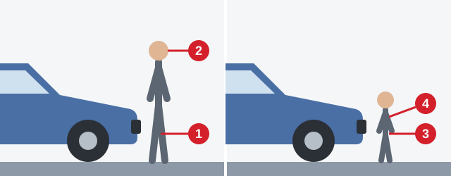

# After a Crash

The first minutes after a crash can decide who survives, and a rescuer who rushes in can become the next
casualty. This lesson gives you the order of action.

> **Remember:** This lesson does not replace a first-aid course.

## What must a driver involved in a crash do?

Article 24 of the RA law "On ensuring road traffic safety" requires all three:

1. Stop the vehicle immediately.
2. Switch on the hazard warning light signal.
3. Leave the vehicle and the objects connected with the accident where they are.

## What do I do first?

1. **Ensure safety.** Switch off the engine, put on the hazard lights, set out the emergency stop sign, and
   judge the risk of fire, spilt fuel or electricity.
2. **Check consciousness and breathing.** A blocked airway kills within minutes. A broken bone does not.
3. **Check for severe bleeding, call the ambulance and treat the injuries.**
4. **Make the casualty comfortable.**

> **Common trap:** Even with a bone sticking out, check consciousness and breathing before you call or
> immobilize the leg.

Extra: If someone else is with you

*Not from the question bank.*

Point at one person and ask them to call the ambulance straight away while you check the casualty.

## What if I can't make the scene safe?

The rescuer must not become a casualty, and sending someone else in only exposes them.

1. Do not approach.
2. Call for help immediately.
3. Keep bystanders away.

## Who do I help first?

The one whose condition can kill soonest. An unconscious person can't keep their own airway open, so they come
before a fractured forearm, scratches or a frightened pregnant woman.

## When do I take a casualty out of the car?

Moving can worsen spinal or internal injuries, so do it only when staying is more dangerous:

- The car will probably overturn, catch fire or explode.
- The casualty has hypothermia, or loss of consciousness and breathing.
- First aid can't be given in the cabin.

Serious injuries, heavy bleeding or a craniocerebral injury (skull and brain) are not reasons on their own.

> **Common trap:** With a power wire on the car, people must stay inside until the current is switched off.
> See the lesson on fractures and burns.

Extra: If you must move someone

*Not from the question bank.*

Move them as little as you can, and keep the head, neck and back in line without twisting.

## What do I tell the ambulance operator?

- **Place:** the street, the house number and the nearest landmarks.
- **Casualties:** how many, their sex and approximate age.
- **State:** consciousness, breathing, blood circulation, heavy bleeding, fractures and other injuries.

Then wait until the operator states that the call has been accepted.

## May I give medicines?

No, not even in extreme necessity. You don't know the casualty's illnesses, allergies or what they have taken.
A casualty who is unconscious or has an internal injury gets nothing by mouth at all.

## Where is a hit pedestrian hurt?

*A low car hitting an adult of 1 m 55 cm or more injures the lower limb (1) and the head (2). The head hits the
bonnet or windscreen, then the road. With a child of 3-5 years, the bumper meets the pelvis (3) and chest (4).*

## Try it yourself

**You hear an engine in your neighbor's garage,** open the door and see your neighbor on the ground.

What comes first? **Open the doors wide, switch off the engine and, if possible, move your neighbor away.** The
engine produces carbon monoxide, an odorless and lethal gas that would poison you too.

## Key points

- Involved in a crash: stop, hazard lights on, move nothing.
- Make the scene safe first. If you can't, stay out, call for help and keep others away.
- Check consciousness and breathing first. An unconscious casualty comes before all others.
- Move a casualty only if staying is more dangerous. Never give medicines.

{{practice}}
