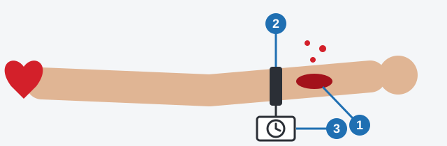
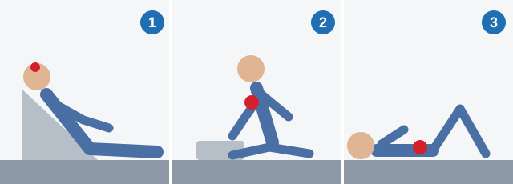

# Bleeding and Wounds

Heavy bleeding can kill within minutes. This lesson teaches you to read the blood, stop it, and place the
casualty correctly for each injury.

> **Remember:** This lesson does not replace a first-aid course.

## How do I protect myself?

A casualty's blood can carry infection. Avoid touching the wound directly, and use sterile gloves or, if there
are none, whatever barrier is to hand. Refusing to help is not protection.

## How dangerous is this bleeding?

| | Major artery: most dangerous | Vein: dangerous, but slower |
|---|---|---|
| Color | Bright red | Dark |
| Flow | Spurts in a jet or like a fountain | Flows steadily or slowly |

Blood clotting within 10 minutes is normal, not a danger sign.

## How do I stop bleeding from a major artery?

1. **Press the damaged artery with your fingers.** This works at once.
2. **Apply a tourniquet above the wound, as close to it as possible.** Blood comes from the heart's direction,
   so below the wound is useless.
3. **Note on it the time it was applied.**

*The wound (1), the tourniquet between it and the heart (2), and the note with the time (3).*

A tourniquet cuts off the blood supply, so its time is limited: **not more than 1 hour in warm weather, and not
more than half an hour in cold weather.**

For severe bleeding, a dressing alone soaks through. Apply a pressure bandage to the injured part and press at
the artery's pressure point above the wound. Never pour ashes in.

> **Common trap:** The times feel backwards. A limb without blood is damaged faster in the cold, so cold means
> half an hour.

Extra: Direct pressure and tourniquets in first-aid courses

*Not from the question bank.*

Most courses start with firm, direct pressure on the wound using a clean pad, adding more on top if blood soaks
through. A tourniquet is kept for life-threatening limb bleeding that pressure can't control. Once it is on,
courses teach you not to loosen or remove it yourself: leave that to medical staff and tell them the time.

## How do I stop bleeding from a vein or smaller artery?

1. Raise the limb above the level of the heart, which lowers the pressure in the wound.
2. Apply a pressure bandage **at the place of the injury**, not above or below it, so it presses on the damaged vessel.
3. Press and release a nail below the bandage. If it turns pink again with difficulty, circulation is impaired
   and the bandage is too tight. Pain and discomfort don't tell you this.

## Should I clean the wound?

There is no single rule. The questions treat these cases separately:

| Situation | What to do |
|---|---|
| Dangerous wound | Stop the bleeding and bandage it. Washing costs time and removes the clot. |
| Injury caused by an accident, first steps | Put on medical gloves. Cover the wound, without cleaning it, with a sterile gauze napkin. Secure the edges with adhesive plaster or bandage it. |
| Less dangerous wound | Wash with soap and clean water, then bandage. |

So at an accident, stop the bleeding and cover the wound. Washing applies only to a wound called "less
dangerous", a term the questions don't define, so read the wording carefully.

> **Common trap:** Iodine, vodka, perfume and cologne burn the tissue and do nothing for bleeding. Keep them out
> of the wound. Cotton is wrong too, because it sticks.

## What if something is stuck in the wound?

Leave it in. It is often pressing the damaged vessel shut, so pulling it out can start heavy bleeding. Pack
dressings around it so it stays immobile.

## How do I treat a nosebleed?

1. Sit the casualty down.
2. Tilt the head forward and down, so blood stays out of the throat.
3. Press the nose for 10-15 minutes.

Don't tilt the head back, use a cotton tampon or leave it to stop on its own.

Extra: Where to press on the nose

*Not from the question bank.*

First-aid courses teach you to pinch the soft part of the nose, just below the bony bridge, while the person
breathes through the mouth. If the bleeding won't stop, get medical help.

## How do I treat head, chest and abdominal injuries?

*The head injury (1), chest injury (2) and abdominal injury (3) positions from the table below.*

| Injury | What to do | Why |
|---|---|---|
| Head injury | Semi-reclined, head and upper body raised | Limits pressure inside the skull. Don't raise the legs or lay flat. |
| Chest injury | Sit up, leaning onto the injured side | The healthy lung stays free. |
| Abdominal injury | Lay down, legs bent at the knees | The abdominal wall slackens. |
| Organs protruding from the abdomen | Cover with clean damp cloth and polyethylene film | They must not dry out. Never push them back. |
| Suspected internal abdominal bleeding | Lay down, cold compress on the injury | Cold narrows the vessels. No hot water bottle, pressure bandage or large drinks. |
| Closed soft-tissue limb injury, first hours | Cold compress, and raise the part | Limits bleeding and swelling. No warm or alcohol compress. |

For a craniocerebral injury with a wound on the hairy part of the head:

1. Stop the bleeding by direct pressure on the wound.
2. Apply a pressure bandage over it.
3. If consciousness is lost, use the stable side (recovery) position.
4. If possible, apply cold to the area.

Extra: If the skull feels dented

*Not from the question bank.*

If the skull feels soft or dented, or you see bone, don't press hard on that spot. Press gently around the wound
and call an ambulance.

## Try it yourself

**A pedestrian has a wound about 5 cm long on the forearm.** Dark blood flows steadily from it.

What stops the bleeding? **Raise the arm and apply a pressure bandage.** Dark, steady blood means a vein. Water
doesn't stop bleeding, and iodine damages the tissue.

## Key points

- Bright red and spurting: major artery. Dark and steady: vein.
- Major artery: fingers, then a tourniquet above the wound with the time noted.
- Tourniquet: 1 hour at most in warm weather, half an hour in cold.
- Vein or smaller artery: pressure bandage at the place of the injury.
- At an accident, stop the bleeding and cover the wound. Leave foreign bodies in, and never push organs back.

{{practice}}
