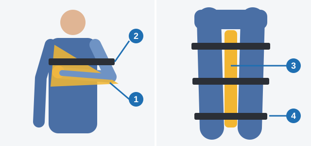

# Fractures and Burns

Well-meant help can make these injuries worse, from moving a broken bone to bursting a blister. This lesson shows
what to do and what to leave alone.

> **Remember:** This lesson does not replace a first-aid course.

## How do I help with a fracture?

For an open fracture, where the wound reaches the bone:

1. Cover the wound with a sterile napkin, against infection.
2. Immobilize the limb, so the fragments can't damage vessels and nerves.

Don't raise the limb or apply direct pressure, which move the fragments, and don't put cold compresses on the wound.

With no splint, tie the bent arm, resting on a headscarf, to the trunk. Tie the legs together with a soft cloth
between them, so the bony points don't press together.

*The headscarf (1), the band to the trunk (2), the soft cloth (3) and the ties (4).*

If the spine may be injured, movement can cause permanent paralysis. Lay a conscious casualty on their back on a
hard, flat surface, and don't move them unless necessary. No side position, no roll under the neck, no raised legs.

Extra: Bleeding and neck care in first-aid courses

*Not from the question bank.*

If an open fracture bleeds heavily, press around the wound with a clean dressing, not on the bone, and call an
ambulance. If someone awake may have a spinal injury, ask them to stay still and support the head as you found it.

## How do I treat a burn?

Superficial thermal burn: redness, swelling, blisters with clear fluid and severe pain.

1. **Cool it with water for 20 minutes.** This stops the tissue burning and eases the pain.
2. **Leave the blisters closed and any stuck clothing in place.** Blisters are a barrier against infection.
3. **Cover with a sterile napkin or clean cloth, without bandaging.**
4. **If possible apply cold, and give water to drink.**

> **Common trap:** Oil holds the heat in. Leaving the burn open invites infection.

Extra: Cool water, not ice

*Not from the question bank.*

Use cool running water, not ice, which can damage the skin. Give drinks only to someone fully awake.

## How do I treat frostbite and hypothermia?

Warm the affected parts and immobilize them, cover the casualty with warm clothes or a blanket, give a warm drink,
and move them to a warm area. Don't rub with snow or wool, give alcohol, or use ointment, warming compresses or
heat pads.

## What about fallen power wires?

**On the car:** ask the people inside to stay there until the current is switched off. Stepping out means touching
the car and the ground together, and the current passes through the body.

**On a casualty:** they are live, so don't touch them. First remove the wire with an insulating object, such as dry
wood. The primary survey comes afterwards.

If you can't make the scene safe, don't approach. Call for help and keep bystanders away.

Extra: Fallen lines can be high voltage

*Not from the question bank.*

You can't see the voltage. High voltage can pass through dry wood and make nearby ground live, so first-aid courses
teach you to stay well back, keep others back and call the emergency services until the power is confirmed off.
If fire forces people out of a car, they should jump clear with feet together, never touching the car and ground
at once, then shuffle away.

## Try it yourself

**A car has hit a pole, and a wire lies on an unconscious casualty beside it.** What comes first, if the scene can
be made safe? **Remove the wire with an insulating object.** Moving the casualty means touching a live person.

## Key points

- Open fracture: sterile napkin, then immobilize.
- Spine: on the back on a hard, flat surface. Don't move them unless necessary.
- Burn: water for 20 minutes, blisters closed, cover without bandaging.
- Frostbite: warm and immobilize. No rubbing, no alcohol.
- Wire on the car: stay inside. Wire on a casualty: insulating object first.

{{practice}}
