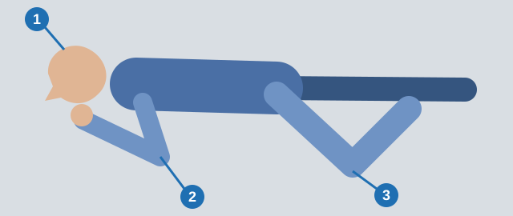

# The Unconscious Casualty

An unconscious person can't protect their own airway, so the first minute matters most. This lesson covers checking
breathing, the recovery position, fainting, seizures and sudden illness.

> **Remember:** This lesson does not replace a first-aid course.

At rest, an adult has a **pulse of 60-80 beats per minute** and **12-18 breathing movements per minute**.

## I've found someone unconscious. What now?

1. **Open the airway.** One hand on the forehead. With two fingers of the other hand, raise the chin and tilt the
   head back.
2. **Check breathing for 10 seconds.** Feel for exhaled air on your cheek and watch the chest.
3. **If they are breathing,** use the recovery position.
4. **If they are not breathing,** start resuscitation at once.

Never give an unconscious person water: it goes into the lungs.

> **Common trap:** Don't check without tilting the head, as the tongue may block the airway. Watching the chest
> alone isn't enough either.

Extra: What resuscitation looks like

*Not from the question bank.*

Adult CPR as widely taught: make sure an ambulance is called and send someone for a defibrillator if one is near.
Put the heel of one hand on the center of the chest, the other hand on top, and push about 5 cm deep, 100-120 times
a minute. If trained, give 2 rescue breaths after every 30 compressions. If not, keep compressing. Continue until
help arrives or normal breathing returns.

## What is the recovery position?

The stable side position, for a casualty who is unconscious but breathing, with circulation present.

*The head tilted back (1), the upper arm under the cheek (2) and the bent knee touching the ground (3).*

The tongue can't block the airway, and vomit drains out. Don't lay them on their back, put a roll under the head or
pull the tongue out.

## What do I do when someone faints?

Fainting is a temporary drop in the brain's blood supply. Lay the casualty down and raise the legs. Don't sit them
up, pour cold water on them or slap them.

Extra: If they don't come round

*Not from the question bank.*

If they don't wake within a minute or so, treat them as unconscious and call an ambulance.

## What do I do during a seizure?

A seizure normally ends on its own within a few minutes, so let the convulsions end.

1. Don't hold the casualty: this causes fractures and dislocations.
2. Don't open the mouth, hold the tongue or put anything between the teeth.
3. Don't tilt the head during the seizure. Afterwards, open the airway and check breathing.

Extra: Keeping someone safe during a seizure

*Not from the question bank.*

First-aid courses also teach you to move dangerous objects away, cushion the head and time the seizure. Call an
ambulance if it lasts over 5 minutes, repeats, or the person doesn't wake properly.

## What about sudden illness?

| Situation | Do | Don't |
|---|---|---|
| Driver has severe crushing chest pain and difficulty breathing | Immediately stop the car, switch on the hazard warning signal, call an ambulance to the spot | Drive on to hospital, give valerian, or walk for fresh air |
| Bronchial asthma attack | Semi-sitting position, chest free | Lay them down |
| Friend with diabetes feels unwell, unsure about insulin | Give sugar or a sweet liquid, as low blood sugar is the likely danger | Advise insulin or a few hours' rest |

Give sugar only to someone awake: an unconscious casualty gets nothing by mouth.

Extra: Asthma inhalers

*Not from the question bank.*

Many people with asthma carry a reliever inhaler. First-aid courses teach you to help them use their own, and to
call an ambulance if the attack is severe or doesn't ease.

## Try it yourself

**A driver squats for a long time changing a wheel,** stands up abruptly, loses consciousness and falls.

What must be done? **Raise his legs.** Blood returns to the brain. Sitting him up does the opposite.

## Key points

- Unconscious: open the airway, then check breathing for 10 seconds.
- Breathing: recovery position. Not breathing: resuscitation at once.
- Fainting: lying down, legs raised.
- Seizure: don't restrain, nothing in the mouth.
- Asthma: semi-sitting. Diabetes: sugar or a sweet liquid.

{{practice}}
