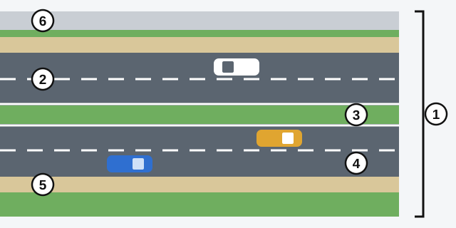
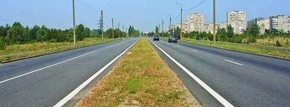
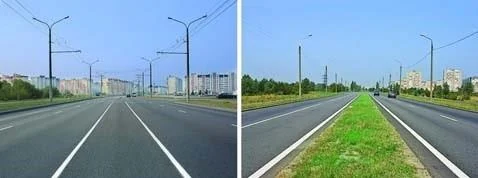
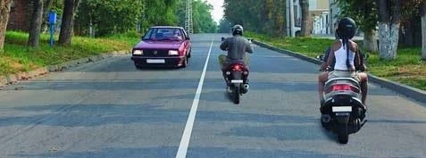
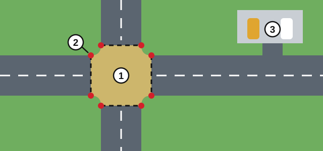
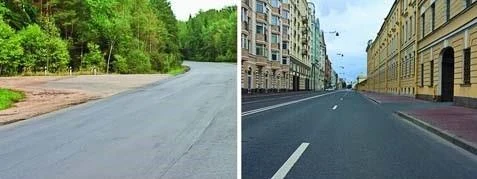
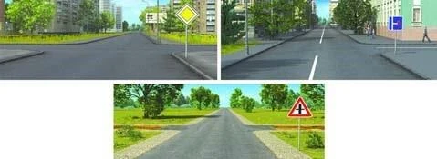
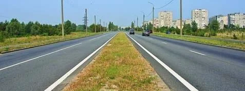
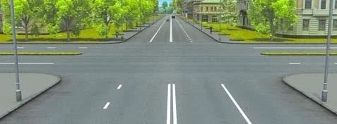
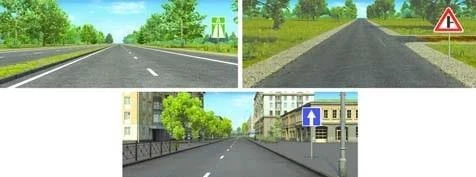

# اجزای راه

قانون برای کلمات روزمره‌ای مثل «راه» و «خط عبور» معنای دقیقی تعیین کرده و آزمون همین معناها را می‌سنجد. اجزای راه را یک بار اینجا یاد بگیرید تا همه درس‌های بعدی آسان‌تر شوند.

## راه از چه بخش‌هایی تشکیل شده است؟

*1: راه. 2: سواره‌رو. 3: نوار جداکننده. 4: خط عبور. 5: شانه راه. 6: پیاده‌رو.*

طبق ماده 2 قانون جمهوری ارمنستان «درباره تأمین ایمنی ترافیک جاده‌ای»، **راه** نواری از زمین یا سطح یک سازه مصنوعی است که دست‌کم یک سواره‌رو دارد. خطوط تراموا، پیاده‌رو، شانه راه و نوار جداکننده هم، اگر وجود داشته باشند، جزو راه هستند.

| بخش | به زبان ساده |
|---|---|
| **سواره‌رو** | بخشی از راه برای وسایل نقلیه غیرریلی. یک راه می‌تواند چند سواره‌رو داشته باشد. |
| **خط عبور** | نواری طولی از سواره‌رو که برای حرکت وسایل نقلیه در یک ردیف عرض کافی دارد؛ خط‌کشی‌شده یا خط‌کشی‌نشده. |
| **نوار جداکننده** | سواره‌روهای مجاور را از نظر سازه‌ای و (یا) با خط‌کشی از هم جدا می‌کند. برای حرکت یا توقف وسایل نقلیه و عابران پیاده در نظر گرفته نشده است. |
| **پیاده‌رو** | بخشی برای عابران پیاده. یا درست کنار سواره‌رو است، یا به هر روشی از آن جدا شده است. |

> **دام رایج:** «راه» کلمه بزرگ‌تر است و «سواره‌رو» کلمه کوچک‌تر. پیاده‌رو و شانه راه هر دو جزو راه هستند.

## سواره‌روها و خط‌های عبور را چگونه بشمارم؟

چیزی که یک راه را به سواره‌روهای جدا تقسیم می‌کند، نوار جداکننده است.

*نوار جداکننده سبز به این راه دو سواره‌رو داده است. نوارهای داخل هر سواره‌رو فقط خط عبور هستند.*

نوار جداکننده لازم نیست سبز باشد. نوار خط‌کشی‌شده هم دقیقاً همان حکم را دارد.

*هر دو راه نوار جداکننده دارند: در چپ با خط‌کشی و در راست به‌صورت سازه‌ای.*

طبق بند 51 مقررات راهنمایی و رانندگی، خط‌کشی تعداد خط‌های عبور را مشخص می‌کند. یک خط در وسط یعنی دو خط عبور، یکی برای هر جهت.

*یک خط میانی: دو خط عبور.*

> **به یاد داشته باشید:** چیزی که خط عبور را می‌سازد عرض است، نه رنگ. راهی که خط‌کشی ندارد هم خط عبور دارد.

## چه چیزی تقاطع محسوب می‌شود؟

**تقاطع** محلی است که راه‌ها در آن در یک سطح یکدیگر را قطع می‌کنند، به هم می‌پیوندند یا از هم جدا می‌شوند. مرز آن خیالی است: خط‌هایی که نقطه‌های مقابلِ شروع انحنای جدول‌ها را به هم وصل می‌کنند.

*1: تقاطع. 2: نقطه‌ای که انحنای جدول از آن شروع می‌شود و خط‌های خیالی میان این نقطه‌ها کشیده می‌شوند. 3: پارکینگ، که خروجی آن تقاطع نیست.*

خروجی از یک محوطه مجاور به راه، مانند حیاط، پارکینگ یا پمپ بنزین، **تقاطع نیست**. در این خروجی باز هم باید به کسانی که در راه هستند راه بدهید، اما مقررات تقاطع اعمال نمی‌شود.

*چپ: تقاطع. راست: فقط خروجی از محوطه‌های مجاور.*

تقاطع یک محل مشترک است، هر چند شاخه به آن برسد.

## چه چیزی یک ایستگاه را «نقطه توقف» می‌کند؟

**نقطه توقف** وسیله نقلیه عمومی محلی در مسیر آن برای سوار و پیاده شدن است که **همچنین** با تابلوهای مربوطه تجهیز شده باشد. این تابلوها به رانندگان دیگر نشان می‌دهند محدودیت‌های نقطه توقف کجا اعمال می‌شود.

## کدام راه، راه اصلی است؟

طبق بند 3 مقررات راهنمایی و رانندگی، راهی در یکی از این دو حالت **راه اصلی** است:

- **تابلو دارد.** نسبت به راهی که آن را قطع می‌کند یا به آن می‌پیوندد، با تابلوی 2.1 «جاده اصلی»، تابلوهای 2.3.1 تا 2.3.7 یا تابلوی 5.1 «آزادراه» مشخص شده است.
- **سطح بهتری دارد.** روکش سخت دارد (آسفالت‌بتن، سیمان‌بتن، مصالح سنگی و مانند آن) و راه دیگر روکش خاکی دارد.

*راه اصلی در تصویر چپ (تابلوی 2.1) و تصویر پایین (تابلوی 2.3.1، آسفالت در برخورد با راه‌های خاکی) نشان داده شده است. تابلوی آبی سمت راست حق تقدمی نمی‌دهد.*

> **دام رایج:** تعداد بیشتر خط عبور راه را اصلی نمی‌کند، آسفالت در برابر سنگ‌فرش هم نمی‌کند، چون هر دو روکش سخت هستند. تابلوی 2.7 «حق تقدم نسبت به حرکت روبه‌رو» فقط مشخص می‌کند در قطعه باریک چه کسی اول برود و تابلوی 5.5 «جاده با حرکت یک‌طرفه» فقط شیوه حرکت را توضیح می‌دهد.

## خودتان امتحان کنید

**این راه چند خط عبور دارد؟**

**چهار.** نوار، دو سواره‌رو ساخته و هر کدام به دو خط عبور تقسیم شده است.

**چند تقاطع و چند محل تلاقی سواره‌روها وجود دارد؟**

**یک تقاطع و دو محل تلاقی.** یک محل مشترک وجود دارد. اما راه چپ به راست با نوار جداکننده تقسیم شده است، پس راه دیگر دو سواره‌رو را قطع می‌کند.

**راه اصلی کجا نشان داده شده است؟**

**در هر دو تصویر بالا.** یکی تابلوی 5.1 «آزادراه» دارد. در دیگری راه خاکی با تابلوی «پیوستن جاده فرعی» به آسفالت می‌پیوندد. تابلوی 5.5 در تصویر پایین حق تقدمی نمی‌دهد.

## نکات کلیدی

- راه شامل سواره‌رو، پیاده‌رو، شانه راه، نوار جداکننده و خطوط تراموا است.
- سواره‌رو برای وسایل نقلیه غیرریلی است. یک راه می‌تواند چند سواره‌رو داشته باشد.
- خط عبور ممکن است خط‌کشی‌شده یا خط‌کشی‌نشده باشد. نوار جداکننده ممکن است سازه‌ای یا خط‌کشی‌شده باشد.
- تقاطع یک محل مشترک است. خروجی از حیاط، پارکینگ یا پمپ بنزین تقاطع نیست.
- نقطه توقف باید تابلوهای مربوط به خود را داشته باشد.
- راه اصلی: تابلوی مربوطه، یا روکش سخت در برابر روکش خاکی. تعداد خط عبور مهم نیست.

{{practice}}
